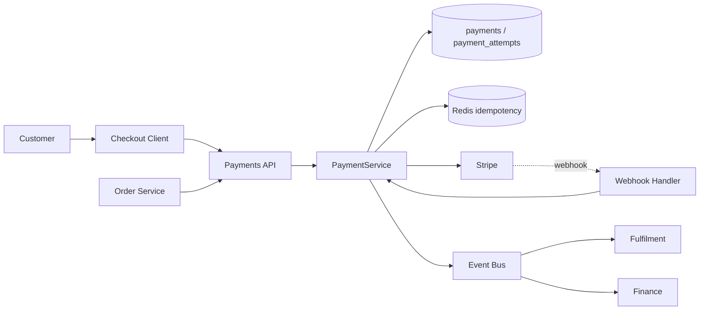
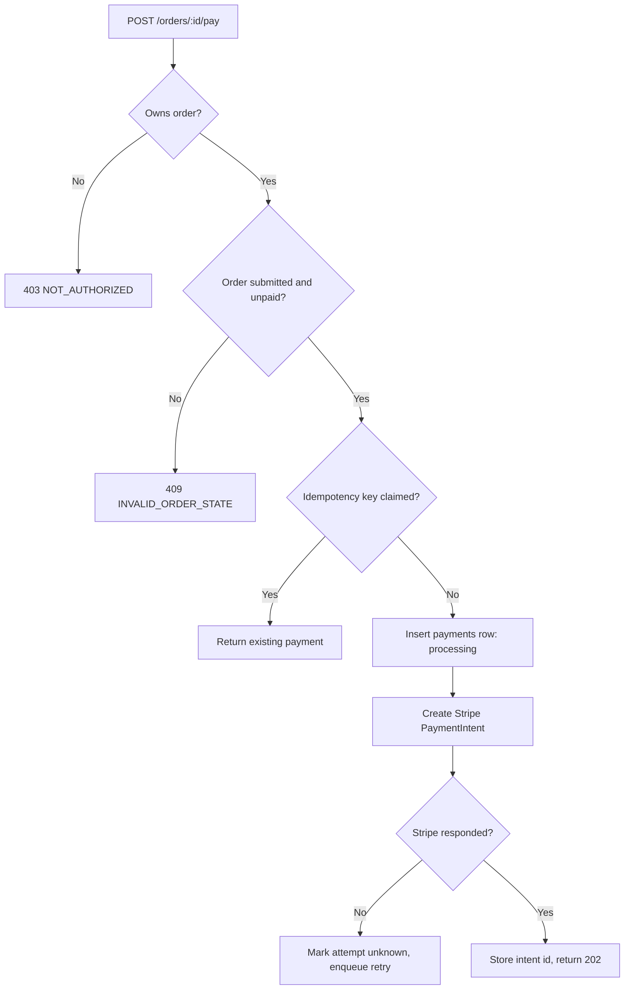
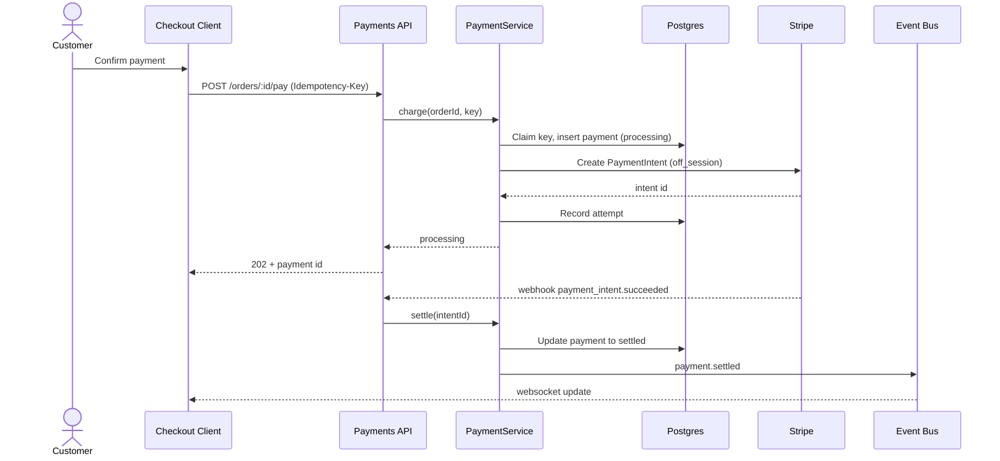
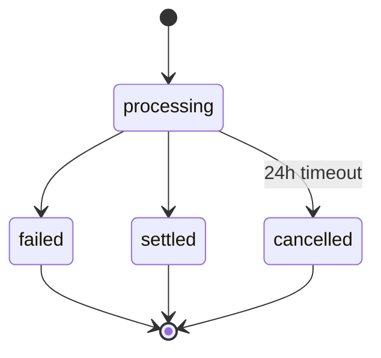
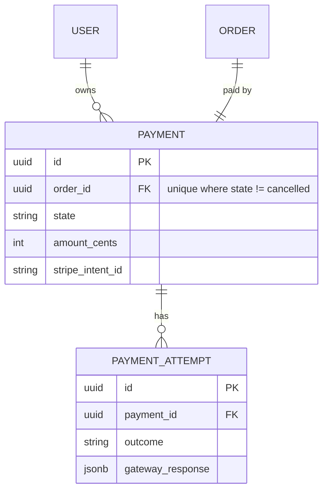

<!--
WORKED EXAMPLE — illustrative only. The repository paths, commits, and metrics below
belong to a fictional codebase. Read this for density and for how the status labels are
used, not for content to copy. Note that the charge flow is Current and the refund flow
is Planned in the same document: that separation is the point.
-->

# Payment Processing

> Charges a customer's saved card when an order is submitted, and records an auditable payment record that downstream fulfilment and finance depend on.

## 1. Feature Snapshot

| Field                 | Details                                                                       |
|-----------------------|-------------------------------------------------------------------------------|
| Document status       | Active                                                                        |
| Implementation status | In progress — charge flow shipped and verified; refunds planned                |
| Owner                 | Payments team (@rmehta)                                                       |
| Primary actors        | Customer, order service, Stripe webhook, finance reconciliation job           |
| Trigger               | `POST /api/orders/:id/pay`, or retry from `payment-retry` worker              |
| Outcome               | A `payments` row in a terminal state, and a `payment.settled` event           |
| Entry points          | `server/api/routes/payments.ts`, `workers/paymentRetry.ts`                    |
| Data stores           | `payments`, `payment_attempts`, Redis idempotency keys                        |
| External systems      | Stripe (PaymentIntents API v2024-06-20)                                       |
| Feature flag          | `PAYMENTS_REFUNDS_ENABLED` (refund flow only; charge flow is unflagged)       |
| Last verified         | 2026-07-28, commit `4c1a7e2`                                                  |

### At a Glance

Customers pay for orders with a card saved during checkout. The order service calls this feature, which creates a Stripe PaymentIntent, persists an attempt, and waits for Stripe's webhook to move the payment to a terminal state. Settlement is asynchronous: the API returns `processing`, and the client polls or waits for a websocket update. The authoritative record is the `payments` row, not Stripe — reconciliation treats Stripe as the source of truth for *money* and the local row as the source of truth for *intent*.

**Sections 1–20 describe current, verified behavior unless a row says otherwise. Section 24 (refunds) is entirely planned and has no implementation.**

### Status Legend

- **Current**: implemented, and read in the code at `4c1a7e2`.
- **Planned**: approved, not implemented.
- **Inferred**: consistent with the evidence, not directly verified.
- **Unknown**: unresolved. Tracked in §28.

## 2. Problem and Outcome

### Problem

Order submission previously charged cards inline, inside the order transaction. A slow Stripe response held a database transaction open, and a timeout left orders in a state where the customer had been charged but no order existed. Finance reconciled these by hand, averaging 30–40 cases per month (source: `#finance-ops` reconciliation log, Q1 2026).

### Desired Outcome

Payment is a separate, idempotent, retryable operation with its own record and lifecycle. No customer is charged without a corresponding `payments` row, and no order is fulfilled without a settled payment.

### Success Measures

| Measure                       | Target        | How measured                                        |
|-------------------------------|---------------|-----------------------------------------------------|
| Manual reconciliation cases   | < 3 / month   | Finance reconciliation log                          |
| Orphaned charges              | 0             | `payment_orphan_detected_total` counter             |
| p95 time to terminal state    | Unknown       | See Q-002 — no target agreed yet; measured at 6.1s  |

## 3. Scope

### Included

- Charging a saved payment method for a submitted order
- Idempotent retry of a failed or timed-out charge
- Recording payment attempts and terminal outcomes
- Emitting settlement events for fulfilment and finance

### Excluded

- Collecting or storing card details — handled by Stripe Elements, see FEAT-021
- Subscriptions and recurring billing — no owner yet
- Refunds — planned in §24, not implemented
- Tax and invoice generation — finance service

### Assumptions

| ID      | Assumption                                                        | Confidence | Validation needed                                  |
|---------|-------------------------------------------------------------------|------------|----------------------------------------------------|
| ASM-001 | Stripe delivers every `payment_intent.*` webhook at least once     | High       | Stripe SLA; reconciliation job catches gaps         |
| ASM-002 | Webhook delivery beats the client's first poll in most cases       | Inferred   | Not measured; see Q-002                            |
| ASM-003 | A customer has at most one in-flight payment per order             | High       | Enforced by unique index, see BR-003               |

## 4. Terminology

| Term            | Meaning                                                                    |
|-----------------|----------------------------------------------------------------------------|
| Attempt         | One call to Stripe. A payment may have several; only one may succeed.       |
| Terminal state  | `settled`, `failed`, or `cancelled`. Terminal states never transition again. |
| Idempotency key | Client-supplied UUID scoped to one order, held in Redis for 24h.            |

## 5. Actors and Permissions

| Actor            | Allowed actions           | Restrictions                          | Enforcement point                           |
|------------------|---------------------------|---------------------------------------|---------------------------------------------|
| Customer         | Pay own order             | Must own the order; order must be `submitted` | `server/api/routes/payments.ts:34` (`requireOrderOwner`) |
| Support staff    | Read payment, cancel      | Cannot initiate a charge              | `requireRole('support')`                    |
| Stripe webhook   | Advance payment state     | Signature-verified; no other action   | `server/api/routes/webhooks/stripe.ts:18`   |
| Reconciliation job | Read, flag discrepancies | Cannot mutate payment state           | Service-account token, read-only DB role    |

## 6. User Journey

### Primary Journey

1. The customer submits an order and lands on the payment step (`/checkout/pay`).
2. The client generates an idempotency key and calls `POST /api/orders/:id/pay`.
3. The API authorizes ownership and validates the order is `submitted` and unpaid.
4. `PaymentService.charge()` claims the idempotency key, writes a `payments` row as `processing`, and creates a Stripe PaymentIntent.
5. The API returns `202 processing`; the client shows a pending state.
6. Stripe delivers `payment_intent.succeeded`; the webhook handler moves the payment to `settled` and emits `payment.settled`.
7. The client receives the websocket update and advances to confirmation.

### Alternate Journeys

| Journey                | Trigger                                | Expected outcome                                                  |
|------------------------|----------------------------------------|-------------------------------------------------------------------|
| Duplicate submit       | Client retries with the same key        | Same `payment_id` returned; no second Stripe call (BR-001)         |
| Card declined          | `payment_intent.payment_failed`         | Payment `failed` with a decline reason; customer may retry with a new key |
| Webhook never arrives  | Stripe outage or dropped delivery       | `payment-retry` worker polls Stripe after 5 min and reconciles      |
| Customer abandons      | No terminal state after 24h             | Payment `cancelled`; PaymentIntent cancelled at Stripe             |

## 7. System Context

The feature owns payment state. The order service is upstream (it decides *when* to charge) and fulfilment is downstream (it reacts to settlement). Neither reads the `payments` table directly.



## 8. Control Flow

Authorization and order-state checks happen at the API edge; idempotency and money decisions happen in the service, inside a transaction that does **not** span the Stripe call.



| Step               | Status  | Controlling component                    | Decision                          | Failure behavior                          |
|--------------------|---------|------------------------------------------|-----------------------------------|-------------------------------------------|
| Ownership          | Current | `requireOrderOwner` middleware           | Order belongs to caller           | 403, no record written                    |
| Order state        | Current | `PaymentService.assertChargeable()`      | Order `submitted` and unpaid      | 409, no record written                    |
| Idempotency claim  | Current | Redis `SET NX` on `pay:{order}:{key}`    | First caller wins                 | Losers read and return the existing row   |
| Stripe call        | Current | `StripeGateway.createIntent()`           | —                                 | Attempt stored as `unknown`, retry enqueued |
| Settlement         | Current | Webhook handler                          | Stripe event type                 | Unsignatured events rejected with 400     |

## 9. Data Flow



### Sensitive Data

| Data                | Classification | Storage                          | Logging rule                            | Retention        |
|---------------------|----------------|----------------------------------|-----------------------------------------|------------------|
| Card number / CVC   | Restricted     | Never — Stripe holds it          | Prohibited; redactor drops `card*` keys | Not stored       |
| Last four, brand    | Internal       | `payments.card_last4`, `card_brand` | Allowed                              | Life of record   |
| Stripe customer id  | Confidential   | `users.stripe_customer_id`       | Allowed at debug only                   | Life of account  |
| Billing address     | Confidential   | Stripe only                      | Prohibited                              | Not stored       |

## 10. State Model



| State        | Meaning                          | Allowed transitions            | Side effects                        |
|--------------|----------------------------------|--------------------------------|-------------------------------------|
| `processing` | Intent created, outcome unknown  | settled, failed, cancelled     | None                                |
| `settled`    | Money captured                   | None (terminal)                | Emits `payment.settled`             |
| `failed`     | Declined or errored              | None (terminal)                | Emits `payment.failed`              |
| `cancelled`  | Abandoned or explicitly cancelled | None (terminal)               | Cancels the PaymentIntent at Stripe |

Terminal states are enforced by a database trigger, not only in application code — see `migrations/20260610_payment_state_guard.sql`.

## 11. Implementation Map

### Existing Artifacts

| Layer      | Responsibility                     | Repository path                                | Main symbol             | Verified |
|------------|------------------------------------|------------------------------------------------|-------------------------|----------|
| API        | Route, auth, validation            | `server/api/routes/payments.ts`                | `payRouter`             | Yes      |
| API        | Stripe webhook intake              | `server/api/routes/webhooks/stripe.ts`         | `stripeWebhookHandler`  | Yes      |
| Service    | Charge, settle, cancel             | `server/services/payments/PaymentService.ts`   | `PaymentService`        | Yes      |
| Gateway    | Stripe client wrapper              | `server/services/payments/StripeGateway.ts`    | `StripeGateway`         | Yes      |
| Idempotency| Redis claim/release                | `server/services/payments/idempotency.ts`      | `claimKey`              | Yes      |
| Worker     | Retry and reconcile stuck payments | `workers/paymentRetry.ts`                      | `runPaymentRetry`       | Yes      |
| Storage    | Schema and state guard             | `migrations/20260610_payment_state_guard.sql`  | —                       | Yes      |
| Client     | Payment step and polling           | `src/features/checkout/PaymentStep.tsx`        | `PaymentStep`           | Yes      |

### Planned Artifacts

| Layer   | Responsibility     | Planned path                                     | Main symbol       | Change type |
|---------|--------------------|--------------------------------------------------|-------------------|-------------|
| Service | Refund issuance    | `server/services/payments/RefundService.ts`       | `RefundService`   | Create      |
| API     | Refund endpoint    | `server/api/routes/refunds.ts`                    | `refundRouter`    | Create      |
| Storage | Refund records     | `migrations/2026XXXX_refunds.sql`                 | —                 | Create      |

### Generated or Restricted Areas

| Path or area                                   | Classification | Rule                                                    |
|------------------------------------------------|----------------|---------------------------------------------------------|
| `server/types/stripe.generated.ts`             | Generated      | Regenerate via `npm run gen:stripe`; do not hand-edit    |
| `migrations/20260610_payment_state_guard.sql`  | Restricted     | State-machine guard; changes need Payments + DBA review  |
| `StripeGateway.createIntent()`                 | Restricted     | Any change to idempotency or capture semantics needs review |

## 12. Contracts

### `POST /api/orders/:id/pay` — Status: **Current**

Header `Idempotency-Key: <uuid>` is required.

```json
// Request
{ "payment_method_id": "pm_1234" }

// 202 Accepted
{ "payment_id": "pay_8f21", "status": "processing" }
```

| HTTP | Code                  | Meaning                          | Retriable          |
|------|-----------------------|----------------------------------|--------------------|
| 400  | `INVALID_INPUT`       | Missing key or payment method    | No                 |
| 403  | `NOT_AUTHORIZED`      | Caller does not own the order    | No                 |
| 409  | `INVALID_ORDER_STATE` | Order not submitted, or paid     | No                 |
| 409  | `KEY_REUSED`          | Key reused with different body   | No                 |
| 502  | `GATEWAY_UNAVAILABLE` | Stripe unreachable               | Yes, with same key |

### Events Produced

| Event             | Status  | Trigger                    | Consumers            |
|-------------------|---------|----------------------------|----------------------|
| `payment.settled` | Current | Webhook confirms capture   | Fulfilment, Finance  |
| `payment.failed`  | Current | Webhook reports decline    | Notifications        |
| `refund.issued`   | Planned | Refund completes           | Finance              |

### Events Consumed

| Event             | Status  | Producer      | Behavior                                        |
|-------------------|---------|---------------|-------------------------------------------------|
| `order.cancelled` | Current | Order service | Cancel a `processing` payment; ignore terminal   |

## 13. Data Model and Storage



| Store              | Status  | Purpose                    | Important fields                        |
|--------------------|---------|----------------------------|-----------------------------------------|
| `payments`         | Current | Authoritative payment state | `order_id`, `state`, `stripe_intent_id` |
| `payment_attempts` | Current | Audit trail per Stripe call | `outcome`, `gateway_response`           |
| Redis              | Current | Idempotency claims, 24h TTL | `pay:{order_id}:{key}`                  |

## 14. Business Rules

| Rule ID | Status  | Rule                                                                | Enforcement point                        | Test reference                          |
|---------|---------|---------------------------------------------------------------------|------------------------------------------|-----------------------------------------|
| BR-001  | Current | Same idempotency key returns the same payment, no second charge      | `idempotency.ts` + Stripe idempotency key | `payments.idempotency.spec.ts`          |
| BR-002  | Current | An order may have at most one non-cancelled payment                  | Partial unique index on `order_id`        | `payments.uniqueness.spec.ts`           |
| BR-003  | Current | Terminal payments never transition                                   | DB trigger + service guard                | `payments.state.spec.ts`                |
| BR-004  | Current | Charge amount must equal the order total at submission time          | `assertChargeable()`                      | `payments.amount.spec.ts`               |
| BR-005  | Current | A payment with no terminal state after 24h is cancelled              | `paymentRetry` worker                     | `paymentRetry.spec.ts`                  |
| BR-006  | Planned | Refunds may not exceed the settled amount minus prior refunds        | `RefundService` (planned)                 | Not yet written                         |

## 15. Acceptance Criteria and Cases

### AC-001: Successful charge — Status: **Current**

**Given** an authorized customer with a submitted, unpaid order
**When** they submit a payment with a fresh idempotency key
**Then** a `payments` row is created as `processing`
**And** a Stripe PaymentIntent is created with the same idempotency key
**And** `202` is returned with the payment id
**And** on `payment_intent.succeeded`, the payment becomes `settled` and `payment.settled` is emitted

### Edge Cases

| Case ID  | Scenario                                        | Expected behavior                                            | Test type   |
|----------|-------------------------------------------------|--------------------------------------------------------------|-------------|
| CASE-001 | Same key submitted twice concurrently           | One Stripe call; both callers get the same payment id         | Integration |
| CASE-002 | Key reused with a different amount              | `409 KEY_REUSED`; no charge                                   | Integration |
| CASE-003 | Stripe times out after creating the intent      | Attempt recorded `unknown`; retry reconciles, no double charge | Integration |
| CASE-004 | Webhook arrives twice for one intent            | Second is a no-op; one `payment.settled` emitted              | Integration |
| CASE-005 | Webhook arrives before the API response is sent | Settlement applied; API still returns 202                     | Integration |
| CASE-006 | Order cancelled while payment is `processing`   | Payment cancelled, PaymentIntent cancelled at Stripe          | Integration |
| CASE-007 | Webhook with an invalid signature               | `400`, no state change, `webhook_signature_failed` incremented | Unit       |

## 16. Error and Recovery Behavior

| Failure                  | User-facing behavior              | Internal behavior                        | Recovery                        |
|--------------------------|-----------------------------------|------------------------------------------|---------------------------------|
| Card declined            | Decline reason, retry offered     | `payment.failed` emitted                 | Customer retries with a new key |
| Stripe timeout           | Pending state maintained          | Attempt `unknown`, retry enqueued        | Worker polls Stripe after 5 min |
| Webhook never arrives    | Pending until reconciled          | Retry worker reconciles from Stripe      | Automatic within 5 min          |
| Redis unavailable        | `502 GATEWAY_UNAVAILABLE`         | Charge refused — **fails closed**        | Client retries with same key    |

Redis failing closed is deliberate: without a working idempotency claim there is no protection against a double charge, so refusing the charge is the safe failure. See DEC-002.

## 17. Security and Privacy

| ID      | Requirement                                        | Enforcement                            | Validation                        |
|---------|----------------------------------------------------|----------------------------------------|-----------------------------------|
| SEC-001 | Only the order owner may pay for it                 | `requireOrderOwner`                    | `payments.authz.spec.ts`          |
| SEC-002 | Webhook signatures verified before any state change | `stripeWebhookHandler`                 | `webhook.signature.spec.ts`       |
| SEC-003 | Card data never reaches logs or the database        | Log redactor + no card columns         | `logging.redaction.spec.ts`       |
| SEC-004 | Amount is taken from the order, never from client input | `assertChargeable()`               | `payments.amount.spec.ts`         |
| SEC-005 | Payment endpoints rate-limited per user             | `rateLimit(10, '1m')`                  | Not directly tested — see Q-003   |

## 19. Observability

| Signal                            | Type      | Purpose                                    |
|-----------------------------------|-----------|--------------------------------------------|
| `payment_attempts_total{outcome}` | Counter   | Volume and decline rate                    |
| `payment_settle_duration_ms`      | Histogram | Time from intent creation to terminal state |
| `payment_orphan_detected_total`   | Counter   | Charges at Stripe with no local record      |
| `webhook_signature_failed_total`  | Counter   | Possible forgery or misconfiguration        |

| Alert                    | Condition                     | Severity | Runbook                                |
|--------------------------|-------------------------------|----------|----------------------------------------|
| Decline rate elevated    | > 15% over 15 min             | High     | `docs/runbooks/payment-declines.md`    |
| Orphan detected          | Any increment                 | Critical | `docs/runbooks/payment-orphans.md`     |
| Retry backlog growing    | Queue depth > 100 for 10 min  | High     | `docs/runbooks/payment-retry.md`       |

## 20. Testing Strategy

| Test type   | Coverage                                       | Path                                         |
|-------------|------------------------------------------------|----------------------------------------------|
| Unit        | State guards, amount checks, redaction         | `server/services/payments/__tests__/`        |
| Integration | Idempotency, webhooks, retries, cancellation   | `test/integration/payments/`                 |
| End-to-end  | Checkout through confirmation                  | `e2e/checkout.spec.ts`                       |
| Security    | Ownership, signature verification              | `test/integration/payments/authz.spec.ts`    |

Integration tests run against `stripe-mock`; two contract tests run nightly against Stripe's test mode (`test/contract/stripe.spec.ts`).

```bash
npm run lint
npm run typecheck
npm run test -- payments
npm run test:integration -- payments
```

## 21. Performance and Reliability

| ID      | Requirement                          | Target                    | Validation                       |
|---------|--------------------------------------|---------------------------|----------------------------------|
| OPS-001 | Charge endpoint responds quickly      | p95 < 800ms (currently 610ms) | `payment_api_duration_ms`   |
| OPS-002 | No double charge under any retry path | Zero                      | CASE-001, CASE-003               |
| OPS-003 | Time to terminal state                 | **Unknown** — see Q-002   | Measured at p95 6.1s             |

## 22. Configuration and Feature Flags

| Setting                     | Status  | Default | Purpose                          | Restart? |
|-----------------------------|---------|---------|----------------------------------|----------|
| `PAYMENTS_REFUNDS_ENABLED`  | Planned | `false` | Gate the refund flow             | No       |
| `PAYMENT_RETRY_INTERVAL_MS` | Current | `300000`| Retry worker poll interval       | Yes      |
| `PAYMENT_TIMEOUT_HOURS`     | Current | `24`    | Age at which a payment cancels   | No       |

## 24. Implementation Plan — Refunds

This section describes future work. Nothing here exists in the codebase.

### Phase 1: Records and rules

- **Changes:** `refunds` table with a foreign key to `payments`; `RefundService.validate()` implementing BR-006.
- **Validation:** unit tests for over-refund and double-refund rejection; migration applies and rolls back cleanly.
- **Done when:** BR-006 is enforced and tested with no API surface exposed.

### Phase 2: Issuance

- **Changes:** `RefundService.issue()` calling Stripe with an idempotency key derived from `refund_id`; `refund.issued` event.
- **Validation:** integration tests for partial refund, full refund, duplicate request, and Stripe timeout.
- **Done when:** refunds can be issued via a service call behind the disabled flag.

### Phase 3: Interface and rollout

- **Changes:** `POST /api/payments/:id/refunds` restricted to support staff; support-tool UI; metrics and alert.
- **Validation:** authorization tests; end-to-end refund in staging; alert fires on a forced failure.
- **Done when:** flag enabled for support staff and one real refund reconciles correctly.

## 25. Deployment, Migration, and Rollback

1. Apply the `refunds` migration (additive, backward compatible).
2. Deploy the service with `PAYMENTS_REFUNDS_ENABLED=false`.
3. Enable for the support team only.
4. Watch `refund_failures_total` and finance reconciliation for one week.
5. Expand.

**Rollback.** Disabling the flag stops new refunds; it does not reverse refunds already sent to Stripe, which must be handled manually. The migration is additive and needs no rollback.

## 26. Risks and Limitations

| Risk ID  | Risk                                                        | Likelihood | Impact   | Mitigation                                      | Owner   |
|----------|-------------------------------------------------------------|------------|----------|-------------------------------------------------|---------|
| RISK-001 | Stripe outage during peak leaves many payments pending       | Low        | High     | Retry worker, pending UI, status page comms     | @rmehta |
| RISK-002 | Redis eviction under memory pressure drops idempotency keys  | Medium     | Critical | `noeviction` on the payments Redis; alerting    | @rmehta |
| RISK-003 | Refund logic double-refunds via concurrent support requests  | Medium     | High     | Row-level lock in Phase 1 — not yet implemented | @rmehta |

### Current Limitations

| Limitation                                        | Impact                                | Planned resolution     |
|---------------------------------------------------|---------------------------------------|------------------------|
| Only saved cards; no wallets or bank debits        | Excludes some customers               | Not scheduled          |
| Settlement is asynchronous with no hard bound      | Customers can wait through a long poll | Q-002                 |
| No partial capture                                 | Cannot ship partial orders            | Not scheduled          |

## 27. Decisions

| ID      | Status   | Decision                                          | Rationale                                                        | Alternatives                          | Date       |
|---------|----------|---------------------------------------------------|------------------------------------------------------------------|---------------------------------------|------------|
| DEC-001 | Accepted | Settlement is asynchronous via webhook             | Keeps Stripe latency out of the request and the DB transaction    | Synchronous capture; polling only     | 2026-06-04 |
| DEC-002 | Accepted | Fail closed when Redis is unavailable              | A double charge is worse than a refused payment                   | Fail open; in-process fallback lock   | 2026-06-18 |
| DEC-003 | Accepted | Local row is authoritative for intent, Stripe for money | Makes reconciliation a well-defined comparison               | Single source of truth at Stripe      | 2026-06-21 |

## 28. Open Questions

| ID    | Question                                                          | Owner   | Needed by      | Status |
|-------|-------------------------------------------------------------------|---------|----------------|--------|
| Q-002 | What is an acceptable p95 time to terminal state?                  | @rmehta | Refunds launch | Open   |
| Q-003 | Should the rate limit be per user or per order? Untested either way | @rmehta | Next sprint   | Open   |
| Q-004 | Who owns refund reconciliation in finance?                          | Finance | Phase 3       | Open   |

## 29. AI Agent Instructions

### Safe Modification Areas

- `server/services/payments/PaymentService.ts` — except the idempotency and state-transition paths
- `src/features/checkout/PaymentStep.tsx`
- Tests under `server/services/payments/__tests__/` and `test/integration/payments/`

### Restricted Areas

- `StripeGateway.createIntent()` — idempotency and capture semantics; needs Payments review
- `migrations/20260610_payment_state_guard.sql` — needs Payments + DBA review
- `server/api/routes/webhooks/stripe.ts` — signature verification; needs security review
- `server/types/stripe.generated.ts` — generated; run `npm run gen:stripe`

### Required Before Coding

1. Read this document, DEC-001 through DEC-003, and `docs/runbooks/payment-orphans.md`.
2. Run the drift check — `git log --oneline 4c1a7e2..HEAD -- server/services/payments/ server/api/routes/payments.ts`.
3. Assume every path can be retried and every webhook can arrive twice.
4. Never take an amount from client input (SEC-004).

### Required Before Completion

1. Add or update tests for every changed rule ID.
2. Run the validation commands in §20.
3. Update §11, §14, and §30, and replace planned paths with actual ones.
4. Update `last_updated` and `last_verified_commit`.

## 30. Changelog

| Date       | Version | Change                                                 | Status  | PR      |
|------------|---------|--------------------------------------------------------|---------|---------|
| 2026-07-28 | 1.2.0   | Documented refund plan; verified charge flow at `4c1a7e2` | Mixed | #2841   |
| 2026-07-02 | 1.1.0   | Added 24h cancellation (BR-005) and retry worker        | Current | #2760   |
| 2026-06-21 | 1.0.0   | Charge flow shipped and verified                        | Current | #2698   |
| 2026-06-02 | 0.1.0   | Initial design                                          | Planned | #2634   |

## 31. Related Resources

- Card collection: `docs/features/FEAT-021-card-collection.md`
- Runbooks: `docs/runbooks/payment-declines.md`, `docs/runbooks/payment-orphans.md`
- Stripe API version pinned in `server/services/payments/StripeGateway.ts`
