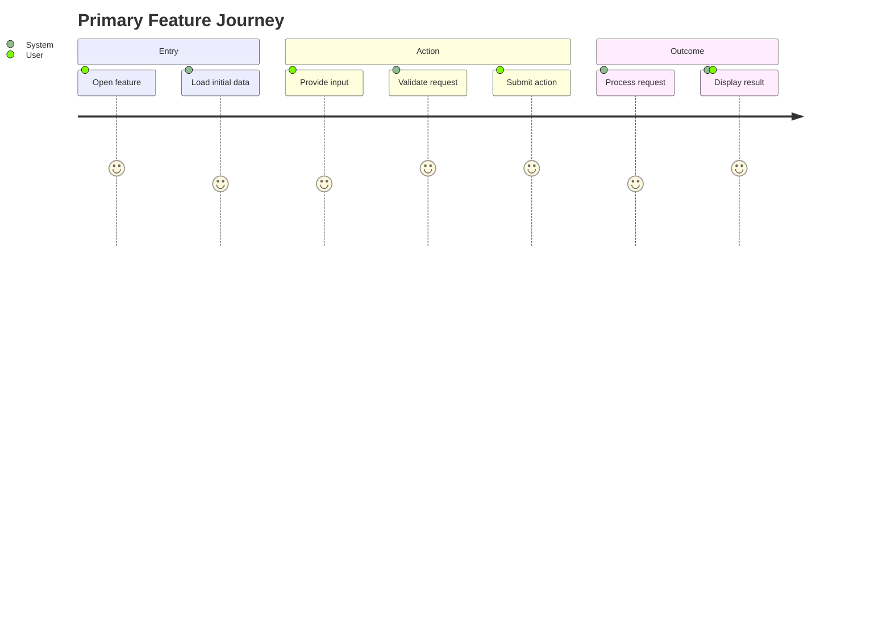
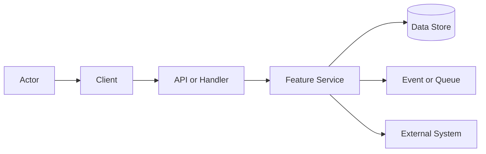
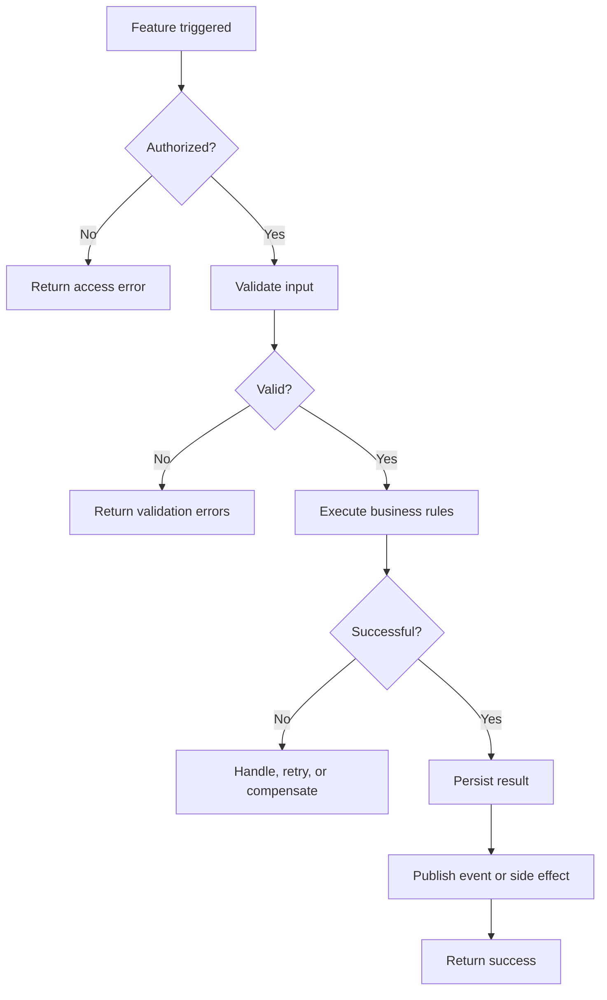
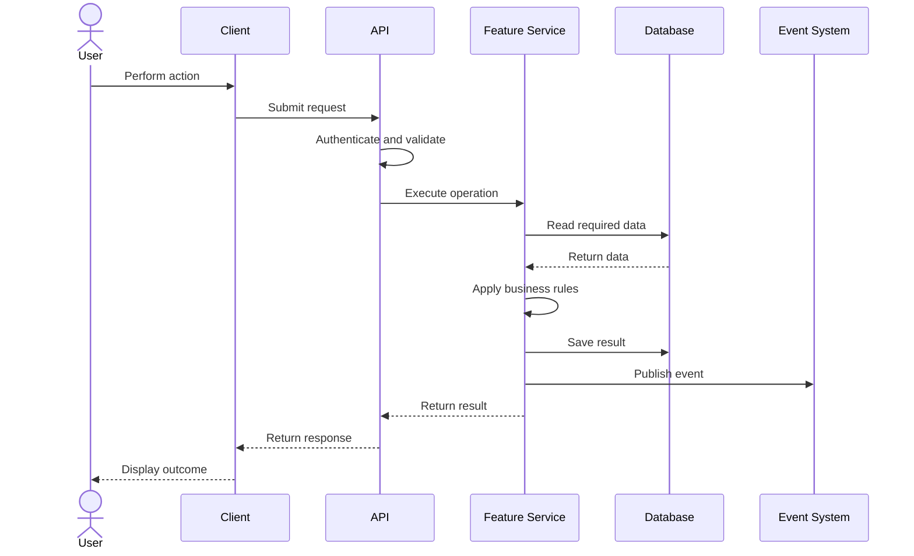
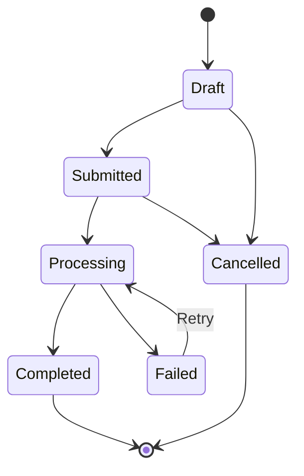
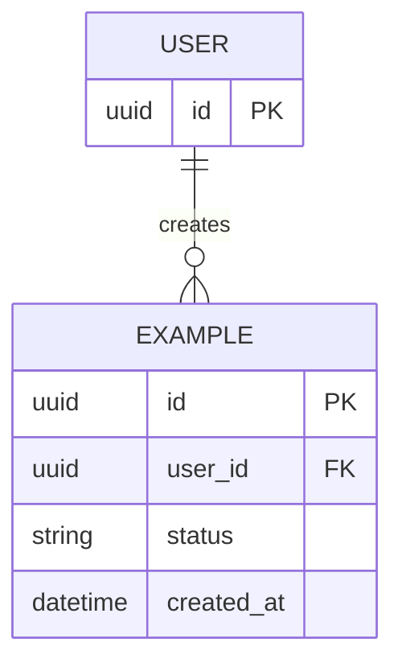

<!--
Every row below is an ILLUSTRATION of expected shape and density. Replace it or delete it.
Delete sections you cannot fill from evidence; do not invent content to complete a table.
Section numbers are stable across all feature documents — never renumber to close a gap.
-->

# Feature Name

> One sentence explaining what this feature does, who it serves, and why it exists.

## 1. Feature Snapshot

| Field                 | Details                                                                 |
|-----------------------|-------------------------------------------------------------------------|
| Document status       | Proposed / Approved / Active / Superseded / Retired                     |
| Implementation status | Not started / In progress / Shipped (unverified) / Shipped (verified) / Sunsetting |
| Owner                 | Team or person                                                          |
| Primary actors        | Users, administrators, services, workers                                |
| Trigger               | UI action, API call, event, webhook, schedule                           |
| Outcome               | Main result produced by the feature                                     |
| Entry points          | Existing or planned routes, screens, handlers                           |
| Data stores           | Existing or planned tables, collections, caches                         |
| External systems      | Providers and third-party integrations                                  |
| Feature flag          | Flag name or Not applicable                                             |
| Last verified         | Date and commit, or Not yet verified                                    |

### At a Glance

Describe in three to five sentences:

- the problem;
- the main user or system journey;
- the major components involved;
- the primary stored or emitted result;
- whether this document describes current or planned behavior.

### Status Legend

Every `Status` value in this document is one of these four. They describe how much trust a statement has earned, and are independent of the document and implementation statuses above.

- **Current**: implemented, and read in the code at `last_verified_commit`.
- **Planned**: proposed or approved, but not implemented.
- **Inferred**: consistent with the evidence, but not directly verified.
- **Unknown**: unresolved. Track it in §28.

## 2. Problem and Outcome

### Problem

Describe the user, business, or system problem.

### Desired Outcome

Describe the observable result after the feature is complete.

### Success Measures

| Measure         | Target         | How measured                       |
|-----------------|----------------|------------------------------------|
| Example measure | Example target | Analytics, metric, user validation |

## 3. Scope

### Included

- Included responsibility
- Supported actor or workflow

### Excluded

- Explicitly excluded behavior
- Responsibility handled by another feature

### Assumptions

| ID      | Assumption | Confidence          | Validation needed       |
|---------|------------|---------------------|-------------------------|
| ASM-001 | Assumption | High / Medium / Low | How it will be verified |

## 4. Terminology

| Term        | Meaning    |
|-------------|------------|
| Domain term | Definition |

## 5. Actors and Permissions

| Actor    | Allowed actions | Restrictions | Enforcement point  |
|----------|-----------------|--------------|--------------------|
| End user | Actions         | Restrictions | UI / API / service |

## 6. User Journey

### Primary Journey

1. The actor enters through `[entry point]`.
2. The system loads `[required data]`.
3. The actor performs `[action]`.
4. The system validates `[input and permissions]`.
5. The system executes `[business operation]`.
6. The system persists or emits `[result]`.
7. The actor receives `[outcome]`.

<!--
Optional. A `journey` diagram carries satisfaction scores that are guesses in most
engineering documents, and it renders poorly in several Markdown viewers. Include it
only when the emotional shape of the journey is genuinely part of the feature's design;
the numbered steps above usually carry the same information more honestly.
-->



### Alternate Journeys

| Journey | Trigger           | Expected outcome                        |
|---------|-------------------|-----------------------------------------|
| Retry   | Temporary failure | Operation completes without duplication |
| Cancel  | User cancels      | No unintended side effects remain       |

## 7. System Context

Explain the feature boundary and surrounding systems.



## 8. Control Flow

Explain who controls each branch and where decisions are enforced.



| Step          | Status  | Controlling component | Decision or action | Failure behavior    |
|---------------|---------|-----------------------|--------------------|---------------------|
| Authorization | Planned | API middleware        | Verify permission  | Return 403          |
| Validation    | Planned | Validator             | Validate request   | Return field errors |
| Processing    | Planned | Feature service       | Apply rules        | Roll back or retry  |

## 9. Data Flow

Describe data origins, transformations, storage, and outputs.



### Data Transformations

| Stage   | Status  | Input             | Transformation       | Output        |
|---------|---------|-------------------|----------------------|---------------|
| Client  | Planned | Raw user input    | Normalize            | API request   |
| Service | Planned | Validated command | Apply business rules | Domain result |

### Sensitive Data

| Data    | Classification                                | Storage  | Logging rule          | Retention |
|---------|-----------------------------------------------|----------|-----------------------|-----------|
| Example | Public / Internal / Confidential / Restricted | Location | Redacted / prohibited | Duration  |

## 10. State Model



| State | Meaning    | Allowed transitions  | Side effects |
|-------|------------|----------------------|--------------|
| Draft | Incomplete | Submitted, Cancelled | None         |

## 11. Implementation Map

### Existing Artifacts

| Layer   | Responsibility          | Repository path | Main symbol  | Verified |
|---------|-------------------------|-----------------|--------------|----------|
| Example | Existing responsibility | `path/to/file`  | `SymbolName` | Yes / No |

### Planned Artifacts

| Layer    | Responsibility | Planned path                           | Main symbol      | Change type |
|----------|----------------|----------------------------------------|------------------|-------------|
| Frontend | Feature page   | `src/features/example/ExamplePage.tsx` | `ExamplePage`    | Create      |
| Backend  | Business logic | `server/services/exampleService.ts`    | `ExampleService` | Create      |

### Generated or Restricted Areas

| Path or area              | Classification | Rule                     |
|---------------------------|----------------|--------------------------|
| `generated/`              | Generated      | Do not edit manually     |
| Authentication middleware | Restricted     | Requires security review |

## 12. Contracts

### API Contract

`POST /api/examples`

Status: **Planned**

#### Request

```json
{
  "name": "Example"
}
```

#### Success Response

```json
{
  "id": "example_123",
  "status": "completed"
}
```

#### Errors

| HTTP status | Code             | Meaning            | Retriable |
|-------------|------------------|--------------------|-----------|
| 400         | `INVALID_INPUT`  | Validation failed  | No        |
| 403         | `NOT_AUTHORIZED` | Permission denied  | No        |
| 409         | `CONFLICT`       | State conflict     | Depends   |
| 500         | `INTERNAL_ERROR` | Unexpected failure | Depends   |

### Events Produced

| Event             | Status  | Trigger             | Payload source | Consumers |
|-------------------|---------|---------------------|----------------|-----------|
| `example.created` | Planned | Successful creation | Domain result  | Analytics |

### Events Consumed

| Event | Status | Producer | Feature behavior |
|---|---|---|---|
| `user.deleted` | Planned | User service | Remove or anonymize data |

## 13. Data Model and Storage



| Store      | Status  | Purpose               | Important keys or fields  |
|------------|---------|-----------------------|---------------------------|
| `examples` | Planned | Store feature records | `id`, `user_id`, `status` |

### Caching

Document cache keys, time to live, invalidation, and cache-miss behavior.

## 14. Business Rules

| Rule ID | Status  | Rule                               | Enforcement point | Test reference         |
|---------|---------|------------------------------------|-------------------|------------------------|
| BR-001  | Planned | User may access only owned records | Service           | `example.auth.spec.ts` |

## 15. Acceptance Criteria and Cases

### AC-001: Successful operation

**Given** an authorized actor and valid input  
**When** the actor submits the request  
**Then** the result is stored  
**And** the success response is returned  
**And** the expected event is published

### Edge Cases

| Case ID  | Scenario             | Expected behavior                        | Test type   |
|----------|----------------------|------------------------------------------|-------------|
| CASE-001 | Duplicate submission | No duplicate side effect                 | Integration |
| CASE-002 | Concurrent update    | Conflict is detected safely              | Integration |
| CASE-003 | Dependency timeout   | Retry or controlled failure              | Integration |
| CASE-004 | Partial failure      | Compensate or preserve recoverable state | Integration |

## 16. Error and Recovery Behavior

| Failure            | User-facing behavior      | Internal behavior  | Retry/compensation |
|--------------------|---------------------------|--------------------|--------------------|
| Validation         | Field-level message       | No exception alert | No retry           |
| Dependency timeout | Temporary failure message | Log and metric     | Retry with limit   |

## 17. Security and Privacy

| Requirement ID | Requirement                   | Enforcement     | Validation         |
|----------------|-------------------------------|-----------------|--------------------|
| SEC-001        | Enforce ownership server-side | Feature service | Authorization test |
| SEC-002        | Do not log restricted data    | Logging layer   | Log review/test    |

Consider authentication, authorization, tenant isolation, validation, injection, secrets, encryption, audit logging, rate limits, abuse prevention, privacy, retention, and deletion.

## 18. Accessibility and Localization

Document keyboard navigation, focus behavior, screen-reader announcements, contrast, reduced motion, date/number formats, translation requirements, and right-to-left support when relevant.

## 19. Observability

### Logs

| Event            | Level | Required fields          | Prohibited fields        |
|------------------|-------|--------------------------|--------------------------|
| Operation failed | Error | `request_id`, error type | Secrets, restricted data |

### Metrics

| Metric                   | Type      | Purpose     |
|--------------------------|-----------|-------------|
| `feature_requests_total` | Counter   | Volume      |
| `feature_duration_ms`    | Histogram | Latency     |
| `feature_failures_total` | Counter   | Reliability |

### Alerts

| Alert             | Condition | Severity | Runbook  |
|-------------------|-----------|----------|----------|
| High failure rate | Threshold | High     | `[link]` |

## 20. Testing Strategy

| Test type   | Required coverage                  | Planned or existing path |
|-------------|------------------------------------|--------------------------|
| Unit        | Business rules and transformations | `path/to/tests`          |
| Integration | API, storage, events, dependencies | `path/to/tests`          |
| End-to-end  | Primary user journey               | `path/to/tests`          |
| Security    | Permissions and tenant isolation   | `path/to/tests`          |

### Validation Commands

```bash
npm run lint
npm run typecheck
npm run test
npm run test:integration
npm run test:e2e
```

Replace these commands with the repository's actual commands.

## 21. Performance and Reliability

| Requirement ID | Requirement      | Target                   | Validation          |
|----------------|------------------|--------------------------|---------------------|
| OPS-001        | Response latency | Define target            | Load test or metric |
| OPS-002        | Idempotency      | No duplicate side effect | Integration test    |

Document volume, latency, payload limits, concurrency, rate limits, timeouts, retries, circuit breakers, and known bottlenecks.

## 22. Configuration and Feature Flags

| Setting           | Status  | Default | Purpose        | Change requires restart? |
|-------------------|---------|---------|----------------|--------------------------|
| `FEATURE_ENABLED` | Planned | `false` | Enable rollout | No                       |

## 23. Dependencies and Impact Analysis

| Dependency or consumer | Relationship        | Change impact    | Compatibility action |
|------------------------|---------------------|------------------|----------------------|
| Service or feature     | Upstream/downstream | Potential impact | Required mitigation  |

## 24. Implementation Plan

This section describes future work and must not be interpreted as current behavior.

### Phase 1: Foundation

**Objective:** Define contracts and storage.

**Expected changes:**

- Create or update specific schemas and migrations.
- Add domain types and validation.

**Validation:**

- Schema validation passes.
- Migration is reversible or recovery is documented.

**Completion criteria:**

- Contracts are reviewed and versioned.

### Phase 2: Core Behavior

**Objective:** Implement the primary control and data flow.

**Expected changes:**

- Add service logic.
- Add authorization and failure handling.
- Add unit and integration tests.

**Validation:**

- Happy path and major failures pass.

### Phase 3: User Experience and Rollout

**Objective:** Complete entry points, observability, and controlled release.

**Expected changes:**

- Add UI or external entry point.
- Add metrics, alerts, and feature flag.
- Run end-to-end tests.

**Validation:**

- Acceptance criteria pass in a production-like environment.

## 25. Deployment, Migration, and Rollback

### Deployment Order

1. Deploy backward-compatible storage changes.
2. Deploy server behavior behind a disabled flag.
3. Deploy clients.
4. Enable for internal or limited users.
5. Monitor metrics and logs.
6. Expand rollout.

### Rollback

Document flag disablement, code rollback, data compatibility, queued work, cleanup, and irreversible migrations.

## 26. Risks and Limitations

| Risk ID  | Risk         | Likelihood | Impact | Mitigation | Owner |
|----------|--------------|------------|--------|------------|-------|
| RISK-001 | Example risk | Medium     | High   | Mitigation | Owner |

### Current Limitations

| Limitation | Impact | Planned resolution |
|------------|--------|--------------------|
| Limitation | Impact | Issue or version   |

## 27. Decisions

| Decision ID | Status   | Decision | Rationale | Alternatives | Date       |
|-------------|----------|----------|-----------|--------------|------------|
| DEC-001     | Proposed | Decision | Reason    | Alternatives | YYYY-MM-DD |

Use a separate architecture decision record for decisions that affect multiple features or the wider system.

## 28. Open Questions

| Question ID | Question            | Owner | Needed by | Status |
|-------------|---------------------|-------|-----------|--------|
| Q-001       | Unresolved question | Owner | Milestone | Open   |

## 29. AI Agent Instructions

### Safe Modification Areas

- List modules that may be modified directly.

### Restricted Areas

- List security-sensitive, shared, generated, or infrastructure areas requiring review.

### Required Before Coding

1. Read this document and linked decisions.
2. Inspect neighboring implementations and repository conventions.
3. Resolve or explicitly preserve open questions.
4. Confirm planned paths do not conflict with existing ownership.

### Required Before Completion

1. Update relevant tests.
2. Run the validation commands.
3. Update this document to final implementation behavior.
4. Replace planned paths with actual paths.
5. Verify contracts, permissions, failures, and observability.
6. Update `last_updated` and `last_verified_commit`.

## 30. Changelog

Include only behaviorally, architecturally, contractually, operationally, or security-significant changes.

| Date       | Version | Change         | Status  | Pull request or author |
|------------|---------|----------------|---------|------------------------|
| YYYY-MM-DD | 0.1.0   | Initial design | Planned | Reference              |

## 31. Related Resources

- Product requirement: `[link]`
- Design: `[link]`
- Tracking issue or epic: `[link]`
- API schema: `[link]`
- Architecture decision records: `[link]`
- Dashboard: `[link]`
- Runbook: `[link]`
- Related feature documents: `[relative link]`
