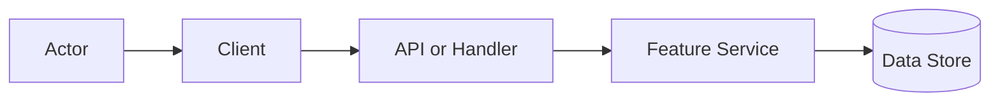
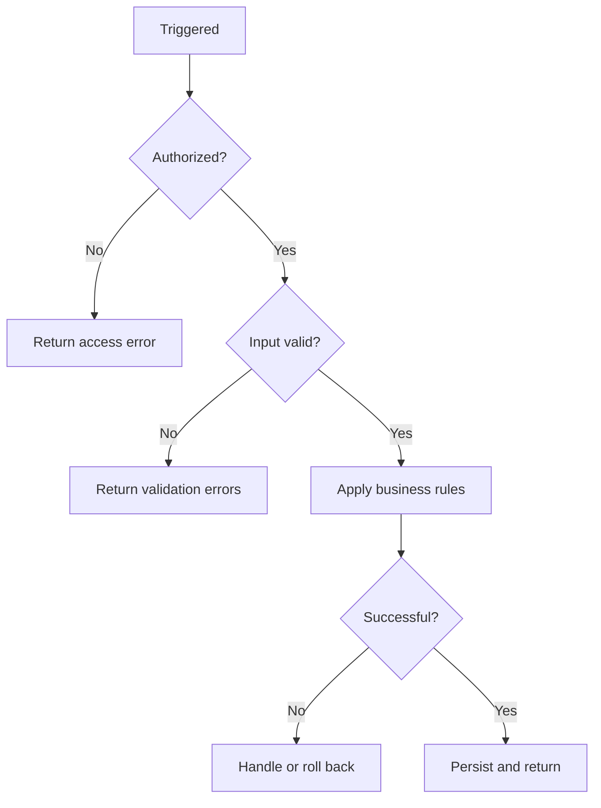

<!--
MINIMAL TEMPLATE — for single-surface, low-blast-radius features with no new contracts,
storage, or permission boundaries. If the feature touches money, personal data, migrations,
tenant isolation, or multiple services, use feature-full.md instead.

Section numbers match feature-full.md and are stable across all feature documents.
The gaps are intentional: they mark sections this feature does not need. Never renumber.
To add a section from the full template, bring its number with it.

Every row below is an ILLUSTRATION. Replace it or delete it. Do not invent content
to complete a table — an empty section is honest, a fabricated one is a defect.
-->

# Feature Name

> One sentence explaining what this feature does, who it serves, and why it exists.

## 1. Feature Snapshot

| Field                 | Details                                     |
|-----------------------|---------------------------------------------|
| Document status       | Proposed / Approved / Active                |
| Implementation status | Not started / In progress / Shipped         |
| Owner                 | Team or person                              |
| Primary actors        | Who or what triggers this                   |
| Trigger               | UI action, API call, event, schedule        |
| Outcome               | Main result produced                        |
| Entry points          | Routes, screens, handlers                   |
| Data stores           | Tables, collections, caches                 |
| Feature flag          | Flag name or Not applicable                 |
| Last verified         | Date and commit, or Not yet verified        |

**Status legend.** Every `Status` value below is one of: **Current** (read in the code at `last_verified_commit`) · **Planned** (not implemented) · **Inferred** (not directly verified) · **Unknown**.

## 2. Problem and Outcome

**Problem.** The user, business, or system problem.

**Desired outcome.** The observable result once this works.

**How success is measured.** The signal that tells you it worked, and where to read it. Omit if there is no real measure — do not invent a target.

## 3. Scope

**Included**

- Responsibility this feature owns

**Excluded**

- Behavior explicitly out of scope, or owned by another feature

**Assumptions**

| ID      | Assumption | Confidence | How it gets validated |
|---------|------------|------------|------------------------|
| ASM-001 |            | High / Medium / Low |               |

## 6. User Journey

1. The actor enters through `[entry point]`.
2. The system loads `[required data]`.
3. The actor performs `[action]`.
4. The system validates `[input and permissions]`.
5. The system executes `[operation]` and persists `[result]`.
6. The actor receives `[outcome]`.

**Alternate paths**

| Journey | Trigger           | Expected outcome                        |
|---------|-------------------|-----------------------------------------|
| Retry   | Temporary failure | Completes without duplicate side effect |
| Cancel  | Actor cancels     | No partial state remains                |

## 7. System Context

One or two sentences on the feature boundary and what sits around it.



## 8. Control Flow

Explain where each decision is enforced, and what happens when it fails.



| Step          | Status  | Controlling component | Failure behavior    |
|---------------|---------|-----------------------|---------------------|
| Authorization | Planned | API middleware        | 403                 |
| Validation    | Planned | Validator             | Field-level errors  |

## 9. Data Flow

Where data comes from, what changes it, where it lands. Include a `sequenceDiagram` if the interaction crosses more than two components; otherwise prose is enough.

**Sensitive data.** Anything confidential or restricted this feature touches, where it is stored, and what must never reach the logs. Write `None` if that is true.

## 11. Implementation Map

### Existing

| Layer | Responsibility | Repository path | Main symbol | Verified |
|-------|----------------|-----------------|-------------|----------|

### Planned

| Layer | Responsibility | Planned path | Main symbol | Change type |
|-------|----------------|--------------|-------------|-------------|

### Generated or restricted

| Path or area | Classification | Rule |
|--------------|----------------|------|

## 14. Business Rules

| Rule ID | Status  | Rule | Enforcement point | Test reference |
|---------|---------|------|-------------------|----------------|
| BR-001  | Planned |      |                   |                |

## 15. Acceptance Criteria

### AC-001: Successful operation

**Given** an authorized actor and valid input
**When** the actor submits the request
**Then** the result is stored
**And** the success response is returned

### Edge cases

| Case ID  | Scenario             | Expected behavior        | Test type   |
|----------|----------------------|--------------------------|-------------|
| CASE-001 | Duplicate submission | No duplicate side effect | Integration |

## 17. Security and Privacy

| ID      | Requirement                   | Enforcement     | Validation         |
|---------|-------------------------------|-----------------|--------------------|
| SEC-001 | Enforce ownership server-side | Feature service | Authorization test |

Consider authorization, tenant isolation, input validation, secrets, logging restrictions, and rate limits. If one does not apply, say so rather than omitting it silently.

## 20. Testing

| Test type   | Required coverage | Path |
|-------------|-------------------|------|
| Unit        |                   |      |
| Integration |                   |      |

**Validation commands** — must be commands that exist in this repository:

```bash
```

## 24. Implementation Plan

Delete this section once the feature is implemented and §11 reflects reality.

### Phase 1: <objective>

- **Changes:** specific modules and their responsibility
- **Validation:** the command or test that proves it works
- **Done when:** observable completion criterion

## 26. Risks and Limitations

| Risk ID  | Risk | Impact | Mitigation |
|----------|------|--------|------------|
| RISK-001 |      |        |            |

## 30. Changelog

Behaviorally, contractually, or operationally significant changes only.

| Date | Version | Change | Status | PR or author |
|------|---------|--------|--------|--------------|
