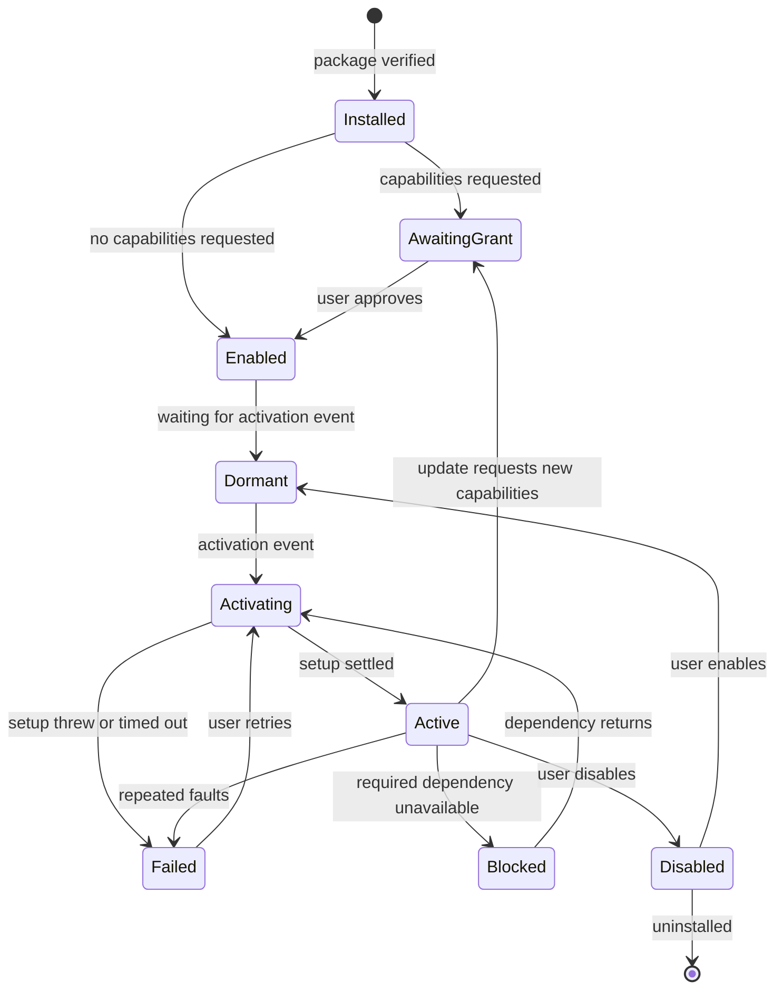

# Extension system

> Status: approved design. Phases: declarative tier in Phase 2, sandboxed tier in Phase 3. Source: [architecture research §7](../research/2026-10-10-architecture-research.html).

### 7.1 Trust tiers

**[Recommendation]** Use one manifest format and one install flow, with separate trust tiers. The tier decides where code runs and what it can reach. Users see the tier before they install.

| Tier | What it can contribute | Runs as | Isolation | Phase |
| --- | --- | --- | --- | --- |
| **T0 Declarative** | Themes, icon themes, keybindings, settings defaults, prompt templates and snippets, tool-call renderers, menu entries bound to existing commands, layout presets | Data validated by schema and interpreted by the host | No code runs | 2 |
| **T1 Sandboxed** | Views (side, dock, page, dialog), background logic, commands, actions on messages, sessions and files, status items, slash-command resolvers, integrations with host-held credentials | Iframe with an opaque origin and a strict CSP, talking to an async API | Capabilities enforced in main | 3 |
| **Engine plugin** | Agent tools, agents, provider and model transforms, session context hooks, RPC to the extension's GUI half | Inside the OpenCode engine | Full engine privileges | 4 |
| **T2 Trusted native** | Native components inside core surfaces such as timeline decorations and composer add-ons | In the renderer, on a vetted subset of the internal SDK | Review only | Later, possibly never for third parties |
| **T3 Privileged service** | Local processes with OS access: indexers, language tools, local bridges | Electron `utilityProcess` or a child process | OS user only | 5, verified publishers |

First-party feature modules are not a tier. They are compiled into the app, use the internal SDK, and are never distributed.

### 7.2 Manifest

**[Recommendation]** Put the manifest in `package.json` so authors use npm tooling they know. The manifest key is `mortise`.

```json
{
  "name": "@acme/tasks",
  "version": "1.2.0",
  "mortise": {
    "apiVersion": 1,
    "id": "acme.tasks",
    "tier": "sandboxed",
    "engines": { "app": ">=0.6.0 <1.0.0", "opencode": ">=2.0.20 <3.0.0" },
    "activation": ["onCommand:acme.tasks.sync", "onView:acme.tasks"],
    "capabilities": ["sessions:read", "network:api.acme.example", "storage"],
    "contributes": {
      "commands": [{ "id": "acme.tasks.sync", "title": "Sync tasks" }],
      "keybindings": [{ "command": "acme.tasks.sync", "key": "mod+shift+t" }],
      "views": [{ "id": "acme.tasks", "title": "Tasks", "region": "side", "entry": "view/index.html" }],
      "toolRenderers": [{ "match": "mcp.acme.*", "title": "{input.id}", "body": "table", "columns": ["id", "title", "status"] }],
      "settings": { "acme.tasks.project": { "type": "string", "description": "Project key" } },
      "themes": [{ "id": "acme-dusk", "path": "themes/dusk.json" }]
    },
    "background": "background/index.js",
    "enginePlugin": { "package": "@acme/opencode-tasks", "rpc": "acme.tasks", "range": "^1.0.0" }
  }
}
```

- `id` is `publisher.name` and prefixes every contributed id, storage key and RPC name, the same discipline upstream uses for built-ins.
- `engines.opencode` is optional. Only extensions that call engine RPC or depend on engine-specific behavior need it.
- `enginePlugin` declares the agent-side half. The client never installs it silently. Section 7.12 covers how.

### 7.3 Discovery and loading

1. Main scans three roots: bundled extensions, the user extensions directory under app data, and developer folders registered in developer mode.
2. It validates each manifest against the schema for its `apiVersion`, checks `engines`, and checks recorded file hashes for installed packages.
3. Declarative contributions are merged into the registries before the first frame. No code loads at this stage.
4. Code loads only when an activation event fires. Main serves package files from `mortise-ext://<id>/` with a per-extension CSP header. On the web, the gateway server serves them from a separate origin instead (6.10).

### 7.4 Activation and lifecycle

Activation events: `onCommand:<id>`, `onView:<id>`, `onAction:<id>`, `onEngineConnected`, `onSessionOpened`, `onToolCall:<pattern>`, `onUri`. There is no `onStartup` for third parties, because startup time is shared by everyone.



*Extension lifecycle. An update that widens capabilities returns to AwaitingGrant and never inherits approval.*

### 7.5 Public API and contribution points

```ts
// @mortise/extension-api, apiVersion 1. Async, serializable, capability-gated. No framework types.
import { defineExtension } from "@mortise/extension-api"

export default defineExtension(async (host) => {
  host.commands.register("acme.tasks.sync", async () => {
    const session = await host.sessions.current()          // "sessions:read"
    if (!session) return host.notify({ kind: "info", message: "Open a session first" })
    const response = await host.network.fetch("https://api.acme.example/tasks") // "network:api.acme.example"
    await host.views.post("acme.tasks", { tasks: await response.json() })
  })

  host.events.on("session.activity", (event) => {
    if (event.status === "idle") host.views.post("acme.tasks", { refresh: event.sessionId })
  })

  if (host.capabilities.has("engine.rpc:acme.tasks")) {
    const open = await host.engine.rpc("acme.tasks", "listOpen", {})   // forwards to POST /api/rpc/{id}/{method}
    host.status.set("acme.tasks", { text: `${open.length} open` })
  }
})
```

| Contribution | Tier | Notes |
| --- | --- | --- |
| Themes, icon themes | T0 | DesktopTheme-compatible JSON; VS Code theme import |
| Keybindings | T0 | Bind only to known command ids; conflicts shown in settings |
| Settings schema | T0 | Rendered by the settings module; values read through the API |
| Prompt templates and snippets | T0 | Inserted into the composer by the user; never sent automatically |
| Tool-call renderers | T0 | Template-based, capped; matched by tool name |
| Menu items | T0 or T1 | Point at commands; placement by named menu id |
| Commands | T1 | Handler runs in the extension's background frame |
| Views | T1 | Side, dock, page or dialog; iframe in a host-drawn frame with the extension's name |
| Actions on messages, sessions and files | T1 | Item passed as data; payload size capped |
| Status items | T1 | Text, icon and command only |
| Integrations | T1 | Token or OAuth held by main; host-proxied requests to one declared origin |
| Engine RPC bridge | T1 plus engine plugin | Only to the extension's own declared RPC id |
| Timeline decorations, composer add-ons | T2 | Deferred |
| Local services | T3 | Deferred |

### 7.6 Capabilities and permissions

| Capability | Allows | Risk | Why |
| --- | --- | --- | --- |
| `storage` | Own namespaced storage | Low | Quota-bound, own data only |
| `notifications` | Toasts and OS notifications | Low | Rate-limited |
| `clipboard:write` | Copy text | Low | Only during a user gesture |
| `sessions:read` | List sessions and metadata | Medium | Reveals project names and titles |
| `model:generate` | One-off generation with the user's small model | Medium | Costs money; rate-limited |
| `conversation:read` | Message content and tool output | High | Transcripts contain code and secrets |
| `files:read` | Read inside the open project, through the engine's fs routes | High | Source code and `.env` files |
| `network:<origin>` | Host-proxied requests to one origin | High with any read capability | The exfiltration path |
| `sessions:create` | Create sessions or worktrees | High | Starts agent work |
| `prompt:send` | Send input to a session | Critical | The agent can run shell commands within the user's permission rules. Sending a prompt is indirect code execution. |
| `engine.rpc:<id>` | Call its own engine plugin | As high as the plugin | The plugin runs inside the engine |

- **[Recommendation]** Show combinations, not lists. "Can read your conversations and send data to api.acme.example" is a sentence a user can judge. Five separate checkboxes are not.
- **[Recommendation]** `prompt:send` always asks per use unless the user grants standing approval for that extension and that session. The prompt is shown in a host-drawn dialog the extension cannot style.
- **[Recommendation]** Never exposed to any tier: permission replies and rule changes, engine credentials, raw engine HTTP, credential and integration management, config writes, other extensions' storage.

### 7.7 Dependencies and compatibility

- **[Recommendation]** In Phase 3, support no inter-extension dependencies. Extensions share functionality through commands, which are already public and late-bound.
- When demand appears, add `requires` and `uses` with upstream's semantics: a missing required provider blocks the extension, a missing optional provider degrades it. Resolve with semver ranges, activate in topological order, and reject cycles at install.
- Compatibility is checked at install and at every app or engine version change. An incompatible extension is disabled with an explanation, never half-loaded.

### 7.8 Storage and scoped settings

- Storage scopes are `global`, `project` (keyed by the engine's project id) and `session`. Starting quotas can follow OpenChamber's tested limits: 64 KiB per value and 2 MiB per namespace.
- `host.secrets` stores per-extension secrets in the OS keychain through main.
- Settings come from the contributed schema, are edited in the settings UI, and are read with `host.settings.get` and `onChange`. An extension can never read another extension's namespace.
- Data survives disable and update. Uninstall removes it after a grace period unless the user chooses to purge it.

### 7.9 Error isolation and crash handling

- A failing view affects only its frame. The host draws the frame and shows an error state inside it.
- Every API call has a timeout. A background invocation has a total time limit (OpenChamber uses 20 s).
- A contribution that throws renders nothing and records the error, which is upstream's rule for built-ins.
- Repeated faults disable the extension automatically and tell the user why.
- A safe-mode launch flag disables every non-bundled extension. It is the recovery path when an extension breaks startup.
- The extension manager shows per-extension logs, the last error, activation time and memory.

### 7.10 Sandbox implementation in Electron

- Windows run with `sandbox: true`, `contextIsolation: true` and no Node integration, as upstream's desktop does.
- Extension frames use `sandbox="allow-scripts"` without `allow-same-origin`. That gives them an opaque origin with no access to the parent DOM, cookies or storage.
- Files are served from `mortise-ext://<id>/` with `default-src 'none'`, scripts and styles limited to the package, and `connect-src 'none'`. All input and output goes through the host bridge.
- Main denies navigation, new windows and all device permission requests that come from extension frames.
- **[Open question]** Whether Electron's site isolation puts these opaque-origin frames in separate renderer processes needs a measurement in the prototype. If they share the host's process, a renderer exploit in an extension frame reaches the host. The fallback is a `WebContentsView` per untrusted extension, at a higher memory cost.

### 7.11 Implementation mechanisms compared

| Mechanism | Isolation | UI | Cost | Verdict |
| --- | --- | --- | --- | --- |
| Declarative manifests | Total | Host-rendered | Minimal | Use first |
| Statically bundled modules | None | Native | Minimal | First-party only |
| Dynamically loaded in-process code (the `.ocdx` approach) | None | Native | Low | Trusted tier or developer mode only |
| Web Workers | Same origin as the host unless created inside a sandboxed frame | None | Low | Not needed; a hidden sandboxed frame covers background logic with one mechanism |
| Sandboxed iframes | Opaque origin plus CSP | Inside a frame | One document per view | Default for third-party code |
| `WebContentsView` per extension | Separate process | Inside a native view | High memory | Fallback if frame isolation proves weak; also for web embeds |
| `utilityProcess` or child process | OS user | None | Medium | T3 services only |
| WASM JavaScript interpreter (for example QuickJS) | Strong | None | High complexity | Rejected; solves a problem iframes already solve |

### 7.12 Threats specific to an agent client

| Threat | Example | Control |
| --- | --- | --- |
| Indirect code execution | An extension sends "run `curl … \| sh`" to a session with permissive rules | `prompt:send` is critical, confirmed per use, shown verbatim in host chrome |
| Approval hijack | An extension answers `permission.asked` with "always" | Permission replies are never in the API; the credential never leaves main |
| Exfiltration | Read transcripts, post them to a remote server | CSP blocks direct network access; host proxy limited to declared origins; combined-risk wording at install |
| Prompt injection into extensions | Tool output instructs an extension's own model call to act | No extension gets autonomous `prompt:send`; `model:generate` output is data only |
| UI spoofing | A view draws a fake permission dialog | Sensitive dialogs are host-drawn outside frames; frames carry the extension's name |
| Supply chain | An update adds malicious code after approval | Hashes recorded at install; widened capabilities need re-approval; signed packages in Phase 5 |
| Engine plugin abuse | A companion plugin adds a tool that reads `~/.ssh` | Plugin install is a separate, explicit, T3-level consent; the client never edits engine config silently |
| Archive attacks | Path traversal, zip bombs | Copy upstream's archive rules: relative paths only, 100 MiB and 4,096-entry limits, 64 KiB manifest cap ([desktop/src/main/extension/archive.ts](https://github.com/anomalyco/opencode/blob/v2.0.25/packages/desktop/src/main/extension/archive.ts)) |

**[Decided]** The engine has no plugin install endpoint. When an extension declares a companion engine plugin, the client shows the exact `plugins` entry with buttons to copy it and to open the user's OpenCode config. It then confirms the plugin loaded through `GET /api/plugin`. The client never edits engine config on its own. If upstream adds an install endpoint, use it behind a capability flag.

### 7.13 Install, update, removal and rollback

- **Package:** a zip with `package.json` at the root and built files only. Validate it before it replaces anything.
- **Layout:** `extensions/<id>/<version>/`, with the current version recorded in the client database. Keep the previous version.
- **Update:** download, validate, compare capabilities, ask for approval if they widened, switch the version pointer atomically, then reactivate.
- **Rollback:** switch the pointer back. Data is untouched, because storage is keyed by id, not version.
- **Removal:** deactivate, delete files, schedule data deletion.
- **Sources:** local folder (developer mode, hot reload), zip file, URL, then index entries.

### 7.14 Distribution, staged

1. **Local:** folder and zip installs, plus a developer mode that reloads on change.
2. **Curated index:** a public git repository of JSON entries with id, versions, download URL, SHA-256 and publisher. Changes arrive by pull request with review. This is cheap to run and leaves an audit trail.
3. **Hosted registry:** publisher accounts, signing, automated scanning, yank and deprecation, abuse reports and download counts. Open VSX is a reference for running a neutral registry.
