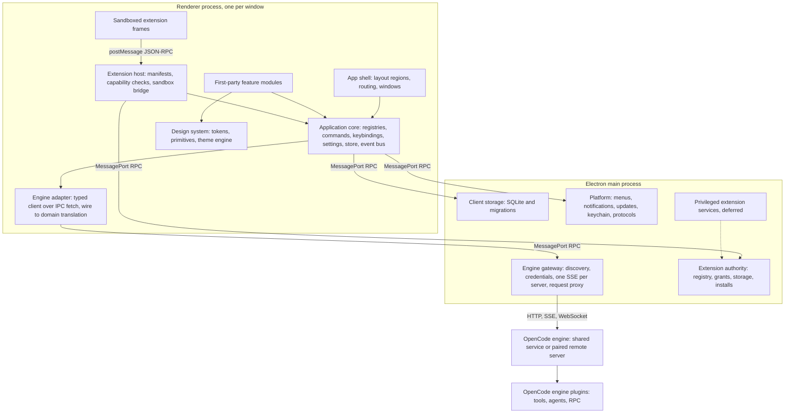
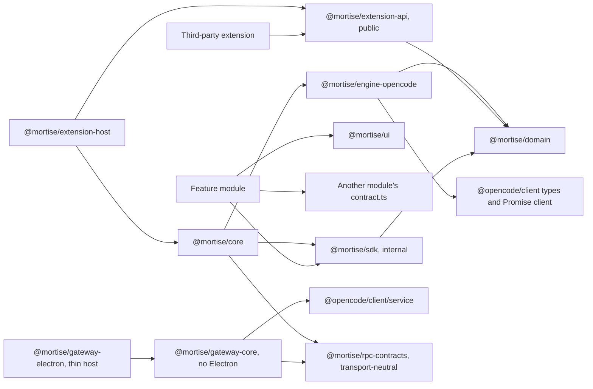
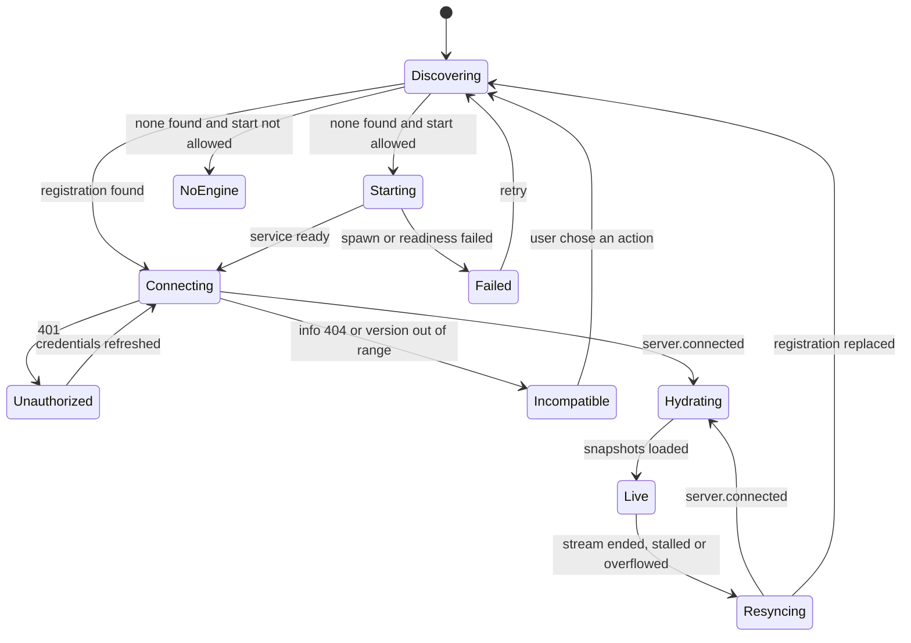
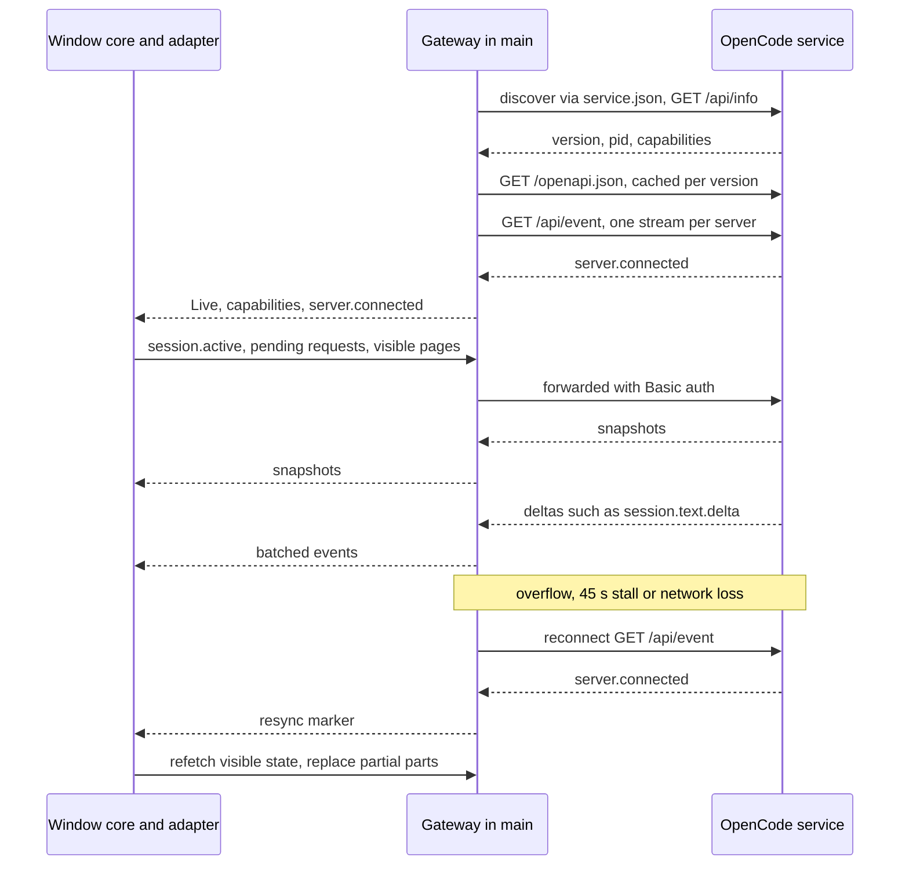
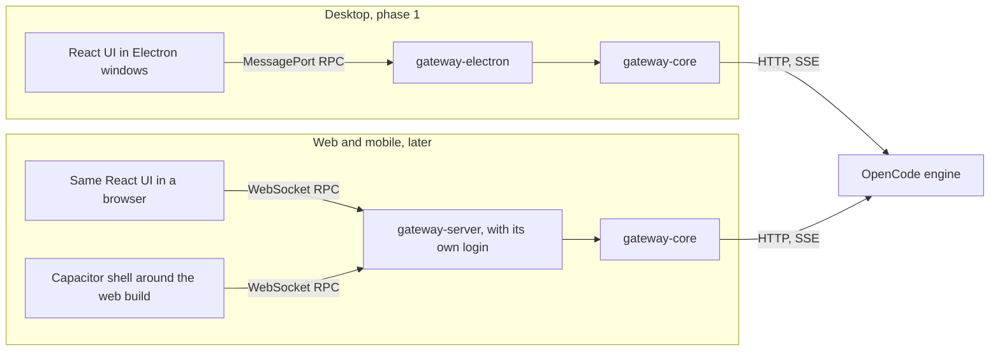

# Mortise architecture overview

> Status: approved design, not yet implemented. Source: [architecture research](../research/2026-10-10-architecture-research.html). Decisions live in [docs/adr](../adr/README.md).

## Repository mapping (read this first)

The sections below come from the research document and use its module names. This repository maps them as follows, and where the two differ, **this table and `.dependency-cruiser.cjs` win**.

| Architecture module | Repository location | Notes |
| --- | --- | --- |
| Domain model | `packages/domain` | Leaf package, imports nothing |
| RPC contracts | `packages/rpc-contracts` | Zod schemas plus the `Channel` interface |
| Engine adapter | `packages/engine-opencode` | Only package importing the `@opencode/client` Promise root |
| Engine gateway (core) | `packages/gateway-core` | No Electron; runs in Electron main now, a Node server later |
| Gateway host for Electron | `apps/desktop/src/main/` | Not a separate package yet; extract to `packages/gateway-electron` only if a second Electron entry appears |
| Application core | `packages/core` | Framework-free |
| Internal module SDK | `packages/sdk` | React bindings live here |
| Design system | `packages/ui` | Must not read application state |
| App shell and feature modules | `packages/workbench` | Shared by desktop now and web later; modules in `src/modules/<id>/` |
| Composition root | `packages/workbench/src/bootstrap/` | The only place that creates the adapter and connects it to the core store |
| Desktop host | `apps/desktop` | Electron main, sandboxed CommonJS preload, renderer entry that mounts `@mortise/workbench` |
| Extension host and public API | Not created yet | Phase 3; Phase 0 spike lives under `apps/desktop/src/spikes/` |

**Refinement of 6.3:** the research diagram draws `@mortise/core --> @mortise/engine-opencode`. In this repository the core does **not** import the adapter. The adapter produces domain types, the core consumes domain types, and the composition root in `packages/workbench/src/bootstrap/` wires the two together. This keeps the core testable without any engine code.

## Summary

**Recommended direction**

Build a **hybrid architecture, in stages**. An Electron app whose main process runs a thin **engine gateway** for discovery, credentials and the single event stream. A pure **adapter package** is the only code that knows OpenCode wire shapes. A small **application core** of contribution registries, commands, settings and a read-only store sits above it. Every product feature is a **first-party module** built on an internal SDK with lint-enforced boundaries. Third parties get a **separate, smaller, versioned extension API**: declarative packages first, sandboxed iframe extensions second, privileged local services last. Agent-side capabilities such as new tools go into **OpenCode engine plugins**, which talk to their GUI half over OpenCode's own plugin RPC. The UI is **React**. The gateway is written **host-neutral**, so the same code can later run in a server for the web and mobile versions.

## Decisions recorded

- **[Decided]** **Desktop first.** Web and mobile follow once the desktop works, reusing the same core (6.10).
- **[Decided]** **Users install OpenCode themselves.** No bundled binary, so the client supports a version range (8.6).
- **[Decided]** **React for the UI** (ADR-006, 6.11).
- **[Decided]** **A curated git index you maintain** as the first registry (ADR-013).
- **[Decided]** **Companion engine plugins:** the client shows the config line and checks it was added. It never edits engine config silently (7.12).
- **[Decided]** **Contribute upstream** by opening issues for four engine improvements, without waiting on them (8.8).
- **[Recommendation]** **Product name:** Mortise, with Binnacle as the alternate (section 13).

## Requirements and constraints

### 4.1 Requirements from the brief

- **R1 Engine independence.** The engine keeps agent execution. The client talks to it only through defined interfaces and does not fork it unless that is unavoidable.
- **R2 Modularity.** Explicit modules with stated responsibilities and interfaces.
- **R3 Customization.** Appearance, behavior, layout, commands, keybindings and settings.
- **R4 Ecosystem.** Create, distribute, install, update, enable, disable and remove community extensions.
- **R5 Composable UI.** Independently developed modules, shared tokens and primitives, replaceable panels and layouts.
- **R6 Safety.** Third-party code must not silently gain filesystem, command, network or agent access.
- **R7 Upgrade resilience.** OpenCode upgrades must not routinely break the client or its extensions.
- **R8 More surfaces later.** Web and mobile follow once the desktop works, and they should reuse the same core rather than fork it.
- **R9 User-installed engine.** Users install OpenCode themselves. The client ships no engine binary.

### 4.2 Quality attributes, in priority order

**[Recommendation]** When goals conflict, resolve them in this order:

1. **User control and security.** An AI agent with tool access magnifies any extension compromise.
2. **Correctness of agent state.** The user must never act on a stale or wrong picture of what the agent did.
3. **Upgrade resilience** against a fast-moving engine.
4. **Extensibility.**
5. **Performance and memory.**
6. **Initial delivery speed.**

### 4.3 Non-negotiable boundaries

| ID | Constraint | Derived from |
| --- | --- | --- |
| C1 | Integrate only through the HTTP API, the SSE stream, PTY WebSockets, plugin RPC, the registration file via `@opencode/client/service`, and published packages. | 2.7; OpenChamber lesson |
| C2 | Never read or write the engine database, CLI-private files or the data-directory layout. | 2.7; `v1-migration-topup.js` |
| C3 | Never replace a running shared service without explicit user consent. | 2.2 |
| C4 | Never run a second engine against the user's default database. | 2.2 (inferred hazard) |
| C5 | Treat the event stream as lossy. Every view must be rebuildable from snapshots. | 2.4 |
| C6 | Send only request fields the connected engine version accepts. | 2.3 strict bodies |
| C7 | Keep the engine credential in the main process. No renderer code or extension may see it. | 2.3, 2.6, 2.9 |
| C8 | Do not expose Effect, OpenCode or UI-framework types in the public extension API. | 2.10 Effect RC; framework neutrality |
| C9 | Extensions never answer permission requests or change permission rules. | 2.6 |
| C10 | Do not impersonate the official app: no `oc://renderer` origin, no OpenCode branding. | 2.3 CORS; OpenCode README naming note |
| C11 | Gateway and extension-authority logic must not import Electron. Electron stays in a thin host layer. | R8, so a server can host the same code later |

### 4.4 Assumptions

| ID | Assumption | What would invalidate it |
| --- | --- | --- |
| A1 | **[Assumption]** The audited HTTP API remains the integration contract for third-party clients. | Upstream declares it internal, or moves clients to another transport or auth scheme. |
| A2 | **[Assumption]** One shared background service per user remains the norm. | Per-client engines become standard, or the registration file changes shape. |
| A3 | **[Assumption]** Users want sessions shared with the TUI and the official desktop. | Your audience prefers isolated history; then isolated mode becomes the default. |
| A4 | **[Decided]** Desktop ships first; web and mobile follow on the same core. | Web or mobile becomes urgent before the desktop is stable. The portable gateway (6.10) keeps that switch cheap. |
| A5 | **[Assumption]** Chromium's iframe sandbox plus a strict CSP is adequate isolation for untrusted UI code. | A threat model demanding process isolation per extension, which costs more memory. |
| A6 | **[Assumption]** Community authors accept iframe views and declarative contributions for untrusted extensions. | Demand for native in-timeline rendering by untrusted code. |
| A7 | **[Assumption]** Upstream will not make the official desktop an open extension platform soon enough to make your client redundant. | Upstream ships `.ocdx` renderer bundles with a trust model and a registry. |

## Why this architecture

### Verdict

**[Recommendation]** Choose **approach 4, built in stages**. Start where approach 3 is strongest: first-party features as modules on an internal SDK, the way OpenCode's own app proves out. That gives you the boundaries and the contribution registries without promising anything publicly. Publish a declarative tier as soon as the registries settle, since it is safe and covers most customization. Add sandboxed code extensions only after the first-party modules have shown which contribution points matter. Keep the internal SDK and the public API as separate surfaces permanently. That separation is what lets the internal side change every release while extensions keep working.

Approach 2 is the main temptation, because rich native extensions attract authors quickly. It is the wrong default here. An extension running in your renderer can reach the store, the DOM and every command, and in an agent client that adds up to sending prompts and approving tool runs. Offer that level of access later as an explicit trusted tier, never as the baseline.

| Abstraction | When | Reason |
| --- | --- | --- |
| Engine adapter and client domain model | Day one | Engine churn is certain (2.10). Retrofitting an adapter means touching every feature. |
| Engine gateway in main | Day one | Credentials, CORS and multi-window streams all need it. |
| Host-neutral gateway core and transport-neutral RPC | Day one | Web and mobile are planned (R8). Keeping Electron out of the core costs little now and avoids a rewrite later. |
| Contribution registries, command service, keybindings | Day one | Every feature uses them; they are the composition backbone. |
| Module manifest with provides, uses and requires | Day one | Cheap at the start, expensive to retrofit. |
| Layered settings with contributed schemas | Day one | Modules own their settings, so the host never names a module. |
| Design tokens and theme engine | Day one | Themes are the first community contribution people expect. |
| Capability vocabulary | Design early, enforce in Phase 3 | Shapes the public API even before third-party code runs. |
| Sandboxed extension runtime | Phase 3 | Needs a stable set of contribution points first. |
| Extension dependencies beyond a simple requires list | Defer | No demonstrated need. Dependency graphs are a major source of support load. |
| Registry, signing, publisher verification | Defer to Phase 5 | Needs real extensions and real publishers first. |
| Privileged Node services for extensions | Defer | The highest risk for the least common need. |
| Generic multi-engine abstraction | Do not build | The adapter isolates OpenCode versions. It is not a portability layer. Revisit only if a second engine becomes a real requirement. |

## Architecture

### 6.1 High-level view



*Proposed layers. Only the gateway opens connections to the engine, and only the adapter understands its payloads.*

### 6.2 Modules and their boundaries

| Module | Runs in | Owns | Must not |
| --- | --- | --- | --- |
| **Engine gateway** `@mortise/gateway-core`, hosted by `@mortise/gateway-electron` | Main on desktop; a Node server later for web and mobile | Server list, discovery and start policy, credentials in the OS keychain, one SSE subscription per server, request forwarding with auth, `/api/info` and `/openapi.json` probing, the connection state machine | Interpret events, derive status, cache domain state |
| **Engine adapter** `@mortise/engine-opencode` | Renderer (pure translation also usable in main) | The typed `@opencode/client` instance over an IPC-backed `fetch`, domain mapping, capability flags, version shims, idempotency keys | Render UI, hold credentials, leak wire types |
| **Domain model** `@mortise/domain` | Shared types | Client-owned types: sessions, timeline items, requests, capabilities, domain events | Import OpenCode, Effect or UI frameworks |
| **Application core** `@mortise/core` | Renderer | Registries, command service, keybinding resolver, settings service, store, domain event bus, module lifecycle, diagnostics | Name specific modules or contain feature logic |
| **App shell** | Renderer | Window layout regions (side, dock, main, titlebar, status), routing, focus, command palette host | Know what fills a region |
| **Feature modules** (sessions, timeline, composer, requests, review, files, terminal, settings UI, extension manager UI, notifications) | Renderer | One feature each, with its contributions, stores and copy | Import other modules' internals, call the engine directly |
| **Design system** `@mortise/ui` | Renderer and extension kit | Tokens as CSS variables, primitives, theme loading and VS Code import, icon catalog | Depend on app state |
| **Extension host** `@mortise/extension-host` | Renderer | Frame lifecycle, the postMessage bridge, mapping public API calls onto core services, contribution merging | Decide grants (main does), expose internal objects |
| **Extension authority** | Main on desktop; the same server later | Installed packages, versions, integrity hashes, enable state, grants, quotas, extension storage, update and rollback | Trust renderer claims about identity or grants |
| **Client storage** | Main | SQLite database, forward-only migrations, declared stores, backups | Store engine-owned data as truth |
| **Platform** | Main | Native menus, tray, notifications, deep links, auto-update, file dialogs, custom protocols | Contain feature logic |

### 6.3 Dependency rules



*Allowed edges. Anything not drawn is prohibited.*

| From | Prohibited | Why |
| --- | --- | --- |
| Feature modules | `@opencode/*`, adapter internals, any network call to the engine | Engine coupling stays in one package |
| Feature modules | Another module's files other than its `contract.ts`; core internals | Modules stay replaceable |
| Third-party extensions | Anything except `@mortise/extension-api`; host DOM, Node, direct network | Security and API stability |
| Renderer code | Node and Electron APIs, the engine password | Process sandbox |
| Gateway | Status derivation, projections, any other domain logic | One translation point |
| `@mortise/gateway-core` | `electron`, DOM APIs, React | It must run unchanged inside a server later (C11) |
| Core and shell | Module ids, command ids, stored key formats of specific modules | The host never names a module, as in upstream's host-boundary rule |
| `@mortise/extension-api` | Solid, React, Effect or OpenCode types | Framework and engine neutrality |
| Everything | Engine database, CLI-private files, data-directory paths | No contract exists (C2) |

**[Recommendation]** Enforce these rules mechanically: package `exports` maps that expose only entry points, TypeScript project references, `no-restricted-imports` or dependency-cruiser rules in CI, and an API report (API Extractor) for `@mortise/extension-api` so any public change shows up in review. Upstream's `gui-extensions` lint gate is a working precedent.

### 6.4 Communication mechanisms

| Mechanism | Use for | Not for |
| --- | --- | --- |
| Commands (id, handler, return value) | User actions, keybindings, menus, palette, extension-triggered actions | Queries or high-frequency updates |
| Registries (contribution points) | Declaring panels, menus, status items, settings pages, tool renderers, link handlers | Runtime messaging |
| Store (reactive, read-only to modules) | Engine-derived and client state | Mutation. Write through commands or services. |
| Domain event bus (typed, past tense) | Reacting to facts: session went idle, permission asked, connection lost | Requesting work |
| Contracts (typed tokens with a liveness status) | Module-to-module services such as a file tree or a diff renderer | Crossing a trust boundary |
| MessagePort RPC, schema-validated | Renderer to main: gateway, storage, platform, extension authority | Calls within one renderer |
| postMessage JSON-RPC, versioned envelope | Extension host to sandboxed frames | Trusted modules |
| HTTP, SSE, WebSocket | Gateway to engine only | Anything else |

**[Verified]** The IPC-backed transport needs no fork. `@opencode/client`'s `ClientOptions` accepts a custom `fetch`, so the renderer adapter can hold a fully typed client whose requests travel to main, gain the Authorization header there, and go to the engine. [client/src/promise/generated/client.ts#L273](https://github.com/anomalyco/opencode/blob/v2.0.25/packages/client/src/promise/generated/client.ts#L273)

### 6.5 State ownership

| State | Owner | Persistence | Rule |
| --- | --- | --- | --- |
| Sessions, messages, inbox, permissions, forms, config, providers, credentials, MCP, terminals | Engine | Engine database | The client cache is disposable and invalidated on every resync |
| Derived views: session activity, timeline grouping, unread markers | Adapter and store | None, recomputed | One derivation point |
| Server list and connection preferences | Gateway | Client SQLite; secrets via Electron `safeStorage` | Remote tokens never reach the renderer |
| Layout, tabs, panel state, drafts | Each module | Declared stores in client SQLite | Scoped globally, per project or per session; migrations declared with the store |
| Settings | Settings service | Defaults, then user, then project | Schemas contributed by modules and extensions |
| Keybindings and themes | Core | User-editable JSON plus SQLite index | Validated against versioned schemas |
| Installed extensions, versions, enable state, grants | Extension authority | Client SQLite | The only source for capability checks |
| Extension data | Each extension, namespaced | Client SQLite with quotas; secrets in the keychain | Kept on disable, removed on uninstall after a grace period |

Project identity comes from the engine's `Location.project` id, so per-project state follows the project rather than a path string.

### 6.6 Lifecycles

#### Application start and stop

1. Main opens the client database, runs migrations and reads extension manifests. No extension code runs at this point.
2. Main shows a window skeleton at once and starts gateway discovery in parallel.
3. The renderer boots the core, sets up first-party modules synchronously (contributions only, no engine calls) and merges declarative extension contributions.
4. The gateway discovers the engine, starts one if policy allows, checks version and capabilities, then opens the event stream.
5. On `server.connected`, windows hydrate visible state and the `onEngineConnected` activation event fires.
6. Sandboxed extensions activate lazily on their declared events.
7. On quit: deactivate extensions with a time limit, flush stores, close streams. Never stop the shared engine.

#### Engine connection



*Every state is visible in the UI. A feature that cannot work in the current state shows why. It never presents a dead button or an endless spinner, which is upstream's own rule for its extensions.*

#### Modules

First-party modules use the liveness model upstream already proved: *pending*, *active*, or *inactive* because the module is restarting, disabled, failed or blocked. Optional dependencies arrive as a live value that degrades gracefully. Required dependencies block setup until the provider returns. Everything a module registers is withdrawn when it leaves the active state. Setup is synchronous, and async work runs in owned tasks that check an abort signal after every await.

**[Recommendation]** Upstream ties these lifetimes to Solid's ownership tree. React has no equivalent, so make them explicit. `ctx.add` returns a disposable, each module instance owns a disposal scope and an `AbortSignal`, and the host disposes the scope when the module leaves the active state. Components reach the module context through a hook such as `useModule()`.

### 6.7 Errors, events and reconnection

| Class | Example | Handling |
| --- | --- | --- |
| Transport | Refused connection, stall, queue overflow | Enter Resyncing; mark affected views stale; back off and retry |
| Authentication | 401 | Re-read the registration (the password may have rotated), otherwise ask to pair again |
| Incompatible | `/api/info` 404, version outside range, missing required capability | Incompatible state with clear actions; read-only features continue where safe |
| Typed domain error | `SessionNotFound`, `InvalidCursor`, form already settled | Handled by the feature; the adapter maps it to a domain error |
| Validation | 400 from a strict request body | Treat as version skew or an adapter bug; attach to the diagnostic bundle |
| Engine failure | 500 `UnknownError` | Report; never auto-retry a non-idempotent call |
| Extension fault | Setup throws, RPC timeout | Isolate; mark failed; auto-disable after repeated faults; offer safe mode |



*Start and resync. The gateway forwards raw wire events; windows translate them through the adapter.*

- **[Recommendation]** Treat every stream end as possible data loss. Bump a store generation and refetch active sessions, pending permissions and forms, and the latest page of each visible session. The stream does not replay requests asked while you were away, as upstream's auto-approve comment confirms.
- **[Recommendation]** When a reconnect interrupts a streamed message, replace its partial parts with `session.message.get` rather than replaying deltas.
- **[Inferred]** Durable events carry `aggregateID` and a per-aggregate `seq`, so a gap in a durable sequence can trigger a targeted refetch even without a disconnect.
- **[Recommendation]** Generate `msg_…` ids on the client for prompts, and retry with the same id after an uncertain outcome.
- **[Recommendation]** Ignore and count unknown event types. A new engine event must never crash an older client.
- **[Recommendation]** A failed fetch must never look like an empty result. This is one of OpenChamber's correctness invariants, and it is worth copying.

### 6.8 Versioning

| Surface | Scheme | Promise |
| --- | --- | --- |
| Internal module SDK and core | App version, one monorepo | None. Refactor freely; the compiler checks callers. |
| Main and renderer IPC contracts | Same build | Both ends ship together; schemas validate every message |
| Public extension API | `apiVersion` integer plus npm semver of `@mortise/extension-api` | Additive within a major. Deprecations last at least two minor releases. The host supports the current and previous major for a stated period. |
| Extension manifest | `apiVersion`, `engines.app` range, optional `engines.opencode` range | Install refused when unmet; upper bounds allowed |
| Theme, keybinding and settings files | `$schema` URL with a version | Migrated on load |
| Engine adapter | Declared supported OpenCode range | Enforced at connect, with a supported, untested or unsupported state |
| Client database | Migration number | Forward-only, with a backup before each migration |

### 6.9 Illustrative contracts

**[Recommendation]** These sketches show shape and ownership. Validate them in the prototype before treating them as fixed.

```ts
// @mortise/domain: owned by you. No OpenCode, Effect or UI framework imports.
export type SessionId = string & { readonly brand: "SessionId" }

export interface EngineCapabilities {
  readonly pairing: boolean              // server.pair exists (added after 2.0.20)
  readonly persistentTerminals: boolean  // ServerInfo.capabilities.persistentPty
  readonly forkBeforeMessage: boolean
  readonly experimental: ReadonlySet<string> // operation ids under /api/experimental
}

export interface EngineInfo {
  readonly version: string
  readonly capabilities: EngineCapabilities
  readonly support: "supported" | "untested" | "unsupported"
}

export type DomainEvent =
  | { readonly type: "session.changed"; readonly session: SessionSummary }
  | { readonly type: "session.activity"; readonly sessionId: SessionId; readonly status: "running" | "idle" | "retrying" }
  | { readonly type: "timeline.patch"; readonly sessionId: SessionId; readonly patch: TimelinePatch }
  | { readonly type: "request.opened"; readonly request: PendingRequest }
  | { readonly type: "request.closed"; readonly requestId: string }
  | { readonly type: "resync"; readonly reason: "reconnected" | "overflow" | "gap" }
```

```ts
// @mortise/engine-opencode: the only package that imports @opencode/*
import { OpenCode } from "@opencode/client"

export function createAdapter(serverId: ServerId, gatewayFetch: typeof fetch): EngineAdapter {
  // Requests leave the renderer through MessagePort; main adds Authorization and forwards.
  const client = OpenCode.make({ baseUrl: `https://engine.invalid/${serverId}/`, fetch: gatewayFetch })
  return {
    sessions: {
      prompt: (input) => client.session.prompt({ sessionID: input.sessionId, id: input.clientMessageId, text: input.text }),
      // ...
    },
    translate: (wire) => translateEvent(wire), // pure; unknown types return [] and are counted
  }
}
```

```ts
// @mortise/sdk: internal module API in React, modeled on upstream gui-extensions. Free to change per release.
export default Module.define({
  id: "review",
  requires: { sessions: Sessions },          // blocked while unavailable
  uses: { files: FileTree },                  // Live<FileTree>, degrades gracefully
  stores: { prefs: Store.global(ReviewPrefs, { layout: "split" }) },
})

const setup: Setup<typeof definition> = (ctx) => {
  ctx.add(Command, { id: "open", title: ctx.t("open"), run: () => ctx.layout.open("review") })
  ctx.add(Panel, { id: "main", region: "side", render: (props) => <ReviewPanel session={props.session} /> })
}
```

**[Verified]** The adapter call matches the generated Promise client at 2.0.25: `client.session.prompt({ sessionID, id, text, … })` posts to `/api/session/{sessionID}/prompt` and serializes only the fields you set. [client/src/promise/generated/client.ts#L715](https://github.com/anomalyco/opencode/blob/v2.0.25/packages/client/src/promise/generated/client.ts#L715)

### 6.10 Path to web and mobile

**[Recommendation]** Ship the desktop first, but split the gateway now. `@mortise/gateway-core` holds discovery, credentials, the event stream, request forwarding and the extension authority, and imports no Electron. On desktop, `@mortise/gateway-electron` hosts it in the main process and speaks to windows over MessagePort. For web and mobile, a small Node server hosts the same core and speaks the same RPC over WebSocket.



*One gateway core, two hosts. The UI and the adapter do not change between surfaces; only the transport does.*

- **Transport-neutral contracts.** Define gateway calls and events as schemas in `@mortise/rpc-contracts`. MessagePort and WebSocket become two implementations of one channel interface.
- **Authentication moves to the server.** On the web, the browser logs in to *your* server, which holds the engine password. The browser never receives it, so C7 still holds. OpenChamber's UI password and the engine's pairing flow are the reference points.
- **Extension assets need their own origin.** Browsers have no `mortise-ext://` scheme. Serve extension files from a separate origin, such as a dedicated port or subdomain, so the sandbox and CSP model carries over unchanged.
- **Mobile through Capacitor.** Wrapping the web build keeps one React codebase and keeps iframe sandboxing for extensions. OpenChamber took the same route. React Native would give a more native feel, but it means a second UI and a different extension sandbox, so treat it as a later option rather than the plan.
- **Platform-specific code stays behind interfaces.** Notifications, file pickers, keychain and deep links go through a platform service with desktop, web and mobile implementations. Modules never call Electron or Capacitor directly.

### 6.11 React implementation notes

Streaming deltas are the one place React needs care. A naive store re-renders the whole timeline on every token. These patterns keep updates local:

- **Keep state outside React.** The adapter writes to a plain store, normalized by id. Components subscribe through `useSyncExternalStore` with narrow selectors, so a delta to one text part re-renders only that part.
- **Batch by frame.** The gateway already batches events (upstream uses 10 ms, OpenChamber 50 ms). Apply each batch once per animation frame.
- **Stream into a leaf.** Render streaming text in a small component keyed by part id. Re-parse only the trailing Markdown block while it streams, and treat finished blocks as immutable.
- **Virtualize long timelines** with a windowing library such as TanStack Virtual, which OpenChamber uses.
- **Keep fast-changing values out of context.** Context suits rarely changing values like theme and the module context, not live session data.

```ts
// Subscribe one component to one timeline part; other parts never re-render.
export function usePart(sessionId: SessionId, partId: PartId) {
  return useSyncExternalStore(
    (notify) => timeline.subscribe(sessionId, partId, notify),
    () => timeline.part(sessionId, partId),
  )
}

function StreamingText(props: { sessionId: SessionId; partId: PartId }) {
  const part = usePart(props.sessionId, props.partId)
  return <Markdown source={part.text} streaming={part.state === "streaming"} />
}
```
