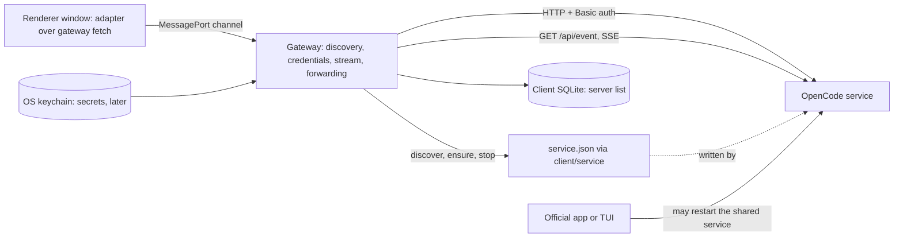
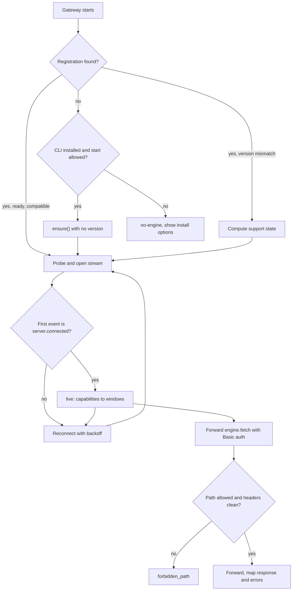
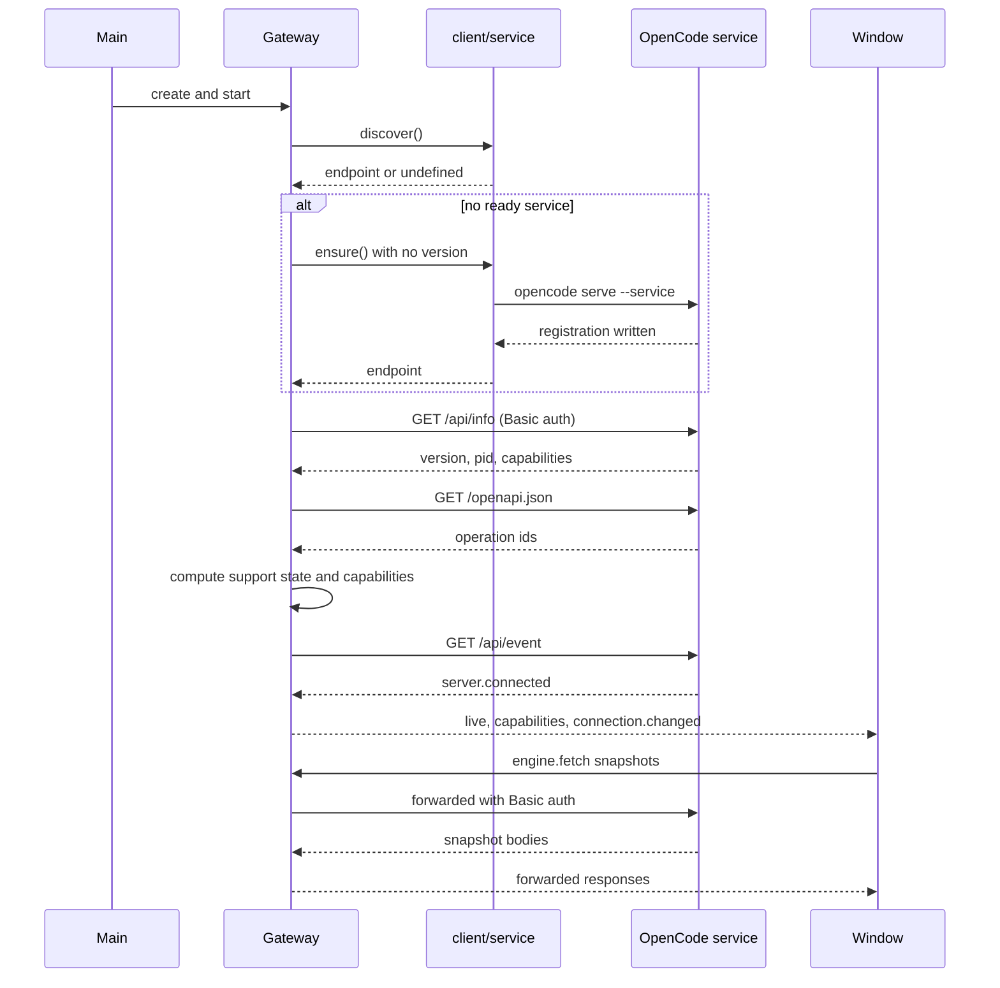
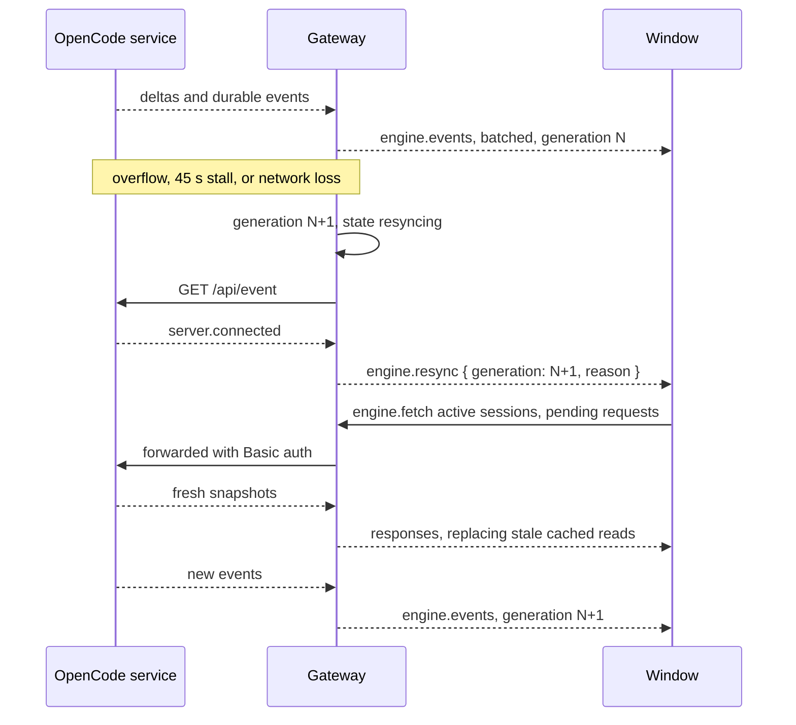
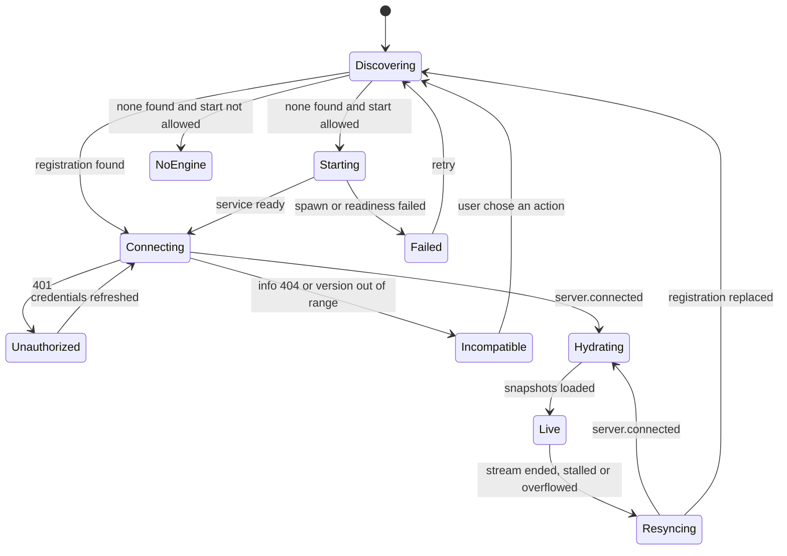
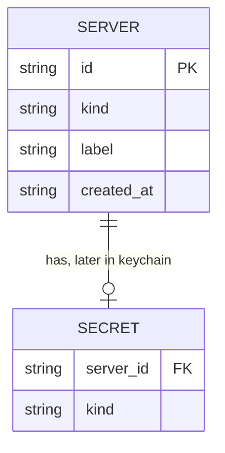

# Engine gateway

> Finds the user's OpenCode service, joins it without ever replacing it, holds the engine credential, keeps one event stream per server, and forwards authenticated requests from the UI, so every other module can talk to the engine without knowing OpenCode or holding a secret.

## 1. Feature Snapshot

| Field                 | Details                                                                                             |
|-----------------------|-----------------------------------------------------------------------------------------------------|
| Document status       | Proposed — awaiting maintainer approval                                                             |
| Implementation status | In progress — T-004 (discovery, probe, capabilities, connection state machine) implemented          |
| Owner                 | Mortise maintainers                                                                                  |
| Primary actors        | User, renderer window, gateway (main process), OpenCode service, other clients (official app, TUI)   |
| Trigger               | Application start; a window opening; a connection state change; a renderer request or subscription   |
| Outcome               | One authenticated connection to one OpenCode server, one shared event stream, forwarded requests     |
| Entry points          | `@mortise/gateway-core` (`src/index.ts`), hosted by `apps/desktop/src/main/gateway-host.ts`          |
| Data stores           | Engine server list in client SQLite; engine password in main memory now, OS keychain later           |
| External systems      | OpenCode v2 engine (`opencode serve --service`), registration file via `@opencode/client/service`    |
| Feature flag          | Not applicable                                                                                       |
| Last verified         | T-004 code read at `1d4669d`; the rest (§11 Planned rows, §24 phases 2–4) has no code yet            |

### At a Glance

The user runs OpenCode independently. Mortise finds the running shared service, checks its version
and capabilities, and joins it. When none is running and the user's CLI is installed, Mortise starts
the shared service with that CLI; it never stops or replaces a running one. The gateway keeps a
single authenticated `/api/event` subscription per server and fans raw events out to every window,
marking each reconnect with a resync. Renderer code sends requests as `engine.fetch` messages; the
gateway adds Basic auth and forwards them, so the password never leaves the main process.

**Sections 1–23 and 30 describe planned behaviour. Section 24 is the phased implementation plan and
maps to tasks T-004, T-005, T-006 and T-009. Phase 1 (T-004: discovery, probe, capabilities and the
connection state machine) is implemented at `1d4669d`; the rows it owns are labeled `Current`. Event
streaming, forwarding and the desktop host have no code yet, so nothing else is `Current`.**

### Status Legend

Every `Status` value in this document is one of these four. They describe how much trust a statement
has earned, independent of the document and implementation statuses above.

- **Current**: implemented, and read in the code at `last_verified_commit`. **Not used in this
  document** — `last_verified_commit` is `null` because no Mortise code exists.
- **Planned**: proposed or approved, but not implemented.
- **Inferred**: consistent with the evidence, but not directly verified against Mortise code.
- **Unknown**: unresolved. Tracked in §28.

A note on the label for engine facts: statements about OpenCode itself were read at OpenCode v2.0.25
and link to `../opencode/engine-contract.md` or to that tag's source. They are labeled `Inferred`
here — verified upstream, but not verified against any Mortise code path, which is the distinction
the axis-3 vocabulary makes.

## 2. Problem and Outcome

### Problem

An AI engine client has three problems the UI cannot solve on its own. The engine listens on HTTP
with Basic auth and refuses browser `Origin` headers it does not know, so a renderer cannot call it
directly. Every window would otherwise open its own SSE subscription, and the engine fails any
subscriber whose 4,096-event queue overflows, so multiple windows would multiply that failure. And
the engine password is a secret that must never reach renderer or extension code.

### Desired Outcome

One host-neutral gateway owns discovery, credentials, one event stream per server, and request
forwarding. It runs inside the Electron main process today and a Node server later. Renderers hold a
typed client over an IPC-backed `fetch` and never see a credential. Two windows share one upstream
stream. Every reconnect is reported as a resync so views rebuild from fresh reads rather than trusting
a lossy stream.

### Success Measures

| Measure                                  | Target                                       | How measured                                            |
|------------------------------------------|----------------------------------------------|---------------------------------------------------------|
| Upstream streams per connected server    | Exactly one, regardless of window count      | Fixture server request count (T-005 AC-6, T-009 AC-2)    |
| Credential occurrences in renderer build | Zero                                          | `rg` over `apps/desktop/out/renderer` and `out/preload` (T-009 AC-3) |
| Connection state after the official app restarts the service | Back to `discovering`, then joined again | Coexistence test (P1, T-013)                             |
| Timeline after a forced overflow vs a fresh load | Identical                              | Resilience test (P2, T-013)                              |

## 3. Scope

### Included

- Discovery of a running shared service through the registration file, only via `@opencode/client/service`.
- Start policy: start the shared service with the user's CLI only when none is registered and the CLI is installed.
- Version and capability detection against a declared supported range.
- The connection state machine and its transitions.
- One authenticated `/api/event` subscription per server, with idle watchdog, backoff, generation counter, batching and resync.
- `engine.fetch` request forwarding with a path allowlist, header rules, Basic auth injection and error mapping.
- Credential handling in the gateway only; secret-free logging.

### Excluded

- Event interpretation, status derivation, timeline projection and caching. These belong to the adapter (`@mortise/engine-opencode`) and the store (§BR-018).
- Isolated-engine mode and remote pairing. Deferred; a short note is in §26.
- Electron wiring and the MessagePort transport, which are a separate task (T-009) even though they complete this feature's Phase 0 goal.
- The engine's own agent loop, sessions, tools, permissions and persistence. The engine owns these.

### Assumptions

| ID      | Assumption                                                                 | Confidence | Validation needed                                                |
|---------|----------------------------------------------------------------------------|------------|-------------------------------------------------------------------|
| ASM-001 | The registration file is the complete discovery contract and is stable.    | High       | Upstream comment in `service.ts`; recheck on the nightly version matrix (T-014) |
| ASM-002 | `GET /api/info` stays the health and version probe.                        | High       | `service-probe.ts`; recheck against v2 HEAD (T-014)               |
| ASM-003 | The user's `opencode` CLI is on `PATH` or in a common install location.    | Medium     | Engine-discovery test with an injected lookup (T-004)            |
| ASM-004 | One shared service per user remains the norm.                              | High       | Overview A2; revisited if per-client engines become standard      |
| ASM-005 | The event stream never replays, so resync is the only correctness anchor.  | High       | `event-feed.ts`, `handlers/event.ts`; resilience test (T-013)     |

## 4. Terminology

| Term                | Meaning                                                                                          |
|---------------------|--------------------------------------------------------------------------------------------------|
| Engine              | The OpenCode v2 process (`opencode serve`), run by the user, reached over HTTP and SSE.          |
| Shared service      | The one background engine per user, registered in `service.json` and started with `serve --service`. |
| Registration file   | `$XDG_STATE_HOME/opencode/service.json` (fallback `~/.local/state/opencode/service.json`), the discovery contract. |
| Gateway             | This feature: the host-neutral engine gateway in `@mortise/gateway-core`.                        |
| Channel             | The transport-neutral typed connection between UI and gateway, defined by `@mortise/rpc-contracts`. |
| Generation          | A counter incremented on each successful stream connect; every event batch is tagged with it.    |
| Resync              | A `engine.resync` message telling views the stream was interrupted and their cached reads are stale. |
| Support state       | One of `supported`, `untested`, `unsupported`, computed from the engine version and the declared range. |
| Capability          | A boolean or set derived from `/api/info` and `/openapi.json`, describing what the engine offers. |

## 5. Actors and Permissions

| Actor             | Allowed actions                                             | Restrictions                                                     | Enforcement point                       |
|-------------------|-------------------------------------------------------------|------------------------------------------------------------------|-----------------------------------------|
| User              | Start the app, open windows, connect, consent to a restart  | Cannot force a replace without consent                           | Gateway start policy (§BR-003, §BR-004) |
| Renderer window   | Call `servers.list`, `connection.get`, `engine.fetch`; subscribe to events | Never receives the password, pairing token, or `set-cookie` | Channel method schemas (§12); T-006 forwarding |
| Gateway           | Read credentials, hold the stream, forward requests         | No domain logic, no Electron imports, no event interpretation    | `@mortise/gateway-core` dependency rules |
| OpenCode engine   | Serve HTTP and SSE, ask permissions                         | The gateway never writes its database or config                  | C1, C2 (§17)                            |
| Other clients     | Restart or replace the shared service on their own          | Mortise detects the change and returns to discovery              | §BR-010                                 |

## 6. User Journey

This is a system journey: the user's observable experience is a connection indicator and a working
window, not a sequence of screens.

### Primary Journey

1. The app starts; main shows a window skeleton and begins discovery in parallel.
2. Discovery reads the registration file through `@opencode/client/service`.
3. A ready, compatible registration is adopted; otherwise start policy decides whether to start one.
4. The gateway probes `GET /api/info`, computes the support state and capabilities.
5. The gateway opens one authenticated `GET /api/event`; the first event is `server.connected`.
6. The gateway reports `live` with capabilities; each window hydrates its visible state from fresh reads.
7. Renderer requests arrive as `engine.fetch`; the gateway adds Basic auth and forwards them.
8. On a stall, overflow or network loss, the gateway reconnects, bumps the generation, and emits `engine.resync` before new events.

### Alternate Journeys

| Journey                       | Trigger                                              | Expected outcome                                                        |
|-------------------------------|------------------------------------------------------|-------------------------------------------------------------------------|
| No engine, CLI installed      | No registration; `opencode` on `PATH`                | The gateway calls `ensure()` with no version; the user's CLI starts the service |
| No engine, no CLI             | No registration; CLI not found                        | `no-engine`; the client shows install options and rechecks on focus      |
| Running below the floor       | Registration version `< 2.0.20`                      | Not replaced; `incompatible`; read-only browsing where safe; update guidance |
| Newer patch, same minor       | Version `> highest tested`, `< 2.1.0`                | Join; report `untested`; keep missing capabilities off                   |
| Registration replaced         | Another client restarts the service                  | Back to `discovering`; recheck version; join again                       |
| Password rotated              | A forwarded request or the stream returns `401`      | Re-read the registration; recover if the password changed                |

## 7. System Context

The gateway sits between the renderer and the engine. Renderers never reach the engine directly; the
adapter never holds credentials. Other clients are peers, not subordinates.



The gateway is the only component in main that touches engine credentials. The adapter and the
workbench receive domain types and raw events, never wire credentials.

## 8. Control Flow

The gateway owns discovery, the start decision, and the connection lifecycle. Windows own hydration.
Forwarding decides path allowance.



| Step                    | Status  | Controlling component        | Decision                                        | Failure behavior                                      |
|-------------------------|---------|------------------------------|-------------------------------------------------|-------------------------------------------------------|
| Discovery               | Planned | `discovery.ts`               | Whether a ready registration exists             | No registration falls through to start policy         |
| Start policy            | Planned | `discovery.ts` + `connection.ts` | Start only if allowed and CLI installed     | `no-engine`; no spawn                                 |
| Support computation     | Planned | `probe.ts` + `capabilities.ts` | Range check and capability set                | `incompatible` or `untested`; never a silent downgrade |
| Stream admission        | Planned | `events.ts`                  | First event must be `server.connected`          | Reconnect and log an error                            |
| Forwarding authorization| Planned | `forward.ts`                 | Path allowlist and header rules                 | `forbidden_path`                                      |
| Auth injection          | Planned | `forward.ts`                 | Add Basic auth, strip `set-cookie`              | Map to `engine_unreachable` or `timeout`              |

## 9. Data Flow

### Startup

The gateway discovers, probes, opens the stream, then hands control to the windows for hydration.



### Resync

After any stream interruption the gateway reconnects, bumps the generation, and emits a resync
before forwarding new events. Windows refetch; they never replay deltas.



### Data Transformations

| Stage     | Status  | Input                          | Transformation                                             | Output                          |
|-----------|---------|--------------------------------|------------------------------------------------------------|---------------------------------|
| Discovery | Planned | Registration file              | Read through `client/service`; classify state and version  | Endpoint plus service descriptor |
| Probe     | Planned | `GET /api/info`, `/openapi.json` | Range compare, capability derivation, cache per version  | `EngineInfo` with support state |
| Stream    | Planned | SSE frames                    | Frame parse, JSON parse for `type`, batch by interval      | `engine.events` batches         |
| Forward   | Planned | `engine.fetch` message         | Validate, inject Basic auth, classify body, strip headers  | Forwarded response or channel error |

### Sensitive Data

| Data                | Classification | Storage                                        | Logging rule                              | Retention            |
|---------------------|----------------|------------------------------------------------|-------------------------------------------|----------------------|
| Engine password     | Restricted     | Main memory now; OS keychain later             | Prohibited — never logged                 | Service lifetime     |
| Pairing token       | Restricted     | Keychain (later)                               | Prohibited                                | Revoked on rotation  |
| `Authorization` header | Restricted  | Never stored                                   | Prohibited                                | Not stored           |
| Registration file   | Confidential   | Read-only through `client/service`             | Never logged verbatim                     | Not stored           |
| Request/response bodies | Confidential | In transit only                             | Content prohibited; size and status allowed | Not stored         |
| Server list         | Internal       | Client SQLite                                  | Allowed without secrets                   | Until removed        |

## 10. State Model

The connection state machine is the gateway's public state, exposed as `ConnectionState` over
`connection.get` and `connection.changed`. Every transition below matches
[overview 6.6](../architecture/overview.md).



| State        | Meaning                                             | Allowed transitions             | Side effects                                          |
|--------------|-----------------------------------------------------|---------------------------------|-------------------------------------------------------|
| `discovering`| Reading the registration and checking the CLI       | `connecting`, `starting`, `no-engine` | None                                             |
| `starting`   | `ensure()` is spawning the user's CLI               | `connecting`, `failed`          | Emits a start notice with the reason                  |
| `no-engine`  | No service and start not allowed                    | `discovering` (on focus, Retry or the 30 s timer) | Shows install guidance; never spawns                  |
| `connecting` | Probing `/api/info` and opening the stream          | `unauthorized`, `incompatible`, `hydrating` | None                                      |
| `unauthorized`| `401`; the password may have rotated               | `connecting` (credentials refreshed) | Re-reads the registration                        |
| `incompatible`| `/api/info` 404 or version outside the range        | `discovering` (user action)     | Shown with clear actions; may keep read-only browsing |
| `failed`     | Spawn or readiness failed                           | `discovering` (retry)           | Logs the failure without secrets                      |
| `hydrating`  | `server.connected` received; views refetch          | `live`                          | Emits `engine.resync` for the new generation          |
| `live`       | Stream connected and snapshots loaded               | `resyncing`                     | Batched `engine.events` fan out                       |
| `resyncing`  | Stream ended, stalled or overflowed                 | `hydrating`, `discovering`      | Marks cached reads stale; backoff reconnect           |

The gateway never emits `hydrating`: per Q-001 in §28, the gateway goes `connecting → live` once
`/api/info` succeeds and the event stream delivers `server.connected`, and `resyncing → live` after a
reconnect. `hydrating` is a per-window phase the workbench composition root (T-012) shows from the
moment it sees `live` or `engine.resync` until its snapshots load. `connection.ts` implements every
other transition at `1d4669d`; the event stream (T-005) reports in through `onStreamConnected` and
`onStreamLost`.

## 11. Implementation Map

### Existing Artifacts

Everything below was read at `1d4669d`, the T-004 implementation commit.

| Layer        | Responsibility                              | Repository path                             | Main symbol                                                        | Verified  |
|--------------|---------------------------------------------|---------------------------------------------|--------------------------------------------------------------------|-----------|
| Domain       | Client-owned model the gateway consumes     | `packages/domain/src/`                      | `ServerRef`, `ConnectionState`, `EngineInfo`, `EngineCapabilities` | `1d4669d` |
| Contracts    | Channel methods and events                  | `packages/rpc-contracts/src/`               | `methods`, `events`, `connectionStateSchema`                       | `1d4669d` |
| Discovery    | Wrap `discover`/`ensure`; start policy      | `packages/gateway-core/src/discovery.ts`    | `createDiscovery`, `openCodeServiceClient`, `defaultFindCli`       | `1d4669d` |
| Probe        | `/api/info` probe and support state         | `packages/gateway-core/src/probe.ts`        | `probeInfo`, `supportState`                                        | `1d4669d` |
| Capabilities | Capability derivation, cached per version   | `packages/gateway-core/src/capabilities.ts` | `deriveCapabilities`, `createCapabilityCache`                      | `1d4669d` |
| Connection   | Connection state machine                    | `packages/gateway-core/src/connection.ts`   | `createConnection`, `systemClock`                                  | `1d4669d` |
| Gateway      | Composition: servers, connection, internals | `packages/gateway-core/src/gateway.ts`      | `createGateway`                                                    | `1d4669d` |
| Logging      | Secret-free logger with the prohibited rule | `packages/gateway-core/src/logging.ts`      | `createLogger`, `redactFields`                                     | `1d4669d` |
| Entry        | Public entry; JSDoc'd exports               | `packages/gateway-core/src/index.ts`        | —                                                                  | `1d4669d` |

### Planned Artifacts

| Layer     | Responsibility                              | Planned path                                    | Main symbol              | Change type | Task  |
|-----------|---------------------------------------------|-------------------------------------------------|--------------------------|-------------|-------|
| Gateway   | SSE parse, watchdog, backoff, batching, fan-out | `packages/gateway-core/src/events.ts`        | `createEventStream`      | Create      | T-005 |
| Gateway   | `engine.fetch` forwarding with auth          | `packages/gateway-core/src/forward.ts`          | `createForwardHandler`   | Create      | T-006 |
| Host      | Create the gateway once; wire per-window MessagePort channels | `apps/desktop/src/main/gateway-host.ts` | `createGatewayHost`      | Create      | T-009 |
| Host      | `Transport` over `MessagePortMain`           | `apps/desktop/src/main/transport.ts`            | `mainTransport`          | Create      | T-009 |
| Renderer  | `Transport` over the DOM `MessagePort`       | `apps/desktop/src/renderer/transport.ts`        | `rendererTransport`      | Create      | T-009 |
| Preload   | Forward the port to the main world           | `apps/desktop/src/preload/index.ts`             | —                        | Change      | T-009 |

### Generated or Restricted Areas

| Path or area                                            | Classification | Rule                                                        |
|--------------------------------------------------------|----------------|-------------------------------------------------------------|
| `$XDG_STATE_HOME/opencode/service.json`                | Restricted     | Read only through `@opencode/client/service`; never edit it |
| `~/.local/state/opencode/`, `~/.config/opencode/`      | Restricted     | Never read or written (ADR-0002, C2)                        |
| `@opencode/*` imports                                  | Restricted     | Only `gateway-core` (`client/service`, types) and `engine-opencode` (`client`) |
| `.dependency-cruiser.cjs`                              | Restricted     | Do not weaken; changes need maintainer review                |
| Engine database and data directory                     | Restricted     | No import path may reach them (C2)                          |
| `apps/desktop/src/preload/`                            | Restricted     | Sandboxed CommonJS; security-sensitive                        |

## 12. Contracts

### Channel Envelope

All messages are defined in `@mortise/rpc-contracts` (T-002). Both ends validate every inbound
message. Every row in this section is labeled **Planned**.

```json
{ "v": 1, "id": "msg_1", "type": "request", "name": "engine.fetch", "payload": {} }
```

`type` is `request`, `response` or `event`. Errors carry `{ "code": "...", "message": "..." }` with
one of `invalid_message`, `invalid_input`, `invalid_output`, `method_not_found`, `timeout`,
`aborted`, `internal`, plus the forwarding codes in §16.

### Requests (UI → Gateway)

| Method           | Input                                                                 | Output                | Status  |
|------------------|-----------------------------------------------------------------------|-----------------------|---------|
| `servers.list`   | none                                                                  | `ServerRef[]`         | Planned |
| `connection.get` | `{ serverId }`                                                        | `ConnectionState`     | Planned |
| `engine.fetch`   | `{ serverId, method, path, query?, headers?, body }`                  | `{ status, headers, body }` | Planned |

`engine.fetch` constraints (from T-002): `method` is one of `GET`, `POST`, `PUT`, `PATCH`, `DELETE`;
`path` starts with `/api/` or equals `/openapi.json` and contains no `..`; `headers` must not contain
`authorization`, `cookie` or `proxy-authorization` (case-insensitive); `body` is
`null | { kind: "text", text } | { kind: "base64", data }`.

### Events (Gateway → UI)

| Event                | Payload                                        | Status  | Emitted when                                     |
|----------------------|------------------------------------------------|---------|--------------------------------------------------|
| `connection.changed` | `{ serverId, state }`                          | Planned | Any connection state transition                  |
| `engine.events`      | `{ serverId, generation, events: unknown[] }`  | Planned | Each batching interval while `live`              |
| `engine.resync`      | `{ serverId, generation, reason }`             | Planned | Before forwarding any event of a new generation   |

Raw wire events are `unknown[]`; the adapter validates them. The gateway never interprets payloads
beyond JSON parsing and reading `type` (§BR-016).

### Engine HTTP Used

| Call                    | Purpose                                  | Status  | Source                                                        |
|-------------------------|------------------------------------------|---------|---------------------------------------------------------------|
| Registration `service.json` | Discovery                            | Inferred | [service.ts](https://github.com/anomalyco/opencode/blob/v2.0.25/packages/client/src/promise/service.ts) |
| `GET /api/info`         | Version, pid, capabilities, health        | Inferred | [service-probe.ts](https://github.com/anomalyco/opencode/blob/v2.0.25/packages/client/src/service-probe.ts) |
| `GET /openapi.json`     | Operation ids for capability derivation   | Inferred | `../opencode/engine-contract.md` §13.2                        |
| `GET /api/event`        | SSE stream                                | Inferred | [handlers/event.ts](https://github.com/anomalyco/opencode/blob/v2.0.25/packages/server/src/handlers/event.ts) |
| `POST /api/pair` etc.   | Pairing and remote access (deferred)      | Unknown | `../opencode/engine-contract.md` §13.6                        |

## 13. Data Model and Storage

The gateway holds no engine-owned truth. Its only persistent data is the server list and connection
preferences in client SQLite; secrets move to the OS keychain in a later phase.



| Store            | Status  | Purpose                              | Important fields                       |
|------------------|---------|--------------------------------------|----------------------------------------|
| Client SQLite    | Planned | Server list and connection preferences | `id`, `kind`, `label`                 |
| OS keychain      | Planned | Engine password and pairing tokens     | Deferred; `safeStorage` as the interim |

In Phase 0 the gateway models exactly one shared server; the table exists so the shape is stable when
remote servers arrive. Engine sessions, messages and configuration are engine-owned and are never
stored by the gateway (C2, §6.5 of the overview).

## 14. Business Rules

Rules BR-001..BR-010 and BR-018 are implemented and tested at `1d4669d` (T-004). Every other rule
below is **Untested**; the task that will add its test is named. Rule IDs are stable and are cited
by test names.

| Rule ID | Status  | Rule                                                                                             | Enforcement point        | Test reference                          |
|---------|---------|--------------------------------------------------------------------------------------------------|--------------------------|-----------------------------------------|
| BR-001  | Current | Join a ready, compatible registration; never call `ensure()` while a registration exists         | `discovery.ts`           | `discovery.test.ts` (BR-001) |
| BR-002  | Current | `ensure()` is never called with a `version` option; the user's CLI starts the service            | `discovery.ts`           | `discovery.test.ts` (BR-002) |
| BR-003  | Current | Never stop, replace or reconfigure a running shared service except with explicit user consent    | `connection.ts`          | `connection.test.ts` (BR-003) |
| BR-004  | Current | Start only when no ready registration exists and the user's `opencode` CLI is found              | `discovery.ts`           | `discovery.test.ts` (BR-004) |
| BR-005  | Current | No service and no CLI yields `no-engine`; show install options and recheck on window focus, on Retry and every 30 s | `connection.ts`          | `connection.test.ts` (BR-005, CASE-010) |
| BR-006  | Current | Support is `supported` for `2.0.20`..highest tested, `untested` for newer `2.0.x`, `unsupported` below `2.0.20` or at/after `2.1.0` | `probe.ts` | `probe.test.ts` (BR-006) |
| BR-007  | Current | A running service below the floor is not replaced; Phase 0 shows the installed and required versions with no restart offer | `connection.ts` | `connection.test.ts` (BR-007, CASE-008/009) |
| BR-008  | Current | A 404 on `GET /api/info` is `incompatible` protocol, not an older version                        | `probe.ts`               | `probe.test.ts` (BR-008) |
| BR-009  | Current | Capabilities derive from `/api/info` and `/openapi.json` operation ids, cached per version       | `capabilities.ts`        | `capabilities.test.ts` (BR-009) |
| BR-010  | Current | A replaced registration returns the machine to `discovering` and rechecks the version            | `connection.ts`          | `connection.test.ts` (BR-010, CASE-006) |
| BR-011  | Planned | Exactly one `/api/event` subscription per connected server, shared by all subscribers            | `events.ts`              | Untested; planned in T-005 (`packages/gateway-core/src/events.test.ts`) |
| BR-012  | Planned | The first stream event must be `server.connected`; anything else is an error that reconnects     | `events.ts`              | Untested; planned in T-005 (`events.test.ts`) |
| BR-013  | Planned | Abort and reconnect after 45 s with no bytes; heartbeat comments reset the deadline              | `events.ts`              | Untested; planned in T-005 (`events.test.ts`) |
| BR-014  | Planned | Reconnect uses capped backoff; a new successful connect resets it                                | `events.ts`              | Untested; planned in T-005 (`events.test.ts`) |
| BR-015  | Planned | Each successful connect increments `generation`; `engine.resync` precedes any event of that generation | `events.ts`         | Untested; planned in T-005 (`events.test.ts`) |
| BR-016  | Planned | Forward events in batches on a configurable interval; never interpret payloads beyond JSON parse and `type` | `events.ts`    | Untested; planned in T-005 (`events.test.ts`) |
| BR-017  | Planned | A malformed event is logged without payload contents and skipped; it never kills the stream       | `events.ts`              | Untested; planned in T-005 (`events.test.ts`) |
| BR-018  | Current | The gateway holds no domain state and derives no status; every view is rebuildable from fresh reads | `gateway.ts`           | `gateway.test.ts` (BR-018) |
| BR-019  | Planned | `engine.fetch` allows only `/api/*` and `/openapi.json`; rejects `..`, absolute URLs and `/auth/*` | `forward.ts`            | Untested; planned in T-006 (`packages/gateway-core/src/forward.test.ts`) |
| BR-020  | Planned | Reject client-supplied `authorization`, `cookie` and `proxy-authorization` headers, case-insensitive | `forward.ts`         | Untested; planned in T-006 (`forward.test.ts`) |
| BR-021  | Planned | Inject `Authorization: Basic` with username `opencode` and the current password                   | `forward.ts`            | Untested; planned in T-006 (`forward.test.ts`) |
| BR-022  | Planned | Response bodies are text for `text/*` and `application/json`, base64 otherwise                    | `forward.ts`            | Untested; planned in T-006 (`forward.test.ts`) |
| BR-023  | Planned | Strip `set-cookie` from forwarded responses                                                       | `forward.ts`            | Untested; planned in T-006 (`forward.test.ts`) |
| BR-024  | Planned | Forwarding failures map to `engine_unreachable`, `timeout` and `forbidden_path`                   | `forward.ts`            | Untested; planned in T-006 (`forward.test.ts`) |
| BR-025  | Planned | A `401` on a forwarded request notifies the connection machine to re-read credentials             | `forward.ts` + `connection.ts` | Untested; planned in T-006 (`forward.test.ts`) |
| BR-026  | Planned | Non-idempotent requests are never retried automatically                                           | `forward.ts`            | Untested; planned in T-006 (`forward.test.ts`) |

## 15. Acceptance Criteria and Cases

AC-001..AC-004 are implemented and tested at `1d4669d` (T-004). Every other criterion is
**Untested**; the task that will add its test is named.

### AC-001: Join an existing service — Status: **Current**

**Given** a ready, compatible registration
**When** the gateway starts
**Then** discovery adopts it and `ensure()` is never called
**And** the state reaches `connecting` without spawning a process

Test: `discovery.test.ts` (BR-001) and `connection.test.ts` (BR-001, BR-003): the fake service client
records that `ensure()` is never called on the `found` path, and the machine emits
`discovering → connecting`.

### AC-002: Version and capability detection — Status: **Current**

**Given** `GET /api/info` answers with a version and capabilities
**When** the probe runs
**Then** `2.0.19` is `unsupported`, `2.0.20`..highest tested is `supported`, a newer `2.0.x` is `untested`, and `2.1.0` is `unsupported`
**And** capabilities are cached per version

Test: `probe.test.ts` (BR-006, BR-008) and `capabilities.test.ts` (BR-009). Capabilities are derived
from the recorded 2.0.20 and 2.0.26 fixtures, and the cache issues one `/openapi.json` read per
version.

### AC-003: Start policy — Status: **Current**

**Given** no registration and an installed `opencode` CLI
**When** the gateway decides to start
**Then** it calls `ensure()` with no `version` option and the user's CLI command
**And** when no CLI is found it enters `no-engine` and spawns nothing

Test: `discovery.test.ts` (BR-002, BR-004) and `connection.test.ts` (BR-005, CASE-010). The captured
`ensure()` options carry `command: ["opencode", "serve", "--service"]` and no `version` key.

### AC-004: Unauthorized recovery — Status: **Current**

**Given** a probe or forwarded request returns `401`
**When** the password has rotated and the registration was rewritten
**Then** the state moves to `unauthorized`, the registration is re-read, and the state recovers

Test: `connection.test.ts` (BR-010, CASE-007). The forwarding half (`forward.test.ts`) is T-006.

### AC-005: Resync on reconnect — Status: **Planned**

**Given** a live stream
**When** it stalls for 45 s, overflows, or the connection drops
**Then** the gateway reconnects, increments `generation`, and emits `engine.resync` before any event of the new generation

Test: Untested; planned in T-005 (`packages/gateway-core/src/events.test.ts`).

### AC-006: Ordered batched delivery — Status: **Planned**

**Given** a healthy stream
**When** events arrive
**Then** they are delivered in order as `engine.events` batches on the configured interval, and malformed events are skipped with a secret-free log

Test: Untested; planned in T-005 (`events.test.ts`).

### AC-007: One upstream stream for many subscribers — Status: **Planned**

**Given** two or more subscribers
**When** they subscribe to the same server
**Then** the fixture server sees exactly one upstream `GET /api/event`
**And** stopping the gateway closes the upstream and clears timers

Test: Untested; planned in T-005 (`events.test.ts`) and T-009 (`gateway-host.test.ts`).

### AC-008: Authenticated forwarding — Status: **Planned**

**Given** an `engine.fetch` request with an allowed path
**When** the gateway forwards it
**Then** the request carries correct Basic auth, the response round-trips, binary bodies arrive as base64, and `set-cookie` is absent

Test: Untested; planned in T-006 (`packages/gateway-core/src/forward.test.ts`).

### AC-009: Forwarding boundaries — Status: **Planned**

**Given** an `engine.fetch` request
**When** the path is outside the allowlist or a forbidden header is supplied
**Then** the request is rejected with `forbidden_path` (or the input is rejected) and never forwarded

Test: Untested; planned in T-006 (`forward.test.ts`).

### AC-010: Desktop host and two windows — Status: **Planned**

**Given** the app is ready with two windows
**When** both connect
**Then** they share one gateway and one event subscription per server, and each has a private channel

Test: Untested; planned in T-009 (`apps/desktop/src/main/gateway-host.test.ts`).

### AC-011: No credential in the renderer — Status: **Planned**

**Given** a production build
**When** the renderer and preload bundles are searched
**Then** no credential-handling code is present, and window security flags are unchanged

Test: Untested; planned in T-009 (build assertion over `apps/desktop/out/`).

### Edge Cases

| Case ID  | Scenario                                            | Expected behaviour                                              | Test type            |
|----------|-----------------------------------------------------|-----------------------------------------------------------------|----------------------|
| CASE-001 | Stream silent for 45 s, then a heartbeat            | Watchdog stays satisfied; no reconnect                           | Unit (fake timers)   |
| CASE-002 | Stream silent for 45 s with no heartbeat            | Abort and reconnect; generation increments                       | Unit (fake timers)   |
| CASE-003 | First event is not `server.connected`               | Reconnect and log an error without payload contents              | Unit                 |
| CASE-004 | Event queue overflow closes the stream              | Reconnect with resync                                            | Unit                 |
| CASE-005 | Malformed JSON in one event                         | Skip and log; stream continues                                   | Unit                 |
| CASE-006 | Registration replaced while live                    | Move to `discovering`, recheck, rejoin                           | Integration (T-013)  |
| CASE-007 | Password rotated; next request returns `401`        | Re-read registration; recover if the password changed            | Unit                 |
| CASE-008 | Version `2.0.19` running                            | `incompatible`; not replaced; update guidance offered            | Unit                 |
| CASE-009 | Version `2.1.0` running                             | `unsupported`; not joined as supported; clear actions            | Unit                 |
| CASE-010 | No CLI installed                                    | `no-engine`; no spawn; install options shown                     | Unit                 |
| CASE-011 | Path `/auth/connect/x` or `../api`                  | Rejected with `forbidden_path`; never forwarded                  | Unit                 |
| CASE-012 | Binary response body                                | Base64 round-trips to the original bytes                         | Unit                 |
| CASE-013 | Two windows close while stream is live              | Upstream stays open while one subscriber remains; closes with none | Unit              |
| CASE-014 | Reconnect storm after repeated instant failures     | Backoff sequence respected; no tight loop                        | Unit (fake timers)   |

## 16. Error and Recovery Behavior

| Failure                          | Surface behavior                        | Gateway behavior                                       | Recovery                                    |
|----------------------------------|-----------------------------------------|--------------------------------------------------------|---------------------------------------------|
| Stream stalled or overflowed     | Views marked stale; resync shown         | Reconnect with backoff; new generation; `engine.resync` | Automatic; views refetch                     |
| Network loss                     | Connection indicator changes             | Reconnect with backoff                                 | Automatic                                    |
| `401` on the stream or a forward  | Authentication prompt where needed       | Re-read registration; move to `unauthorized`           | Recover when credentials refresh             |
| `/api/info` 404                  | Incompatible state with actions          | No replace; surface the error                          | User updates the engine or restarts it       |
| Version out of range             | Incompatible state with actions          | No replace; may keep read-only browsing where safe     | Consented restart or engine update           |
| Spawn or readiness failure        | `failed` with retry                      | Log without secrets; no tight loop                     | Retry returns to `discovering`               |
| Engine unreachable on forward     | `engine_unreachable` channel error       | Fail the call; never retry non-idempotent calls        | Adapter/user decides                         |
| Forward timeout                   | `timeout` channel error                  | Fail the call                                          | Caller retries only if idempotent            |
| Malformed event                   | No user-visible change                   | Skip; log type only                                    | None needed                                  |

The gateway fails closed on forwarding: an invalid path or header is rejected before any network call
(§BR-019, §BR-020). It also fails closed on secrets: a log line that would contain a credential is
never emitted (§17).

## 17. Security and Privacy

| ID      | Requirement                                                                 | Enforcement                                  | Validation                                          |
|---------|------------------------------------------------------------------------------|----------------------------------------------|-----------------------------------------------------|
| SEC-001 | The engine password and pairing tokens never cross the channel               | Gateway holds them; channel schemas cannot carry them | Current: `gateway.test.ts` (AC-5) asserts every public value is password-free while `internal.endpoint()` still carries it |
| SEC-002 | No password, auth header, pairing token or body content appears in logs      | Secret-free logger with a prohibited-field rule | Current: `connection.test.ts` (SEC-002) with a capturing logger; the forwarding half is T-006 |
| SEC-003 | The gateway re-validates the path allowlist and header rules                 | `forward.ts`, defense in depth               | Untested; planned in T-006 (`forward.test.ts`)      |
| SEC-004 | `set-cookie` is stripped from forwarded responses                            | `forward.ts`                                 | Untested; planned in T-006 (`forward.test.ts`)      |
| SEC-005 | Renderer and preload bundles contain no credential handling                  | Bundle assertion                             | Untested; planned in T-009 (`rg` over `apps/desktop/out/`) |
| SEC-006 | The gateway never touches the engine database, data directory or CLI-private files | Only `@opencode/client/service` reads the registration file | Current: `bun run check:deps` passes; the registration is read only through `@opencode/client/service` in `discovery.ts` |

Extensions are out of scope for this feature, but the design keeps ADR-0011 true: nothing in the
channel exposes credentials or lets a caller answer permission requests. The gateway forwards
permission replies like any other request; it never decides them.

## 19. Observability

Only logs are defined here. No metric names or latency targets are invented; monitoring needs are
Unknown (§28, Q-002).

### Logs

| Event                          | Level | Required fields                       | Prohibited fields                                  |
|--------------------------------|-------|---------------------------------------|----------------------------------------------------|
| Connection state change        | Info  | `serverId`, from-state, to-state      | Password, pairing token, registration contents     |
| Start decision                 | Info  | reason (`missing`/`version-mismatch`) | Credentials                                        |
| Stream connected / disconnected| Info  | `attempt`, error message (no secrets) | Payload contents                                   |
| Resync                         | Info  | `serverId`, `generation`, reason      | Payload contents                                   |
| Malformed event                | Warn  | event `type` when available           | Payload contents                                   |
| Forwarding failure             | Warn  | path, status or code                  | `Authorization`, body content, `set-cookie`        |

The logger takes a prohibited-field rule so SEC-002 is testable with a capturing logger rather than
by inspection.

T-004 implements the connection-state-change and start-decision lines, plus `registration replaced`
and the probe/start failure lines. `logging.ts` redacts prohibited fields at every depth before a
sink sees them. The stream, resync, malformed-event and forwarding lines arrive with T-005 and T-006.

## 20. Testing Strategy

Tests run with Vitest, next to the code. Unit tests use injected `fetch`, clock, discovery and
logger — no network, no display, no real engine. Integration tests that need an isolated engine are
named `*.integration.test.ts` and are wrapped in `describe.skipIf(!process.env.MORTISE_INTEGRATION)`.

| Test type   | Coverage                                              | Planned path                                        |
|-------------|-------------------------------------------------------|-----------------------------------------------------|
| Unit        | Discovery, start policy, probe, capabilities, state machine, stream, forwarding | `packages/gateway-core/src/*.test.ts` |
| Unit        | Desktop host and both transports                      | `apps/desktop/src/main/*.test.ts`, `apps/desktop/src/renderer/*.test.ts` |
| Integration | Coexistence and resync against an isolated engine     | `packages/gateway-core/src/*.integration.test.ts` (T-013) |

SSE fixtures use a local Node `http` server, so the stream tests need no engine.

### Validation Commands

```bash
bun run check
bun run test
bun run typecheck
bun run check:deps
```

## 21. Performance and Reliability

Only targets that come from a real source are listed. No latency target is invented.

| ID      | Requirement                            | Target                                            | Source / validation                                  |
|---------|----------------------------------------|---------------------------------------------------|------------------------------------------------------|
| OPS-001 | Idle stream detection                  | Abort after 45 s with no bytes; heartbeats reset   | Upstream `defaultIdleTimeout`; T-005 AC-2 (fake timers) |
| OPS-002 | Reconnect backoff                      | 1, 2, 5, 10 s, capped; reset on a good connect     | T-005; CASE-014                                       |
| OPS-003 | Event batching window                  | Default 16 ms, configurable                        | T-005; confirm against upstream 10 ms (Q-004)         |
| OPS-004 | Channel request timeout                | 30 s default                                       | T-002                                                 |
| OPS-005 | Connect timeout for the stream         | 2 s                                                | Upstream `connectTimeout`                             |
| OPS-006 | Upstream streams per connected server  | 1, independent of window count                     | T-005 AC-6, T-009 AC-2                                |

Event volume and payload limits are Unknown; the batching window bounds renderer wakeups, and the
engine bounds the stream at 4,096 queued events per subscriber. Timeouts and retries for forwarded
requests follow §16; non-idempotent calls are never retried.

## 22. Configuration and Feature Flags

There is no feature-flag rollout; the gateway is always on. These are internal constants with the
values fixed by this document so implementing tasks do not choose them.

| Setting                     | Status  | Default                     | Purpose                                      | Restart? |
|-----------------------------|---------|-----------------------------|----------------------------------------------|----------|
| `SUPPORTED_RANGE`           | Planned | `>=2.0.20 <2.1.0`           | Declared engine support range                | No       |
| `HIGHEST_TESTED_VERSION`    | Planned | `2.0.26`                    | Boundary between `supported` and `untested`  | No       |
| `STREAM_IDLE_TIMEOUT_MS`    | Planned | `45000`                     | Watchdog for a silent stream                 | No       |
| `EVENT_BATCH_INTERVAL_MS`   | Planned | `16`                        | Fan-out batching window                      | No       |
| `RECONNECT_BACKOFF_MS`      | Planned | `[1000, 2000, 5000, 10000]` | Reconnect backoff, capped                    | No       |
| `CHANNEL_TIMEOUT_MS`        | Planned | `30000`                     | Default channel request timeout (T-002)      | No       |
| `START_ALLOWED`             | Planned | `true`                      | Whether start policy may spawn the user CLI  | No       |

## 23. Dependencies and Impact Analysis

| Dependency or consumer       | Relationship | Change impact                                                    | Compatibility action                                 |
|------------------------------|--------------|------------------------------------------------------------------|------------------------------------------------------|
| `@opencode/client/service`   | Upstream     | Discovery, ensure, stop and probe behaviour                       | Wrapped behind an injectable interface; version matrix (T-014) |
| `@opencode/client` (types)   | Upstream     | Server info types                                                 | Types only; never re-exported to features             |
| `@mortise/domain`            | Upstream     | `ServerRef`, `ConnectionState`, `EngineInfo`, `EngineCapabilities` | Provided by T-001; the gateway consumes it            |
| `@mortise/rpc-contracts`     | Upstream     | Channel methods and events                                        | Provided by T-002; the gateway registers handlers     |
| `@mortise/engine-opencode`   | Peer         | Uses the gateway's `engine.fetch`; never imported by the gateway  | No direct import; the channel is the boundary         |
| `@mortise/workbench`         | Downstream   | Consumes connection state and events                              | Debug string view in T-009; full UI in T-012          |
| OpenCode engine versions     | External     | A new minor may add capabilities or move the floor                | Declared range plus `untested` state; capability flags |

The gateway is the second of the two packages allowed to import OpenCode (ADR-0004). It must stay
host-neutral: no Electron, React or DOM imports (C11). This is why the Electron wiring is a separate
task and a separate file (`gateway-host.ts`).

## 24. Implementation Plan

Phases 2–4 describe future work. Phase 1 is implemented at `1d4669d`.

### Phase 1: Discovery and the connection state machine (T-004) — Status: **Current**

**Objective:** Find the user's service, decide whether to start one, compute the support state, and expose the connection state machine. Covers P1.

**Actual changes:** `packages/gateway-core/src/discovery.ts`, `probe.ts`, `capabilities.ts`, `connection.ts`, `gateway.ts`, `logging.ts`, and JSDoc'd exports in `index.ts`. `logging.ts` was not in the original plan; the prohibited-field logger needed a home.

**Behavior introduced:** BR-001..BR-010 and BR-018; every §10 transition except `hydrating`, which the gateway never emits (Q-001).

**Validation:** Unit tests cover every transition with injected fakes; `ensure()` is never called with a version and never when a registration exists; no public value or log line contains the password. `bun run check` passes at `1d4669d`.

**Completion criteria:** AC-001..AC-004 pass; `bun run check:deps` holds. AC-007's host-independent part (one gateway per server) is deferred to T-005/T-009 because it needs the stream.

**Recovery:** No persistent state; a bad build is a code rollback.

### Phase 2: Event stream, batching and resync (T-005)

**Objective:** One authenticated stream per server, with watchdog, backoff, generation, batching and resync. Covers P2 and P3.

**Expected changes:** `events.ts`.

**Behavior introduced:** BR-011..BR-017.

**Validation:** Tests against a local Node `http` SSE fixture: order and batching, heartbeat survival past 45 s with fake timers, stall and overflow reconnect with resync, one upstream for two subscribers, clean shutdown.

**Completion criteria:** AC-005..AC-007 pass; no open handles after stop.

### Phase 3: Authenticated request forwarding (T-006)

**Objective:** Answer `engine.fetch` by forwarding with Basic auth and mapping errors. Covers P3.

**Expected changes:** `forward.ts` and its channel handler.

**Behavior introduced:** BR-019..BR-026.

**Validation:** Tests against a local Node `http` server: auth round-trip, header rejection, path rejection, base64 bodies, `set-cookie` stripping, `401` re-auth, secret-free logs.

**Completion criteria:** AC-008..AC-009 pass; a capturing logger proves no secret is logged.

### Phase 4: Desktop host and MessagePort channel (T-009)

**Objective:** Run one gateway in main and give each window a private channel that never holds a credential. Covers P3.

**Expected changes:** `apps/desktop/src/main/gateway-host.ts`, both `transport.ts` files, the preload forwarding, and a temporary debug view in the workbench.

**Behavior introduced:** The host wiring that turns the gateway into the app's engine connection.

**Validation:** Unit tests for both transports; a fake gateway proves two windows share one gateway and one subscription; a production build search finds no credential handling.

**Completion criteria:** AC-010..AC-011 pass; window security flags unchanged.

## 25. Deployment, Migration, and Rollback

Not applicable in the usual sense: this is in-app code with no storage migration and no server
deployment. Rollback is a code revert. The one caution is operational, not a migration: the gateway
never changes the shared service, so a bad build cannot strand the user's engine.

## 26. Risks and Limitations

| Risk ID  | Risk                                                        | Likelihood | Impact   | Mitigation                                                        |
|----------|-------------------------------------------------------------|------------|----------|-------------------------------------------------------------------|
| RISK-001 | The official desktop or TUI replaces the shared service mid-session | High  | Medium   | Detect replacement, return to `discovering`, rejoin (§BR-010)     |
| RISK-002 | A version war over the shared service                       | Medium     | Medium   | Join-never-replace policy; restart only with consent (§BR-003)    |
| RISK-003 | Event loss produces wrong state                             | Medium     | High     | Resync on every reconnect; generation tag; resilience tests (T-013) |
| RISK-004 | A credential leaks into a log or the renderer               | Low        | Critical | SEC-001..SEC-005; capturing-logger tests                          |
| RISK-005 | A forbidden path or header reaches the engine               | Low        | High     | Allowlist and header rules re-validated gateway-side (§BR-019, BR-020) |
| RISK-006 | A newer engine changes discovery or the probe shape         | Medium     | Medium   | Wrapped behind an injectable interface; nightly matrix (T-014)    |

### Current Limitations

| Limitation                                             | Impact                                             | Planned resolution                          |
|--------------------------------------------------------|----------------------------------------------------|---------------------------------------------|
| One shared server only, in Phase 0                     | Remote servers unavailable                          | Remote and pairing in a later phase         |
| Isolated-engine mode not implemented                   | No private history option yet                       | Later; requires its own `OPENCODE_DB`        |
| Secrets held in main memory, not the keychain          | Secret survives in the process only                 | Keychain integration later                  |
| `hydrating` → `live` trigger crosses the gateway/window boundary | The gateway cannot observe snapshot completion | Q-001                                       |

## 27. Decisions

| Decision ID | Status   | Decision                                                              | Rationale                                                              | Alternatives                                   | Date       |
|-------------|----------|-----------------------------------------------------------------------|------------------------------------------------------------------------|------------------------------------------------|------------|
| DEC-001     | Proposed | Join the shared service; never replace it unasked                     | Two engines on one database are likely unsafe; sessions should be shared | Always spawn a private engine; pin and replace | 2026-10-10 |
| DEC-002     | Proposed | The gateway lives in main; the logic stays host-neutral in `gateway-core` | Credentials and one stream per server require one owner; web reuses the core | Renderer connects directly; separate server process | 2026-10-10 |
| DEC-003     | Proposed | Declare a supported range and detect capabilities rather than pinning | Daily engine releases; strict bodies reject unknown fields              | Pin one exact version                          | 2026-10-10 |
| DEC-004     | Proposed | Resync over replay; the stream is treated as lossy                    | Upstream sends no replay and fails on queue overflow                    | Cache-and-replay deltas                        | 2026-10-10 |
| DEC-005     | Proposed | Inject Basic auth in the gateway; renderers use an IPC-backed `fetch` | The password must never reach a renderer (C7)                           | Password in the renderer; per-window tokens    | 2026-10-10 |
| DEC-006     | Proposed | A path allowlist plus header rejection is the forwarding boundary    | Defense in depth against a renderer that supplies hostile input         | Trust the channel schema alone                 | 2026-10-10 |
| DEC-007     | Proposed | A `HIGHEST_TESTED_VERSION` constant drives the `untested` state       | Newer patches must be usable, but flagged honestly                     | Block anything newer than the floor            | 2026-10-10 |

DEC-001 to DEC-003 restate existing accepted ADRs (ADR-0002, ADR-0003, ADR-0012) for the gateway's
own readers. They do not change any ADR. A decision that would change one must stop and ask first.

## 28. Open Questions

| ID    | Question                                                                                   | Owner              | Needed by | Status |
|-------|--------------------------------------------------------------------------------------------|--------------------|-----------|--------|
| Q-001 | Is `hydrating` → `live` a gateway state or a per-window state? The gateway does not read snapshots. | Mortise maintainers | T-004 | Resolved |
| Q-002 | What monitoring signals are wanted (counters, alerts), if any, in Phase 0?                  | Mortise maintainers | T-009     | Resolved |
| Q-003 | Is offering a consented restart in Phase 0 scope, or deferred to a later phase?             | Mortise maintainers | T-004     | Resolved |
| Q-004 | Confirm the batching default: 16 ms (T-005) versus upstream 10 ms and OpenChamber 50 ms.    | Mortise maintainers | T-005     | Resolved |
| Q-005 | When no compatible service runs but the installed CLI is below the floor, which read-only features remain? | Mortise maintainers | T-004 | Resolved |
| Q-006 | Should the gateway surface `no-engine` rechecks only on window focus, or also on a timer?   | Mortise maintainers | T-004     | Resolved |

### Answers (maintainer, 2026-10-10)

These answers are binding for T-004, T-005 and T-009. Where they change a rule above, the answer wins.

- **Q-001:** `hydrating` is a per-window state, not a gateway state. The gateway goes `connecting → live` once `/api/info` succeeds and the event stream delivers `server.connected`, and `resyncing → live` after a reconnect (preceded by `engine.resync`). It never emits `hydrating`. The workbench composition root (T-012) shows `hydrating` for its own window from the moment it sees `live` or `engine.resync` until its snapshots load. `ConnectionState` keeps the `hydrating` phase for that UI use.
- **Q-002:** Phase 0 has no alerts and no metrics pipeline. The gateway writes structured logs (never secrets or payloads) and keeps in-memory counters (reconnects, current generation, last error) that tests can read. A diagnostics view comes in Phase 1.
- **Q-003:** Deferred. In Phase 0 the `incompatible` state shows the installed and required versions and how to update OpenCode. No restart offer.
- **Q-004:** 16 ms, one display frame, configurable. It sits between upstream's 10 ms and OpenChamber's 50 ms and matches the renderer's frame batching.
- **Q-005:** No engine features. The app shell, settings and themes keep working; every engine-backed view shows the update instructions with the installed and minimum versions.
- **Q-006:** Both. Recheck when a window gains focus, on an explicit "Retry", and on a 30-second timer while in `no-engine`. Discovery is cheap (a file read and one local HTTP probe), but do not poll faster than that.

## 29. AI Agent Instructions

### Safe Modification Areas

- `packages/gateway-core/src/*.ts` (except the credential and forwarding paths below).
- Tests next to the code, `*.test.ts`.

### Restricted Areas

- Credential handling and Basic auth injection (`forward.ts`, `connection.ts`) — needs security review.
- The path allowlist and header rules — the forwarding security boundary.
- `apps/desktop/src/preload/` — sandboxed, security-sensitive.
- `@opencode/*` imports — only the two allowed packages (ADR-0004).
- `.dependency-cruiser.cjs` — do not weaken; changes need maintainer review.

### Required Before Coding

1. Read this document and the cited rules; cite the rule IDs in test names.
2. Read `../opencode/engine-contract.md` ("Agent gotchas", sections 2, 3, 4, 13.2, 13.3, 13.6) before any engine call.
3. Resolve or explicitly preserve the Open Questions above.
4. Confirm the planned paths still match the task you are implementing.

### Required Before Completion

1. Add a test named for every rule ID you implement.
2. Run `bun run check`.
3. Update §11, §14, §15 and §30; replace planned paths with actual ones.
4. Update `last_updated`, and set `last_verified_commit` only when the code was actually read.

## 30. Changelog

| Date       | Version | Change                        | Status  | Author             |
|------------|---------|-------------------------------|---------|--------------------|
| 2026-10-10 | 0.1.0   | Initial pre-implementation design | Planned | deepseek-v4.1-flash |
| 2026-10-10 | 0.1.1   | Mode D sync for T-004: discovery, probe, capabilities, connection machine and gateway are `Current` at `1d4669d`; corrected the stale §11 domain and contracts rows | Current | deepseek-v4.1-flash |
| 2026-10-10 | 0.1.2   | Cover the probe-failure path: `connection.test.ts` now asserts an unreachable probe and a non-2xx probe both reach `failed`, and that retry recovers (§16) | Current | deepseek-v4.1-flash |

## 31. Related Resources

- Engine contract reference: [`docs/opencode/engine-contract.md`](../opencode/engine-contract.md)
- Architecture overview: [`docs/architecture/overview.md`](../architecture/overview.md)
- Roadmap and Phase 0 criteria: [`docs/architecture/roadmap.md`](../architecture/roadmap.md)
- Decisions: ADR-0002 [`join the shared service`](../adr/0002-join-the-shared-service-never-replace-it-unasked.md), ADR-0003 [`gateway in main`](../adr/0003-engine-gateway-in-the-electron-main-process.md), ADR-0004 [`adapter as the only OpenCode-aware code`](../adr/0004-adapter-package-as-the-only-opencode-aware-code.md), ADR-0012 [`declared engine range`](../adr/0012-declared-engine-range-with-capability-detection.md)
- Implementing tasks: [`tasks/T-004`](../../tasks/T-004-gateway-discovery.md), [`tasks/T-005`](../../tasks/T-005-gateway-events.md), [`tasks/T-006`](../../tasks/T-006-gateway-forwarding.md), [`tasks/T-009`](../../tasks/T-009-desktop-gateway-host.md)
- Upstream at v2.0.25: [`promise/service.ts`](https://github.com/anomalyco/opencode/blob/v2.0.25/packages/client/src/promise/service.ts), [`service-probe.ts`](https://github.com/anomalyco/opencode/blob/v2.0.25/packages/client/src/service-probe.ts), [`solid/connection.ts`](https://github.com/anomalyco/opencode/blob/v2.0.25/packages/client/src/solid/connection.ts), [`event-feed.ts`](https://github.com/anomalyco/opencode/blob/v2.0.25/packages/server/src/event-feed.ts), [`handlers/event.ts`](https://github.com/anomalyco/opencode/blob/v2.0.25/packages/server/src/handlers/event.ts), [`background-service.ts`](https://github.com/anomalyco/opencode/blob/v2.0.25/packages/desktop/src/main/service/background-service.ts)
