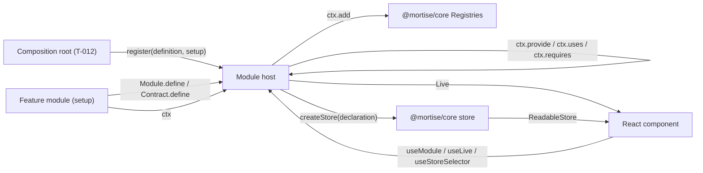
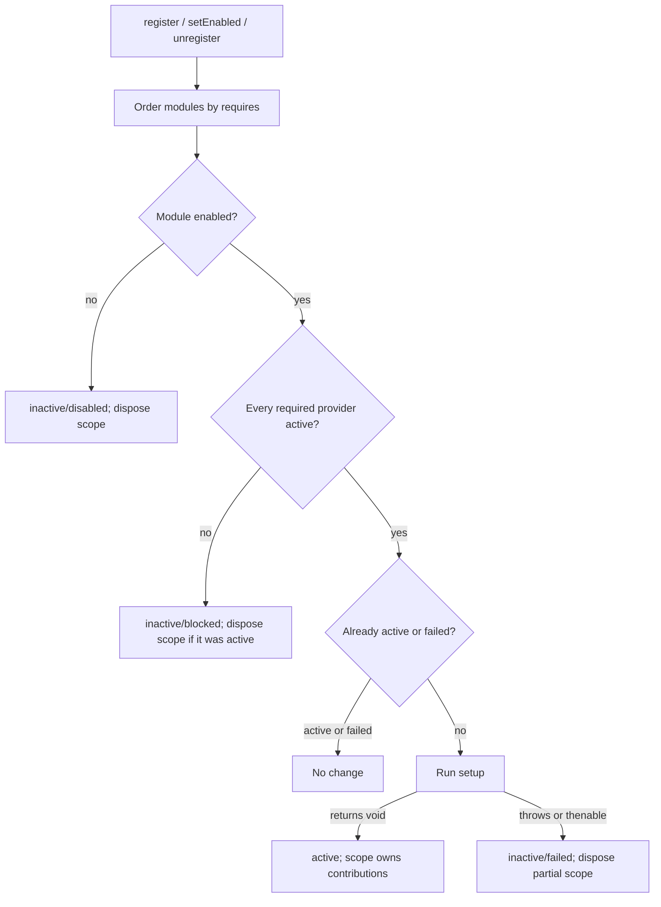
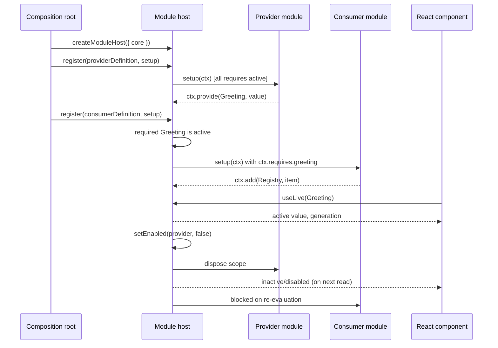
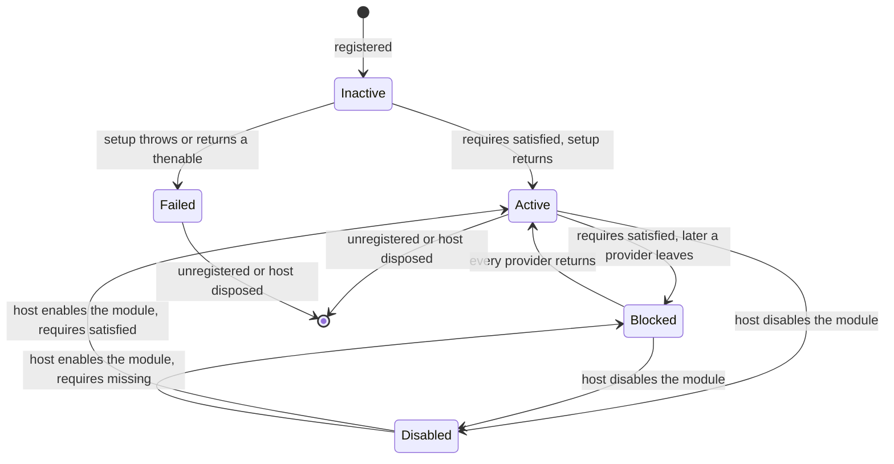

# Module system

> Every first-party feature of the workbench is a module declared with `Module.define`, activated by
> the host in dependency order, and reachable from React through explicit hooks, so a missing or
> failed provider degrades or blocks exactly one module instead of the whole window.

## 1. Feature Snapshot

| Field                 | Details                                                                                              |
|-----------------------|------------------------------------------------------------------------------------------------------|
| Document status       | Proposed — awaiting maintainer approval                                                              |
| Implementation status | Shipped and verified at `d784c30` (T-011)                                                            |
| Owner                 | Mortise maintainer                                                                                   |
| Primary actors        | A first-party feature module (author), the composition root that builds the host, React components    |
| Trigger               | A module registers with the host at window boot; a provider activates, fails, or is disabled          |
| Outcome               | Modules active in dependency order, each with a typed context, a `Live` liveness value and a scope    |
| Entry points          | `@mortise/sdk` (`packages/sdk/src/index.ts`): `Module`, `Contract`, `createModuleHost`, hooks         |
| Data stores           | Declared module stores (in-memory now; persisted in a later phase). No engine data                    |
| Feature flag          | Not applicable                                                                                       |
| Last verified         | 2026-10-11 at `d784c30`                                                                              |

**Status legend.** Every `Status` value below is one of: **Current** (read in the code at `last_verified_commit`) · **Planned** (not implemented) · **Inferred** (not directly verified) · **Unknown**.

## 2. Problem and Outcome

**Problem.** A client with many features needs each feature isolated: one feature must be able to
depend on another without importing its internals, must keep working when an optional dependency is
absent, and must not take the window down when its own setup throws. Without a system for this, the
app shell accumulates knowledge of every feature and every feature imports every other, which is the
coupling ADR-0007 exists to prevent. React compounds it: upstream ties module lifetimes to Solid's
ownership tree, and React has no equivalent.

**Desired outcome.** A module author declares `provides`, `uses`, `requires` and `stores`; the host
activates modules in dependency order and reports each as `pending`, `active`, or `inactive` with a
reason. Reading a dependency the module did not declare fails to compile. Leaving `active` withdraws
everything the module registered. Components reach the module context and its live contracts through
`useModule`, `useLive` and `useStoreSelector`.

**How success is measured.** The unit and type tests in §20 pass: activation order, a blocked module
resuming when its provider returns, failure isolation, withdrawal of contributions on disable, the
`Live` transitions, and a compile-time rejection of an undeclared dependency.

## 3. Scope

**Included**

- `Module.define` and the `Setup<typeof definition>` typing rule (declared dependencies only).
- `Contract.define<T>` tokens and their typed value.
- `Live<T>`: `pending`, `active` (with `generation`), and `inactive` with a reason.
- `createModuleHost({ core })`: dependency-ordered activation, blocking, failure isolation,
  disable/enable, and withdrawal of contributions.
- Declared stores: a per-instance store created from the module's declaration.
- React bindings: `ModuleHostProvider`, `useModule`, `useLive`, `useStoreSelector`.

**Excluded**

- Persistence of declared stores. Stores live in memory for the current activation; a later phase
  loads and saves them. The declaration shape is fixed now so persistence can attach later.
- The public extension API for third-party code (ADR-0008, Phase 3). This SDK is internal, unstable
  and in-process; it is never published.
- Contribution registries themselves and their items. `@mortise/core` owns the `Registry` and
  `Registries` types; this feature passes items to them through `ctx.add`.
- Host APIs such as layout, sessions, storage and dialogs. Those are the workbench shell's to add
  (T-012); this feature fixes only the module boundary.
- Async module setup. Setup is synchronous; asynchronous work runs in owned tasks that check
  `ctx.signal`.

**Assumptions**

| ID      | Assumption                                                                                  | Confidence | How it gets validated                                         |
|---------|---------------------------------------------------------------------------------------------|------------|----------------------------------------------------------------|
| ASM-001 | A manifest of `provides`/`uses`/`requires` is enough to order activation; no version ranges are needed for first-party modules. | High | Host tests in §20; ADR-0007 |
| ASM-002 | React components can obtain their module context explicitly, without an ownership tree.      | High       | Hook tests under happy-dom (§20)                              |
| ASM-003 | Declared stores can be in-memory until persistence lands without changing the manifest shape. | Medium     | T-012 usage; revisited when persistence is scheduled          |

## 4. Terminology

| Term            | Meaning                                                                                            |
|-----------------|----------------------------------------------------------------------------------------------------|
| Module          | A first-party feature: a manifest (`Module.define`) plus a synchronous setup function.              |
| Contract        | A typed token (`Contract.define<T>`) that one module provides and others use or require.           |
| Provider        | The module that declares a contract in `provides` and supplies its value during setup.              |
| `provides`      | Contracts the module supplies; a duplicate provider is an error.                                    |
| `uses`          | Optional dependencies. Read as `Live<T>`; their absence never blocks the module.                    |
| `requires`      | Hard dependencies. The module is blocked until every one is `active`.                              |
| Declared store  | State the module owns, declared in the manifest and created by the host per activation.             |
| Module host     | `createModuleHost`: the activator that orders, starts, blocks, disables and disposes modules.        |
| Blocked         | A module waiting on an unavailable required provider. It resumes on its own.                        |
| Failed          | A module whose setup threw. Only that module is affected; it stays failed until re-registered.     |
| Scope           | The `DisposableScope` from `@mortise/core` that owns everything an activation registered.            |

## 6. User Journey

This is a developer-and-boot journey, not a user-facing flow.

1. The composition root creates the core services and calls `createModuleHost({ core })`.
2. Each first-party module folder calls `Module.define(...)` and exports
   `const setup: Setup<typeof definition>`.
3. The composition root registers every module with the host.
4. The host activates modules in dependency order. A module whose `requires` are all `active` runs
   its setup; one waiting on a provider becomes `blocked`.
5. During setup the module registers contributions with `ctx.add(...)` and provides its contracts
   with `ctx.provide(...)`; everything is owned by the module's scope.
6. Components reach the module context with `useModule(definition)` and read a contract with
   `useLive(token)`; a selector reads a declared store with `useStoreSelector`.
7. On disable or host disposal the host disposes the module's scope, withdrawing contributions, and
   re-evaluates the modules that required it.

**Alternate paths**

| Journey                        | Trigger                                              | Expected outcome                                                    |
|--------------------------------|------------------------------------------------------|---------------------------------------------------------------------|
| Consumer before provider       | The consumer registers first                         | Consumer is `blocked`; it activates when the provider registers      |
| Optional provider missing      | A `uses` contract has no provider                    | The module activates; `ctx.uses.name` is `inactive`                  |
| Provider disabled              | `host.setEnabled(id, false)` on a provider           | The provider is `inactive/disabled`; requiring modules become `blocked`; contributions withdrawn |
| Provider returns               | The provider is re-enabled or registers              | Blocked consumers activate in order                                  |
| Setup throws                   | A module's setup throws                              | Only that module is `inactive/failed`; every other module is unchanged |

## 7. System Context

The SDK sits between the framework-free core and the workbench. The shell never names a module; the
host activates by declaration. Modules exchange values only through contract tokens.



## 8. Control Flow

The host owns activation. Registration and enablement changes re-run the same deterministic pass.



| Step                | Status  | Controlling component        | Decision                                            | Failure behavior                                   |
|---------------------|---------|------------------------------|-----------------------------------------------------|----------------------------------------------------|
| Ordering            | Current | `host.ts`                    | Topological order over `requires` edges             | A dependency cycle leaves every member blocked      |
| Enablement          | Current | `host.ts`                    | Is the module enabled?                              | `inactive/disabled`; nothing runs                   |
| Requirement check   | Current | `host.ts`                    | Is every `requires` contract `active`?              | `inactive/blocked`; resumes later                   |
| Setup               | Current | `host.ts`                    | Run the synchronous setup once per activation       | `inactive/failed`; partial scope disposed           |
| Provider claim      | Current | `host.ts`                    | One provider per contract token                     | Duplicate claim throws at registration              |
| Withdrawal          | Current | `host.ts` + `DisposableScope`| Dispose the scope on leaving `active`               | Registrations and provided values are removed       |

## 9. Data Flow

Values enter the host from the composition root (core services) and from module setups (provided
contracts and stored state). The host derives `Live` values and hands them to setup and to React.



**Sensitive data.** None. Modules are trusted first-party code running in the window. The host
passes only core services and contract values; it never holds or forwards engine credentials or
agent authority, and nothing in this feature logs.

## 10. State Model

A module has one lifecycle. The `Live` value a consumer or component reads is derived from the
provider module's state and is one of `pending`, `active` or `inactive` with a reason.



| State             | `Live` value                        | Meaning                                               | Side effects                                  |
|-------------------|-------------------------------------|-------------------------------------------------------|-----------------------------------------------|
| `inactive/blocked`| `{ status: "inactive", reason: "blocked" }` | A required provider is unavailable            | A prior activation's scope is disposed        |
| `inactive/disabled`| `{ status: "inactive", reason: "disabled" }` | The host disabled the module, or no provider owns a contract | Nothing runs                     |
| `inactive/failed` | `{ status: "inactive", reason: "failed" }` | Setup threw. Terminal until re-registration    | A partial scope is disposed                   |
| `active`          | `{ status: "active", value, generation }` | Setup returned; contributions are owned by the scope | `generation` increments on each activation |
| `pending`         | `{ status: "pending" }`             | A provider module is active but has not supplied the value | Setup should supply it; it is not a stable state for a correct module |

`restarting` is part of the `Live` vocabulary for a later phase when a provider is replaced in place;
the host in this feature reaches `blocked` and then `active` instead. The reason vocabulary is fixed
now so consumers can match on all four cases today.

## 11. Implementation Map

### Existing

Everything below was read at `d784c30`, the T-011 implementation commit.

| Layer       | Responsibility                                              | Repository path                  | Main symbol                                             | Verified  |
|-------------|-------------------------------------------------------------|----------------------------------|---------------------------------------------------------|-----------|
| Core        | Disposables, registries, store, event bus                   | `packages/core/src/`             | `DisposableScope`, `Registries`, `Registry`, `createStore`, `Store`, `EventBus` | `d784c30` |
| Core docs   | Public API table for the primitives the host builds on      | `packages/core/README.md`        | —                                                       | `d784c30` |
| Contracts   | Typed contract tokens and their value type                  | `packages/sdk/src/contract.ts`   | `Contract`, `ContractValue`                             | `d784c30` |
| Liveness    | The `Live<T>` union and its inactive reasons                | `packages/sdk/src/live.ts`       | `Live`, `LiveInactiveReason`                            | `d784c30` |
| Manifest    | `Module.define`, definition and context types, `Setup<D>`, declared stores | `packages/sdk/src/module.ts` | `Module`, `ModuleInput`, `ModuleDefinition`, `ModuleContext`, `Setup`, `Store`, `StoreDefinition` | `d784c30` |
| Host        | Dependency-ordered activation, blocking, failure isolation, disable, withdrawal | `packages/sdk/src/host.ts` | `createModuleHost`, `ModuleHost`, `ModuleHostCore`      | `d784c30` |
| React       | Provider and the three hooks on `useSyncExternalStore`      | `packages/sdk/src/react.tsx`     | `ModuleHostProvider`, `useModule`, `useLive`, `useStoreSelector` | `d784c30` |
| Entry       | JSDoc'd public exports                                      | `packages/sdk/src/index.ts`      | —                                                       | `d784c30` |
| Tests       | Behaviour and type coverage for every rule below            | `packages/sdk/src/host.test.ts`, `module.test.ts`, `contract.test.ts`, `react.test.tsx` | — | `d784c30` |
| Docs        | Package responsibility and public API table                 | `packages/sdk/README.md`         | —                                                       | `d784c30` |

### Generated or restricted

| Path or area             | Classification | Rule                                                             |
|--------------------------|----------------|------------------------------------------------------------------|
| `packages/sdk/src/index.ts` | Restricted  | The package's only public surface; keep the README in sync         |
| `.dependency-cruiser.cjs` | Restricted    | Do not weaken; the SDK may import only `core`, `domain` and `react` |
| Module manifests in modules | Restricted  | A module's `contract.ts` is the only file its peers may import    |

## 14. Business Rules

Every rule below is implemented at `d784c30` and carries a test named for it.

| Rule ID | Status  | Rule                                                                                                        | Enforcement point        | Test reference                        |
|---------|---------|-------------------------------------------------------------------------------------------------------------|--------------------------|---------------------------------------|
| BR-001  | Current | A module reads only the dependencies it declared; an undeclared key is a compile error.                     | `module.ts` context types | `module.test.ts` (BR-001), compiled by `bun run typecheck` |
| BR-002  | Current | A provider activates before any module that requires it; the host orders by `requires` edges.               | `host.ts`                | `host.test.ts` (BR-002)               |
| BR-003  | Current | A module with an unavailable required provider is `inactive/blocked` and activates when every one is active. | `host.ts`                | `host.test.ts` (BR-003)               |
| BR-004  | Current | An optional provider never blocks; `ctx.uses.name` is a `Live<T>` that degrades.                            | `host.ts`                | `host.test.ts` (BR-004)               |
| BR-005  | Current | A setup that throws, or returns a thenable, marks only that module `inactive/failed`; every other module keeps its state. | `host.ts` | `host.test.ts` (BR-005, CASE-002) |
| BR-006  | Current | Leaving `active` disposes the module's scope: contributions and provided values are withdrawn.              | `host.ts`                | `host.test.ts` (BR-006)               |
| BR-007  | Current | Two modules may not provide the same contract token; the second registration throws.                        | `host.ts`                | `host.test.ts` (BR-007)               |
| BR-008  | Current | Each activation increments `generation`; an `active` `Live` carries the provider's current generation.      | `host.ts`                | `host.test.ts` (BR-008)               |
| BR-009  | Current | The host names no module; it activates by declaration and orders by `requires`.                             | `host.ts`                | `host.test.ts` (BR-009)               |
| BR-010  | Current | A contract with no provider is `inactive/disabled`; a declared but unprovided contract is `pending`.        | `host.ts`                | `host.test.ts` (BR-010)               |

## 15. Acceptance Criteria

### AC-001: The feature document exists — Status: **Current**

**Given** the repository
**When** the feature-document quality gate runs
**Then** FEAT-002 exists, passes the blocking checks, and appears in `docs/features/_index.md`.

Checked by the Mode D pass and review; there is no code test for a document.

### AC-002: Activation order — Status: **Current**

**Given** a provider of `Greeting` and a consumer that requires it, registered consumer-first
**When** both are registered
**Then** the provider's setup runs before the consumer's
**And** both are `active`.

Test: `packages/sdk/src/host.test.ts` (BR-002, BR-009).

### AC-003: Blocked resumes — Status: **Current**

**Given** only the consumer is registered
**When** the host evaluates it
**Then** the consumer is `inactive/blocked`
**And** when the provider registers, the consumer becomes `active`.

Test: `packages/sdk/src/host.test.ts` (BR-003).

### AC-004: Failure isolation — Status: **Current**

**Given** a module whose setup throws and a healthy module
**When** both are registered
**Then** only the throwing module is `inactive/failed`
**And** the healthy module is `active`.

Test: `packages/sdk/src/host.test.ts` (BR-005).

### AC-005: Withdrawal on disable — Status: **Current**

**Given** an active provider and consumer, with the provider's contribution in a registry
**When** the provider is disabled
**Then** the provider is `inactive/disabled`, its registry contribution is withdrawn, and the consumer is `inactive/blocked`.

Test: `packages/sdk/src/host.test.ts` (BR-006).

### AC-006: Live transitions — Status: **Current**

**Given** no provider for `Greeting`
**When** the provider registers, is disabled, and is re-enabled
**Then** `get(Greeting)` moves `inactive/disabled → active → inactive/disabled → active`
**And** the second `active` generation is greater than the first.

Test: `packages/sdk/src/host.test.ts` (BR-008, BR-010).

### AC-007: Undeclared dependency fails to compile — Status: **Current**

**Given** a module whose `uses` is empty
**When** a setup reads `ctx.uses.undeclared`
**Then** TypeScript rejects it, recorded with `// @ts-expect-error`.

Test: `packages/sdk/src/module.test.ts` (BR-001) compiled by `bun run typecheck`.

### AC-008: React hooks render — Status: **Current**

**Given** a host and a component under `ModuleHostProvider`
**When** the component reads `useModule`, `useLive` and `useStoreSelector`
**Then** the rendered output reflects the contract's `Live` value and the store's selected value, and
updates when the host or store changes.

Test: `packages/sdk/src/react.test.tsx` under happy-dom.

### Edge cases

| Case ID  | Scenario                                             | Expected behavior                                                | Test type |
|----------|------------------------------------------------------|------------------------------------------------------------------|-----------|
| CASE-001 | Two modules declare the same contract in `provides`  | The second registration throws; neither is activated by it        | Unit      |
| CASE-002 | A setup returns a promise                            | The module is `inactive/failed`; it is not awaited                | Unit      |
| CASE-003 | A registered module is unregistered while active     | Its scope is disposed and its contract is withdrawn               | Unit      |
| CASE-004 | A `requires` cycle                                  | Every member of the cycle stays `inactive/blocked`                | Unit      |
| CASE-005 | A consumer declares a `uses` contract with no provider | The module activates; `ctx.uses.name` is `inactive/disabled`    | Unit      |

## 17. Security and Privacy

This feature handles no credentials and no personal data. Modules are trusted first-party code, not
the sandboxed extensions of Phase 3, so the module boundary is a maintainability boundary, not a
security boundary.

| ID      | Requirement                                                                 | Enforcement                          | Validation                                          |
|---------|------------------------------------------------------------------------------|--------------------------------------|-----------------------------------------------------|
| SEC-001 | The SDK never gives a module engine credentials or agent authority.           | The host passes only core services and contract values; no transport or credential type is in scope. | Current: `bun run check:deps` passes; the package imports only `core`, `domain` and `react`. |
| SEC-002 | A module cannot answer a permission request or bypass the gateway.            | Permissions travel through the gateway and adapter contracts, never through this SDK. | Out of scope; ADR-0011, ADR-0004                     |

## 20. Testing

| Test type | Required coverage                                                                                          | Path |
|-----------|------------------------------------------------------------------------------------------------------------|------|
| Unit      | Contract tokens, activation order, blocking and resumption, failure isolation, disable and withdrawal, `Live` transitions, duplicate providers, cycles | `packages/sdk/src/contract.test.ts`, `packages/sdk/src/host.test.ts` |
| Type      | An undeclared dependency does not compile (`// @ts-expect-error`)                                            | `packages/sdk/src/module.test.ts` |
| Component | `useModule`, `useLive`, `useStoreSelector` render and update under happy-dom                                 | `packages/sdk/src/react.test.tsx` |

**Validation commands** — must be commands that exist in this repository:

```bash
bun run check
bun run test
bun run typecheck
```

## 26. Risks and Limitations

| Risk ID  | Risk                                                              | Impact                                              | Mitigation                                                        |
|----------|-------------------------------------------------------------------|-----------------------------------------------------|-------------------------------------------------------------------|
| RISK-001 | React has no ownership tree, so a component can read a context that is no longer active. | A stale read renders after the module went inactive. | Explicit module scope and `Live`; `useModule` throws when not active; components gate on `useLive`. |
| RISK-002 | `ctx.uses` is a snapshot taken at setup, so a long-lived module does not see an optional provider change in setup code. | Setup-time reads go stale. | Components read `useLive(token)`; setup-time reads are for values fixed for the activation. |
| RISK-003 | Declared stores are not persisted yet.                              | Module state resets on every window load.           | Out of scope here; the declaration shape is fixed so persistence can attach without a manifest change. |
| RISK-004 | The manifest typing is the most complex part of the package.        | Poor readability; hard to extend.                   | Small, named mapped types; the host erases types at one boundary only; stop and ask if it grows. |

### Current Limitations

| Limitation                                       | Impact                                     | Planned resolution                          |
|--------------------------------------------------|--------------------------------------------|---------------------------------------------|
| No persistence for declared stores               | State resets per activation                | Later phase; shape fixed now                |
| `restarting` is never emitted                    | A provider replacement is `blocked → active` | Emit it when in-place restart lands         |
| No host APIs on the context (layout, sessions)   | Modules cannot reach the shell yet         | Added by the workbench composition root, T-012 |
| Async setup is rejected                          | Async work must use `ctx.signal` in owned tasks | Intentional; matches overview 6.6       |

## 27. Decisions

| Decision ID | Status   | Decision                                                                    | Rationale                                                                | Alternatives                              | Date       |
|-------------|----------|-----------------------------------------------------------------------------|--------------------------------------------------------------------------|-------------------------------------------|------------|
| DEC-001     | Proposed | `useModule(definition)` takes the module's definition explicitly.            | React has no ownership tree to bind the provider's context, so the binding is explicit. | An implicit context set by the shell; `bindExtension`-style wrappers | 2026-10-11 |
| DEC-002     | Proposed | Declared stores are descriptors created per activation, not module-level stores. | Avoids module-level mutable state; leaves room for persistence.           | Pass a live `Store` in the manifest          | 2026-10-11 |
| DEC-003     | Proposed | A setup throw is terminal (`failed`) until re-registration; a missing provider is resumable (`blocked`). | A bug should not retry in a loop; a dependency absence should heal. | Retry failed setups; treat both as blocked | 2026-10-11 |
| DEC-004     | Proposed | The host activates by declaration and never names a module.                  | ADR-0007; the shell stays free of feature knowledge.                      | Register modules with the shell             | 2026-10-11 |
| DEC-005     | Proposed | `ctx.uses` is a `Live<T>` snapshot at setup; React reactivity goes through `useLive`. | Setup is synchronous and runs once per activation.                       | Accessor functions for `uses` in setup      | 2026-10-11 |
| DEC-006     | Proposed | `restarting` is reserved but not emitted in this phase.                      | Keeps the `Live` vocabulary stable for consumers; no in-place restart yet. | Omit `restarting` until needed             | 2026-10-11 |

## 28. Open Questions

| ID    | Question                                                                                     | Owner              | Needed by | Status  |
|-------|----------------------------------------------------------------------------------------------|--------------------|-----------|---------|
| Q-001 | Does the workbench composition root (T-012) need commands, settings or the event bus on the module context, or are registries and contracts enough? | Mortise maintainer | T-012     | Open    |

## 30. Changelog

| Date       | Version | Change                                                                 | Status   | PR or author   |
|------------|---------|------------------------------------------------------------------------|----------|----------------|
| 2026-10-11 | 0.1.0   | Initial plan, written in Mode A before coding                          | Planned  | T-011          |
| 2026-10-11 | 0.1.1   | Implemented and verified at `d784c30`; the implementation plan removed | Shipped  | T-011 (`d784c30`) |
