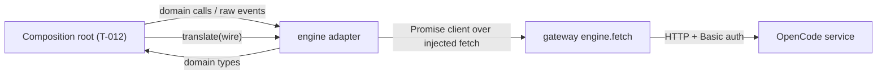
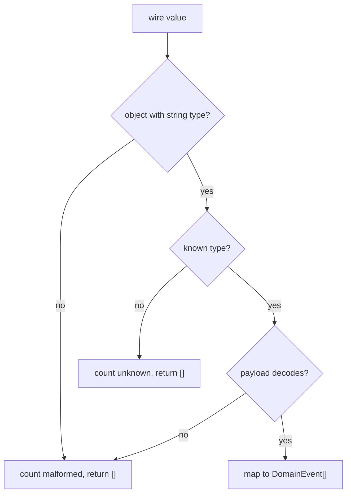

<!--
FEAT-002 is reserved for the module system (T-011), so this feature takes the next free id, FEAT-003.
-->

# Engine adapter

> `@mortise/engine-opencode` is the only code that understands OpenCode wire formats: it turns the
> engine's HTTP responses and event stream into the shared Mortise domain model, so every other
> layer speaks domain types and never the wire.

## 1. Feature Snapshot

| Field                 | Details                                                                                          |
|-----------------------|--------------------------------------------------------------------------------------------------|
| Document status       | Proposed                                                                                         |
| Implementation status | Shipped and verified at `e7726c2`                                                                 |
| Owner                 | Mortise maintainer                                                                               |
| Primary actors        | The composition root (T-012) and the gateway (T-004…T-006) through an injected `fetch`          |
| Trigger               | A read (session list/get/create, message page, pending requests) or one wire event              |
| Outcome               | Domain `SessionSummary`, `TimelineItem`, `PendingRequest` and `DomainEvent` values              |
| Entry points          | `packages/engine-opencode/src/index.ts` (`createAdapter`, `translate`)                           |
| Data stores           | None. The adapter is stateless; credentials live in the gateway (C7)                            |
| Feature flag          | Not applicable                                                                                   |
| Last verified         | 2026-10-10 at `e7726c2`                                                                           |

**Status legend.** Every `Status` value below is one of: **Current** (read in the code at `last_verified_commit`) · **Planned** (not implemented) · **Inferred** (not directly verified) · **Unknown**.

## 2. Problem and Outcome

**Problem.** OpenCode's wire formats (generated client types, SSE event envelopes, strict request
bodies) are the engine's business. If they leak into the workbench, every engine release touches the
UI. ADR-0004 makes one package the translation boundary.

**Desired outcome.** The rest of Mortise works only in `@mortise/domain`. A renderer can run the
adapter over any injected `fetch` (the gateway's `engine.fetch`), so the adapter can also be exercised
against recorded fixtures without an engine.

**How success is measured.** Replaying every recorded engine version's fixtures through a fake
`fetch` yields the domain values the fixtures describe, and replaying each recorded turn's deltas
yields the same timeline as mapping its final message list.

## 3. Scope

**Included**

- `createAdapter({ serverId, baseUrl, fetch })` building the zero-Effect Promise client.
- Client-generated, time-ordered message ids for idempotent prompts.
- Session reads and writes: list, get, create, prompt (idempotent), interrupt.
- Message pages to `TimelineItem[]`; pending permissions and forms to `PendingRequest[]`.
- Pure translation of one wire event to zero or more `DomainEvent`s, with diagnostics counters.

**Excluded**

- Discovery, credentials, the event stream, resync policy and capability detection. Those belong to
  FEAT-001 (`@mortise/gateway-core`).
- Holding state: the timeline store and resync are the composition root's (T-012).
- Non-`user`/`assistant` message projections (shell, compaction, synthetic, skill, system,
  agent/model/location switches). v0 ignores them.

**Assumptions**

| ID      | Assumption                                                                 | Confidence | How it gets validated                                              |
|---------|----------------------------------------------------------------------------|------------|--------------------------------------------------------------------|
| ASM-001 | The generated Promise client accepts an injected `fetch` and covers every read/write the adapter needs. | High | Replayed fixture tests; `bun run check:deps` |
| ASM-002 | `Identifier.ascending()`'s 12 hex chars + 14 base-62 chars sort by creation order. | High | AC-003 test |
| ASM-003 | A pure, stateless `translate` is possible for every modeled event.        | High       | AC-002 fixture replay; DEC-003 |
| ASM-004 | The recorded 2.0.20 and 2.0.26 turn fixtures represent the event shapes across the supported range. | High | T-014 version matrix: the same contract assertions pass on both |

## 7. System Context

The adapter sits behind the gateway's `engine.fetch`. It imports the Promise root of
`@opencode/client` and `@mortise/domain`, and nothing else. It never holds credentials and renders
nothing.



## 8. Control Flow

Reads map a decoded response to domain values. Events are validated once, then mapped; unknown or
malformed input is counted, never thrown, because the gateway hands the adapter raw JSON.



| Step | Status | Controlling component | Decision | Failure behavior |
|------|--------|-----------------------|----------|------------------|
| Decode | Current | `events.ts` | Is the value an object with a known `type`? | Counted, `[]` |
| Validate | Current | `events.ts`, `requests.ts` | Does the payload have the declared fields? | Counted as malformed, `[]` |
| Map | Current | `events.ts` | Which domain event(s) does it produce? | `[]` when the wire concept has no domain home |

## 9. Data Flow

A prompt carries a client-generated message id so a retry is idempotent. Live events are translated
one at a time; the composition root applies the resulting timeline patches. Known events with no
domain home and plugin `rpc.*` traffic yield nothing and are not counted.

**Sensitive data.** None. The adapter holds no credentials and logs nothing. Wire payloads may name
file paths, which are not secrets.

## 11. Implementation Map

### Existing

| Layer | Responsibility | Repository path | Main symbol | Verified |
|-------|----------------|-----------------|-------------|----------|
| Domain model | Shared client types | `packages/domain/src/` | `DomainEvent`, `TimelineItem`, `PendingRequest`, `ToolPartPatch` | `44fc431` |
| Wiring | Build the client and bind the operations | `packages/engine-opencode/src/adapter.ts` | `createAdapter` | `44fc431` |
| Ids | Time-ordered `msg_` ids | `packages/engine-opencode/src/ids.ts` | `newMessageId` | `44fc431` |
| Sessions | Session reads/writes | `packages/engine-opencode/src/sessions.ts` | `listSessions`, `promptSession`, … | `44fc431` |
| Timeline | Message page → items | `packages/engine-opencode/src/timeline.ts` | `mapTimeline` | `44fc431` |
| Requests | Pending permissions/forms and answers | `packages/engine-opencode/src/requests.ts` | `listPendingRequests`, `answerPermission`, … | `44fc431` |
| Events | Wire event → domain events | `packages/engine-opencode/src/events.ts` | `translate`, `eventDiagnostics` | `44fc431` |
| Fixtures | Recorded 2.0.20 and 2.0.26 responses and one turn each | `packages/engine-opencode/fixtures/<version>/` | `events-turn.jsonl`, `messages.json`, … | `e7726c2` |
| Contract matrix | Replays the adapter against every recorded version | `packages/engine-opencode/src/sessions.test.ts`, `timeline.test.ts`, `events.test.ts` | `describe.each(VERSIONS)` | `e7726c2` |
| Compatibility diff | Compares two recorded specs and flags adapter-breaking changes | `scripts/diff-openapi.ts` | `compareSpecs` | `e7726c2` |

### Generated or restricted

| Path or area | Classification | Rule |
|--------------|----------------|------|
| `node_modules/@opencode/client/dist/` | Generated | Never edit; use only exports |
| `packages/engine-opencode/fixtures/` | Restricted | Recorded engine output; replay, do not reformat |

## 12. Contracts

### Domain events emitted

| Wire event | Domain event(s) |
|------------|-----------------|
| `session.created` | `session.changed` |
| `session.execution.started` | `session.activity` running |
| `session.execution.succeeded` / `.failed` / `.interrupted` | `session.activity` idle |
| `session.retry.scheduled` | `session.activity` retrying |
| `session.inbox.enqueued` (user) | `timeline.patch` `item.added` |
| `session.inbox.delivered` | `timeline.patch` `item.patched` |
| `session.step.started` | `timeline.patch` `item.added` (assistant) |
| `session.step.failed` | `timeline.patch` `part.added` (error) |
| `session.text.*` / `session.reasoning.*` | `timeline.patch` `part.added` / `part.text.appended` / `part.updated` |
| `session.tool.input.started` | `timeline.patch` `part.added` (tool) |
| `session.tool.input.ended` / `.called` / `.progress` / `.success` / `.failed` | `timeline.patch` `part.patched` |
| `permission.asked` / `.replied` | `request.opened` / `request.closed` |
| `form.created` / `.replied` / `.cancelled` | `request.opened` / `request.closed` |
| anything else known | none (not counted) |
| unlisted `type` | none (counted as unknown) |
| malformed value | none (counted as malformed) |

### Engine HTTP used

| Operation | Endpoint | Domain output |
|-----------|----------|---------------|
| `session.list` | `GET /api/session` | `SessionSummary[]` |
| `session.get` | `GET /api/session/{id}` | `SessionSummary` |
| `session.create` | `POST /api/session` | `SessionSummary` |
| `session.prompt` | `POST /api/session/{id}/prompt` | — |
| `session.interrupt` | `POST /api/session/{id}/interrupt` | `boolean` |
| `session.message.list` | `GET /api/session/{id}/message` | `TimelineItem[]` |
| `permission.request.list` | `GET /api/permission/request` | `PermissionRequest[]` |
| `session.permission.reply` | `POST /api/session/{id}/permission/{rid}/reply` | — |
| `form.list` | `GET /api/form` | `FormRequest[]` |
| `session.form.reply` | `POST /api/session/{id}/form/{fid}/reply` | — |
| `session.form.cancel` | `DELETE /api/session/{id}/form/{fid}` | — |

## 14. Business Rules

| Rule ID | Status  | Rule | Enforcement point | Test reference |
|---------|---------|------|-------------------|----------------|
| BR-001  | Current | The adapter imports `@opencode/client` only through the Promise root (ADR-0004). | `index.ts` imports; `.dependency-cruiser.cjs` | AC-006 |
| BR-002  | Current | `prompt` always sends `id: clientMessageId`, so retries are idempotent, and sends only fields the engine declares. | `sessions.ts` | AC-004 |
| BR-003  | Current | `newMessageId()` returns `msg_` + 12 hex + 14 base-62 chars and sorts by creation order. | `ids.ts` | AC-003 |
| BR-004  | Current | Translating an unknown event type or malformed payload returns `[]` and increments a counter; it never throws. | `events.ts` | AC-005 |
| BR-005  | Current | Translating the recorded turn and reducing its patches reproduces the final message-list timeline. | `events.ts`, `timeline.ts` | AC-002 |
| BR-006  | Current | Tool part identity is the wire call id; text and reasoning part identity is `(messageId, ordinal)`. | `events.ts`, `timeline.ts` | AC-002 |

## 15. Acceptance Criteria

### AC-001: Fixture replay through the client — Status: **Current**

**Given** a fake `fetch` returning the recorded 2.0.26 bodies
**When** the adapter's reads run
**Then** the mapped domain values match the fixtures. Covered for session list/get/create and the
message page; `info.json` and `openapi.json` are gateway-owned (T-004) and not mapped here.

### AC-002: Snapshot and deltas agree — Status: **Current**

**Given** the recorded turn's events and its final message page
**When** the events are translated and reduced into a timeline
**Then** that timeline equals mapping the message page.

### AC-003: Time-ordered ids — Status: **Current**

**Given** two `newMessageId()` calls, including within one millisecond
**When** compared as strings
**Then** the earlier call sorts first.

### AC-004: Idempotent prompt body — Status: **Current**

**Given** the same `clientMessageId` used twice
**When** `prompt` sends both requests
**Then** both bodies carry the same `id` and no undeclared field.

### AC-005: Counted, never thrown — Status: **Current**

**Given** an unknown event type and a malformed payload
**When** `translate` runs
**Then** it returns `[]` and increments the matching counter.

### AC-006: Promise root only — Status: **Current**

**Given** the package source
**When** `bun run check:deps` runs
**Then** only the Promise root of `@opencode/client` is imported.

### AC-007: Supported engine versions agree — Status: **Current**

**Given** the recorded 2.0.20 and 2.0.26 fixtures
**When** `bun run test` runs the contract tests once per fixture directory, and
`bun scripts/diff-openapi.ts` compares the two specs
**Then** both versions pass the same assertions and the diff reports no adapter operation or
request field removed, and no new required field the adapter does not send.

### Edge cases

| Case ID  | Scenario | Expected behavior | Test type |
|----------|----------|-------------------|-----------|
| CASE-001 | Non-user inbox item | No timeline event; not counted | Unit |
| CASE-002 | Known event with no domain home | No domain event; not counted as unknown | Unit |
| CASE-003 | Tool event without a preceding start | `part.patched` is emitted; the store ignores an unknown part id | Unit |

## 17. Security and Privacy

| ID      | Requirement                   | Enforcement     | Validation         |
|---------|-------------------------------|-----------------|--------------------|
| SEC-001 | The adapter never holds or logs credentials. | No credential types cross its boundary; the gateway's `fetch` injects auth. | Code review; no secret in fixtures |
| SEC-002 | Only fields the engine declares are sent. | The generated client builds request bodies. | AC-004 |

## 20. Testing

| Test type | Required coverage | Path |
|-----------|-------------------|------|
| Unit | Ids, fixture replay per recorded version (2.0.20, 2.0.26), fixture integrity, timeline mapping, request mapping and answers, event translation, counters | `packages/engine-opencode/src/ids.test.ts`, `sessions.test.ts`, `timeline.test.ts`, `requests.test.ts`, `events.test.ts` |

**Validation commands** — must be commands that exist in this repository:

```bash
bun run check
bun scripts/diff-openapi.ts packages/engine-opencode/fixtures/2.0.20/openapi.json packages/engine-opencode/fixtures/2.0.26/openapi.json
```

## 26. Risks and Limitations

| Risk ID  | Risk | Impact | Mitigation |
|----------|------|--------|------------|
| RISK-001 | Wire event payloads drift between supported versions. | Translation drops a field. | Lenient decode; counters; the T-014 version matrix replays every recorded version; `scripts/diff-openapi.ts` and the nightly workflow flag removals. |
| RISK-002 | A pure translator cannot resend a whole part for tool transitions. | Domain patches under-specify. | Resolved by the additive `part.patched`/`item.patched` (DEC-003). |
| RISK-003 | Non-user/assistant message kinds and several known events are ignored in v0. | Missing timeline entries. | Documented; extend when the UI needs them. |
| RISK-004 | Reads trust the generated client's decoded types (no runtime validation). | A malformed read throws or maps oddly. | Generated from the engine's own schema; revisit if a read proves flaky. |

## 27. Decisions

| ID | Decision | Rationale |
|----|----------|-----------|
| DEC-001 | Adapter is its own feature document, FEAT-003. | FEAT-001 excludes event interpretation and timeline projection; FEAT-002 is reserved for the module system. |
| DEC-002 | `translate` is a pure function with module-level diagnostic counters. | Matches engine-contract §13.1; counters are diagnostics, not render state. |
| DEC-003 | Additive domain changes: `ToolPartPatch`, `TimelinePatch.part.patched`/`item.patched`, optional `metadata`/`error` on `ToolCallPart`, and `multiselect`/`external` form field types with `url`. | Tool transitions arrive without the whole part; the engine corrects a message's created time on delivery; those wire concepts had no home. |

## 30. Changelog

| Date | Version | Change | Status | PR or author |
|------|---------|--------|--------|--------------|
| 2026-10-10 | 0.1.0 | Initial plan. | Planned | T-008 |
| 2026-10-10 | 0.1.0 | Implemented; all acceptance criteria Current at `44fc431`. | Shipped | T-008 (`44fc431`) |
| 2026-10-10 | 0.1.1 | Recorded 2.0.20, ran the contract tests once per fixture version, and added the OpenAPI compatibility diff and nightly workflow; verified at `e7726c2`. | Shipped | T-014 (`e7726c2`) |

## 31. Related Resources

- [FEAT-001 engine gateway](./FEAT-001-engine-gateway.md)
- [Engine contract reference](../opencode/engine-contract.md)
- [ADR-0004 adapter as the only OpenCode-aware code](../adr/0004-adapter-package-as-the-only-opencode-aware-code.md)
