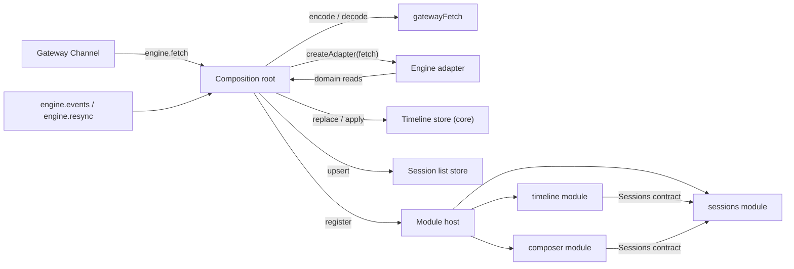
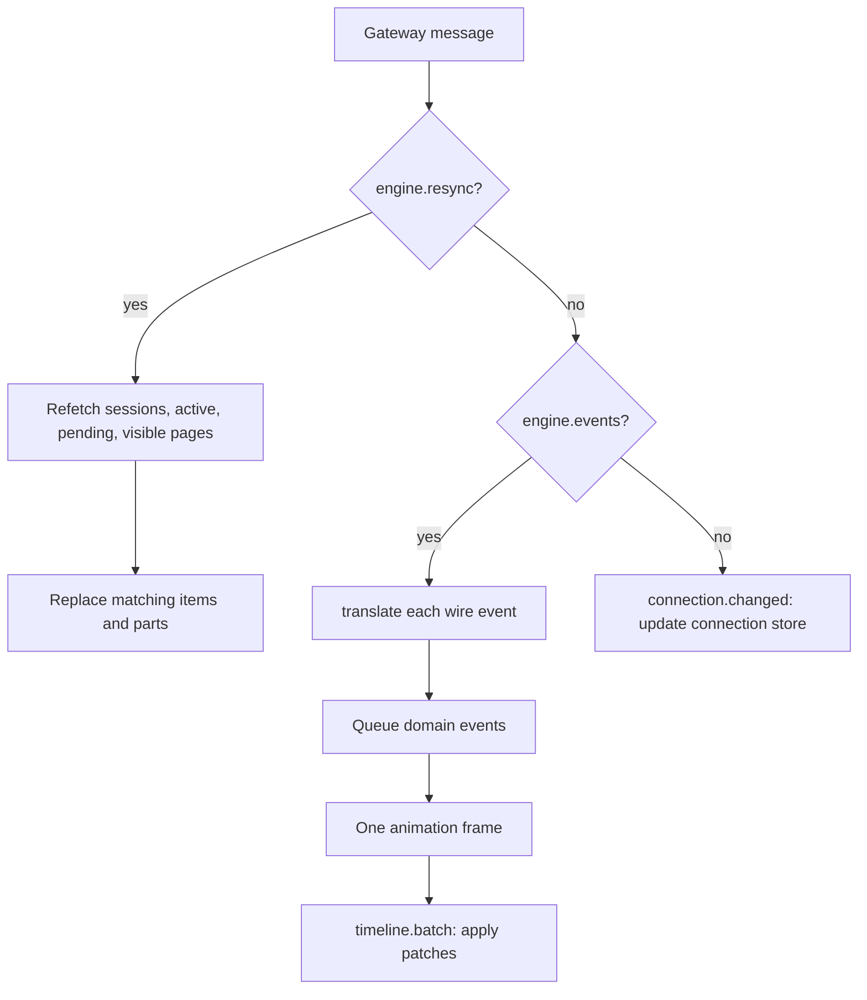
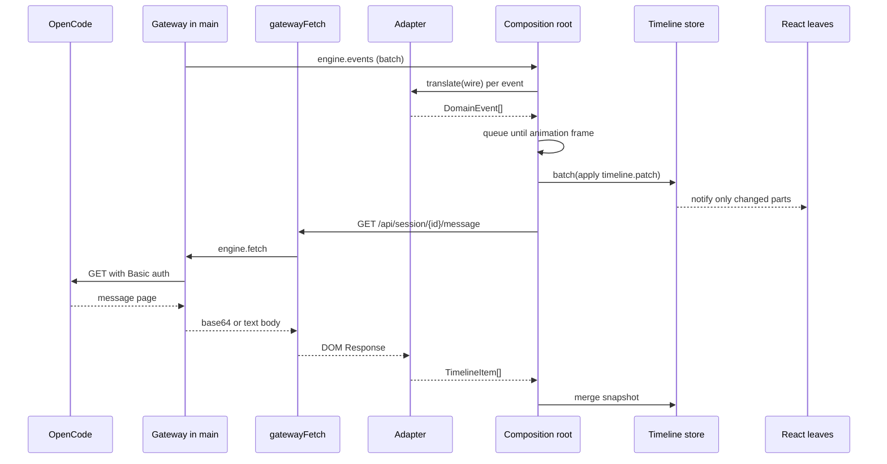

# Workbench composition root and streaming timeline

> The desktop window lists sessions from the user's OpenCode service, renders one session's
> timeline with live streaming text, sends prompts idempotently, and rebuilds visible state from
> fresh reads after a resync. A text delta re-renders only the part it changed.

## 1. Feature Snapshot

| Field                 | Details                                                                                                  |
|-----------------------|----------------------------------------------------------------------------------------------------------|
| Document status       | Proposed                                                                                                 |
| Implementation status | Shipped and verified at `c4fe0f2` (T-012)                                                                |
| Owner                 | Mortise maintainer                                                                                       |
| Primary actors        | A person using the desktop window; the composition root wiring the gateway channel to modules            |
| Trigger               | Window boot, session selection, a prompt, a gateway event batch, or a resync marker                      |
| Outcome               | A session list, a live timeline, an idempotent prompt composer, and state that survives a resync         |
| Entry points          | `packages/workbench/src/index.ts` (`App`), `packages/workbench/src/bootstrap/` (`createWorkbenchRuntime`) |
| Data stores           | In-memory session list, timeline store, per-session load status, connection state. No persistence        |
| Feature flag          | Not applicable                                                                                           |
| Last verified         | 2026-10-22 at `c4fe0f2`                                                                                  |

**Status legend.** Every `Status` value below is one of: **Current** (read in the code at
`last_verified_commit`) · **Planned** (not implemented) · **Inferred** (not directly verified) ·
**Unknown**.

## 2. Problem and Outcome

**Problem.** The adapter and the gateway already speak their own contracts, but nothing joins them
in the renderer. Without a composition root, every feature would need its own fetch bridge, the
timeline would re-render the whole window on every token, and an event stream that drops or
overflows would leave a permanently stale view.

**Desired outcome.** One composition root builds the gateway-backed `fetch`, creates the adapter,
creates the framework-free stores, registers the first-party modules, and owns the event and resync
procedures. The timeline is normalized by session, item and part, so a streaming text delta notifies
one leaf component. Selecting a session, sending a prompt, retrying the same client message id, and
refetching after a resync all go through the same stores and contracts.

**How success is measured.** The store tests replay the recorded turn fixture and show that a
resync from fresh snapshots equals a fresh load. The React render-count test shows that 2,000 text
deltas into one part leave sibling parts and the session list untouched. A fake channel proves that
retrying one client message id yields one user message. `bun run check:deps` proves only
`src/bootstrap/` imports the adapter and modules import peers only through `contract.ts`.

## 3. Scope

**Included**

- `gatewayFetch`: encode `Request` into `engine.fetch` (`method`, `path`, `query`, `headers`,
  `body`) and decode the response body and headers back into a DOM `Response`.
- Adapter creation and the subscription to `engine.events` and `engine.resync`.
- A timeline store in `@mortise/core`, normalized by session, item and part id, with narrow
  subscriptions and batched notifications.
- The resync procedure: refetch active sessions, pending requests, and the latest page of every
  loaded session; replace matching items and parts with the snapshot.
- Frame batching: translate a gateway event batch and apply it once per animation frame.
- First-party modules `sessions`, `timeline` and `composer`, communicating through contracts only.
- `StreamingText`, subscribed to one part.
- Minimal light and dark design tokens in `@mortise/ui`.
- The adapter counter fix from the wave 2 review: diagnostics live on the adapter instance.
- `activeSessions()` on the adapter, so the composition root refetches activity without reading wire
  shapes.

**Excluded**

- Permission and form UI, settings, theming, multiple servers, session creation UI, virtualization.
  The resync procedure reads pending requests but this feature renders none.
- Persistence of layout, drafts or stores.
- Registry-driven panel contributions for third-party or future modules. The Phase 0 shell receives
  its three views from the composition root; see DEC-004 and RISK-005.

**Assumptions**

| ID      | Assumption                                                                                  | Confidence | How it gets validated                                              |
|---------|---------------------------------------------------------------------------------------------|------------|--------------------------------------------------------------------|
| ASM-001 | The generated client needs only `fetch` over `engine.fetch`; it emits query values as strings in the URL, which the `engine.fetch` `query` schema covers. | High | `bootstrap/engine-fetch.test.ts` and the manual prompt run |
| ASM-002 | A frame-batched, normalized store is enough for smooth streaming; no state library is needed. | High | AC-002 render-count test |
| ASM-003 | Replacing matching items from the latest page is enough to clear a partial streamed message without dropping older loaded items. | Medium | AC-001 resync test; revisit if an engine turn spans more than one page |

## 4. Terminology

| Term            | Meaning                                                                                      |
|-----------------|----------------------------------------------------------------------------------------------|
| Composition root| `packages/workbench/src/bootstrap/`, the only place that creates the adapter and joins it to the stores and modules. |
| Gateway fetch   | A `fetch` implementation whose request travels through the channel method `engine.fetch`.     |
| Event batch     | The array of raw wire events the gateway delivers in one `engine.events` message.              |
| Frame batch     | The domain events applied together in one animation frame, with one notification per listener. |
| Resync          | A signal that the stream lost events; views refetch snapshots instead of trusting what they have. |
| Visible session | A session with a loaded timeline (the selected session and any previously loaded session).     |
| Part            | A text, reasoning, tool, shell, compaction or error piece of a timeline item.                  |

## 5. User Journey

1. The window mounts `App` with a gateway `Channel`.
2. The composition root asks the channel for `servers.list`, picks the first server, and builds
   `gatewayFetch` for that server.
3. It creates the adapter, the session list store, the timeline store, the load-status store, the
   module host, and the three modules.
4. It fetches the session list and the active-session snapshot, then selects the first session and
   fetches its latest message page.
5. The person selects another session; the timeline view subscribes to that session's item ids and
   the composition root loads its latest page.
6. The person types a prompt. The composer generates one `msg_` id, sends it, and keeps that id for
   a retry after a failure.
7. Gateway event batches arrive. The composition root translates them, queues the patches, and
   applies them once per animation frame. A streaming text delta notifies only its part.
8. A resync marker arrives. The composition root refetches sessions, active sessions, pending
   requests, and every visible session's latest page, replacing partial items.

**Alternate paths**

| Journey                | Trigger                                      | Expected outcome                                                     |
|------------------------|----------------------------------------------|----------------------------------------------------------------------|
| Engine list fails      | `engine.fetch` rejects or times out          | The list shows an error; it never renders as an empty session list   |
| Timeline page fails    | The message page rejects                     | The timeline keeps what it had and shows an error for that session   |
| Prompt fails           | The prompt request rejects                   | The draft and its client message id stay; Retry reuses the same id   |
| Prompt response lost   | The engine admitted the prompt but the reply was lost | The retry sends the same id; the user message appears once  |
| Resync while streaming | The stream overflowed mid-turn               | The partial parts are replaced by fresh reads; older items stay      |
| No engine              | `servers.list` is empty                      | The window shows "No OpenCode engine found", not an empty timeline   |

## 6. System Context

The composition root is the only renderer code that knows both the gateway channel and the adapter.
Modules see domain values and stores through contracts. The adapter never sees credentials; the
gateway adds them.



## 7. Control Flow

The incoming path has three decisions: is this a resync, is this an event batch, or is this a user
action. Event batches are translated once and applied per frame. A failed read never overwrites a
good snapshot with an empty one.



| Step                | Status  | Controlling component       | Decision                                            | Failure behavior                                      |
|---------------------|---------|-----------------------------|-----------------------------------------------------|-------------------------------------------------------|
| Boot                | Current | `bootstrap/runtime.ts`      | Is a server listed?                                 | Show "No OpenCode engine found"                        |
| Encode              | Current | `bootstrap/engine-fetch.ts` | Is the body text or absent?                         | Let the channel reject invalid input                   |
| Translate           | Current | adapter `translate`         | Is the wire event known and well formed?            | Adapter counts it and returns `[]`; the batch continues |
| Batch               | Current | `bootstrap/runtime.ts`      | Has a frame been scheduled?                         | Coalesce into the pending frame                        |
| Apply               | Current | `core` timeline store       | Which item and part does the patch name?            | Ignore an unknown target; never invent state           |
| Resync              | Current | `bootstrap/runtime.ts`      | Which sessions are visible?                         | Keep existing items and mark that session's status error |

## 8. Data Flow

Wire events become domain events in the adapter, then timeline patches in the store. Reads travel
the other way: the generated client builds a URL, `gatewayFetch` turns it into an `engine.fetch`
request, and the channel returns an encoded response.



**Sensitive data.** None in the renderer beyond session text the person already owns. The engine
password never crosses `engine.fetch`; `gatewayFetch` forwards only the headers the generated client
sets, and the channel rejects `authorization`, `cookie` and `proxy-authorization`.

## 9. State Model

The timeline store keeps one record per session. A record holds item order, item values, part values
and part references. Subscriptions are narrow: item ids per session, part references per item, and
one part by id.

| State            | Owner                 | Notification scope                                   |
|------------------|-----------------------|------------------------------------------------------|
| Session list     | `createStore`         | Every session-list subscriber                        |
| Selected session | Session list store    | Session list, timeline and composer                  |
| Load status      | `createStore`         | Timeline subscribers for that status map             |
| Item order       | Timeline store        | `subscribeItemIds(sessionId)`                        |
| Part membership  | Timeline store        | `subscribePartRefs(sessionId, messageId)`            |
| Part value       | Timeline store        | `subscribePart(sessionId, partId)`                   |
| Connection       | `createStore`         | The shell status line                                |

An append or a tool patch notifies one part key. Adding or removing a part also notifies that
item's part references. Adding, removing or reordering an item notifies that session's item ids.
Nothing in the timeline store notifies the session list.

## 10. Implementation Map

### Existing

| Layer                | Responsibility                                                       | Repository path                                            | Main symbol                       | Change type |
|----------------------|----------------------------------------------------------------------|-----------------------------------------------------------|-----------------------------------|-------------|
| Core timeline store  | Normalized state, narrow subscriptions, patches, snapshots, batching  | `packages/core/src/timeline.ts`                           | `createTimelineStore`, `TimelineStore` | New    |
| Gateway fetch        | Encode a DOM request into `engine.fetch` and decode the response      | `packages/workbench/src/bootstrap/engine-fetch.ts`        | `createGatewayFetch`              | New         |
| Frame batching       | Coalesce domain events into one frame                                 | `packages/workbench/src/bootstrap/frame.ts`               | `frameScheduler`, `FrameScheduler` | New         |
| Composition root     | Create stores, adapter, modules, subscriptions and resync             | `packages/workbench/src/bootstrap/runtime.ts`             | `createWorkbenchRuntime`          | New         |
| Sessions module      | Session list view, selection and refresh                              | `packages/workbench/src/modules/sessions/`                | `Sessions`, `SessionsView`        | New         |
| Timeline module      | Timeline view, item and part leaves                                   | `packages/workbench/src/modules/timeline/`                | `Timeline`, `TimelineView`, `StreamingText` | New |
| Composer module      | Prompt box with one client message id per attempt                     | `packages/workbench/src/modules/composer/`                | `ComposerView`, `ComposerService` | New         |
| Design tokens        | Light and dark base variables                                        | `packages/ui/src/tokens.css`                              | CSS variables                     | New         |
| App shell            | Mount the runtime and lay out the three views                         | `packages/workbench/src/app.tsx`, `src/shell.tsx`         | `App`, `WorkbenchShell`           | Rewritten   |
| Adapter activity     | Domain-typed active session ids                                       | `packages/engine-opencode/src/sessions.ts`, `adapter.ts`  | `activeSessions`                  | Changed     |
| Adapter diagnostics  | Counters per adapter instance, no module-level state                  | `packages/engine-opencode/src/events.ts`, `adapter.ts`    | `createEventTranslator`           | Changed     |

### Generated or restricted

| Path or area                    | Classification | Rule                                                              |
|---------------------------------|----------------|-------------------------------------------------------------------|
| `packages/engine-opencode/fixtures/` | Restricted | Recorded engine output; replay, never reformat                    |
| `.dependency-cruiser.cjs`       | Restricted     | Do not weaken; the boundaries in AC-004 are the point of the task |
| Module `contract.ts` files      | Restricted     | The only file a peer module may import                            |

## 11. Business Rules

| Rule ID | Status  | Rule                                                                                                              | Enforcement point                    | Test reference                         |
|---------|---------|-------------------------------------------------------------------------------------------------------------------|--------------------------------------|----------------------------------------|
| BR-001  | Current | Only `src/bootstrap/` creates the adapter; everything else reaches the engine through contracts or stores.          | `.dependency-cruiser.cjs`            | AC-004                                 |
| BR-002  | Current | `gatewayFetch` sends only fields the `engine.fetch` schema declares and forwards no credential header.              | `bootstrap/engine-fetch.ts`          | `engine-fetch.test.ts`                 |
| BR-003  | Current | A failed read never renders as an empty list; the previous items stay and the error is visible.                     | stores and views                     | `runtime.test.ts`, `modules/sessions/view.test.tsx` |
| BR-004  | Current | Timeline state is normalized by session, item id and part id; a part change notifies only that part.                | `core/src/timeline.ts`               | AC-002, `timeline.test.ts`             |
| BR-005  | Current | Event batches are applied once per animation frame, with one notification per affected key.                         | `bootstrap/runtime.ts`, store batch  | `runtime.test.ts`                      |
| BR-006  | Current | A resync refetches sessions, active sessions and pending requests, then the latest page of every visible session.   | `bootstrap/runtime.ts`               | AC-001                                 |
| BR-007  | Current | A resync replaces matching items and parts from the snapshot and keeps older loaded items.                           | `core/src/timeline.ts` (`merge`)     | AC-001                                 |
| BR-008  | Current | A prompt is sent with one client-generated message id; a retry after failure reuses it.                             | composer module                      | AC-003                                 |
| BR-009  | Current | An unknown item or part target in a patch is ignored, never created.                                                | `core/src/timeline.ts`               | `timeline.test.ts` (CASE-002)          |
| BR-010  | Current | Adapter diagnostics counters belong to one adapter instance; a fresh adapter starts at zero.                        | `engine-opencode/src/events.ts`      | `events.test.ts`                       |

## 12. Contracts

### Host services (composition root provides, modules require)

| Contract               | Module             | Value                                                                 |
|------------------------|--------------------|-----------------------------------------------------------------------|
| `SessionsService`      | sessions           | `{ store, refresh(), select(id) }`                                     |
| `TimelineService`      | timeline           | `{ store, status, load(sessionId) }`                                   |
| `ComposerService`      | composer           | `{ send(input), newMessageId() }`                                      |

### Module contracts (modules provide)

| Contract          | Module   | Value                                             |
|-------------------|----------|---------------------------------------------------|
| `Sessions`        | sessions | The same session list and selection surface       |
| `Timeline`        | timeline | The same timeline read surface and load status    |

The composer requires `Sessions` to know which session it addresses. The timeline requires
`Sessions` for selection. No module imports another module's implementation.

### Channel use

| Call | Direction | Purpose |
|------|-----------|---------|
| `servers.list` | renderer → gateway | Pick the first engine |
| `connection.get` | renderer → gateway | Initial connection state |
| `engine.fetch` | renderer → gateway | Every adapter read and write |
| `engine.events` | gateway → renderer | Raw event batches |
| `engine.resync` | gateway → renderer | Stream generation changed |
| `connection.changed` | gateway → renderer | Connection state transitions |

## 13. Acceptance Criteria

### AC-001: Resync equals a fresh load — Status: **Current**

**Given** a store built from the recorded 2.0.26 turn's deltas, with some patches omitted
**When** a resync merges the recorded message page
**Then** the resulting timeline equals a store created from the page alone
**And** older loaded items that the page does not mention remain.

Test: `packages/workbench/src/bootstrap/timeline-resync.test.ts`.

### AC-002: Streaming notifies one part — Status: **Current**

**Given** one assistant item with two text parts, a session list, and a rendered timeline
**When** 2,000 text deltas are applied to one part, batched per frame
**Then** that part's component re-renders
**And** the sibling part and the session list do not re-render.

Test: `packages/workbench/src/bootstrap/render.test.tsx`.

### AC-003: Retry is idempotent — Status: **Current**

**Given** a fake channel that admits the first prompt and loses its response
**When** the composer retries
**Then** both request bodies carry the same client message id
**And** the timeline holds one user message.

Test: `packages/workbench/src/bootstrap/composer.test.tsx`.

### AC-004: Boundaries hold — Status: **Current**

**Given** the workbench source
**When** `bun run check:deps` runs
**Then** only `src/bootstrap/` imports the adapter
**And** every module-to-module import is a `contract.ts`.

### AC-005: Manual engine run — Status: **Current**

**Given** a supported OpenCode engine
**When** `bun run dev` runs
**Then** the window lists real sessions and a prompt streams a reply.

The installed engine on this machine is 2.1.2, above the supported `<2.1.0` range, so the run used
an isolated OpenCode 2.0.26 sandbox with its own `XDG_STATE_HOME` and a scripted provider. The
window showed the sandbox session and its timeline, reported `live · OpenCode 2.0.26`, and a prompt
sent through the composer added its user message and streamed reply without a reload. The exact
evidence is recorded in the task Result.

### Edge cases

| Case ID  | Scenario                                    | Expected behavior                                             | Test type |
|----------|---------------------------------------------|---------------------------------------------------------------|-----------|
| CASE-001 | Session list request fails after a success  | Previous rows stay; an error is shown                         | Unit      |
| CASE-002 | A patch names an unknown message or part    | Ignored; no placeholder item is created                       | Unit      |
| CASE-003 | A part is updated before it was added       | Ignored, matching the adapter's reducer                       | Unit      |
| CASE-004 | Prompt succeeds but the response is lost    | Retry reuses the id; one user item                            | Component |
| CASE-005 | Resync page fetch fails for one session     | That session keeps its items and shows an error               | Unit      |

## 14. Security and Privacy

| ID      | Requirement                                                                  | Enforcement                                      | Validation                          |
|---------|------------------------------------------------------------------------------|--------------------------------------------------|-------------------------------------|
| SEC-001 | The renderer never receives or sends the engine password.                    | `gatewayFetch` forwards only client headers; the channel schema rejects credential headers. | AC-004, `engine-fetch.test.ts` |
| SEC-002 | A failed request is distinguishable from an empty result.                    | Status and error fields on every read store.     | BR-003                             |
| SEC-003 | Event payloads are treated as untrusted input.                               | The adapter validates and counts, never throws.  | FEAT-003 AC-005                    |
| SEC-004 | No session content is logged by the composition root or the modules.         | No logging in `bootstrap/` or `modules/`.        | Code review                         |

## 15. Testing

| Test type | Required coverage                                                                                      | Path |
|-----------|--------------------------------------------------------------------------------------------------------|------|
| Unit      | Store patches, item order, part subscriptions, batching, unknown targets, merge                    | `packages/core/src/timeline.test.ts` |
| Unit      | Request encoding, query arrays, body kinds, response decoding, no credential headers                 | `packages/workbench/src/bootstrap/engine-fetch.test.ts` |
| Unit      | Frame coalescing, event translation, resync order, failure keeps items                               | `packages/workbench/src/bootstrap/runtime.test.ts` |
| Fixture   | Resync from the recorded 2.0.26 turn equals a fresh page load                                        | `packages/workbench/src/bootstrap/timeline-resync.test.ts` |
| Component | 2,000 deltas re-render one part only; session list and sibling part do not                             | `packages/workbench/src/bootstrap/render.test.tsx` |
| Component | Retry with the same client message id over a fake channel yields one user message                     | `packages/workbench/src/bootstrap/composer.test.tsx` |
| Unit      | Adapter diagnostics are per instance                                                                  | `packages/engine-opencode/src/events.test.ts` |

**Validation commands**

```bash
bun run check
bun run build
```

## 16. Implementation Notes

Delivered in one pass by T-012. The store, adapter fixes, composition root, modules and tokens
landed together because the acceptance criteria cross those boundaries; the order in §11 is the
order to read them. No phases remain.

## 17. Risks and Limitations

| Risk ID  | Risk                                                                                   | Impact                                      | Mitigation                                                        |
|----------|----------------------------------------------------------------------------------------|---------------------------------------------|--------------------------------------------------------------------|
| RISK-001 | The installed engine (2.1.2) is outside the supported range.                            | The manual run may be impossible on this machine. | Use an isolated 2.0.26 sandbox; record the outcome otherwise.      |
| RISK-002 | A resync page may not include a streamed message that fell out of the latest page.      | A partial part could survive.                | The page is fetched newest-first with a generous limit; AC-001 covers the recorded turn. |
| RISK-003 | Frame batching hides intermediate text from a snapshot subscriber.                     | Only the latest frame value renders, which is intended. | The store's `items()` remains the full current value.             |
| RISK-004 | A module view rendered without an active module throws from `useModule`.                | A failed module blanks its panel.            | Setup is synchronous and deterministic; a shell error boundary is a follow-up. |
| RISK-005 | The Phase 0 shell is given its three views by the composition root instead of reading a panel registry. | The shell cannot host a fourth view without a code change. | Deferred to the shell feature; DEC-004 records it.                 |

## 18. Decisions

| Decision ID | Status   | Decision                                                                                  | Rationale                                                                 | Date       |
|-------------|----------|-------------------------------------------------------------------------------------------|---------------------------------------------------------------------------|------------|
| DEC-001     | Proposed | The timeline store lives in `@mortise/core` and knows only `@mortise/domain` patches.      | Modules cannot import core, and the composition root may pass it through a contract; a framework-free store is testable without React. | 2026-10-22 |
| DEC-002     | Proposed | Event batches are queued and applied in one animation frame with store-level batching.     | The gateway batches for transport; the renderer must also coalesce notifications. | 2026-10-22 |
| DEC-003     | Proposed | A resync merges the latest page instead of clearing the session.                           | It replaces partial parts without dropping older loaded messages.          | 2026-10-22 |
| DEC-004     | Proposed | The Phase 0 composition root supplies the three views; no panel registry yet.              | Keeps T-012 to its named modules; registry-driven panels belong to the shell feature. | 2026-10-22 |
| DEC-005     | Proposed | `gatewayFetch` serializes every request body as UTF-8 text.                                | The generated client sends JSON; binary request bodies are not used by any adapter call. | 2026-10-22 |

## 19. Open Questions

| ID    | Question                                                                                                   | Owner              | Needed by | Status |
|-------|------------------------------------------------------------------------------------------------------------|--------------------|-----------|--------|
| Q-001 | Should a later shell feature replace the composition-root-supplied views with a panel registry, and which region vocabulary should that registry use? | Mortise maintainer | Shell feature | Open |
| Q-002 | Does the workbench composition root need commands, settings or the event bus on the module context (FEAT-002 Q-001)? This design uses registries and contracts only. | Mortise maintainer | After T-012 | Open |

## 20. Changelog

| Date       | Version | Change                                                        | Status  | PR or author |
|------------|---------|---------------------------------------------------------------|---------|--------------|
| 2026-10-22 | 0.1.0   | Initial design, written in Mode A before coding.               | Planned | T-012        |
| 2026-10-22 | 0.1.1   | Implemented; planned paths and statuses synchronized with the code. Verified at `c4fe0f2`. | Shipped | T-012 (`c4fe0f2`) |
