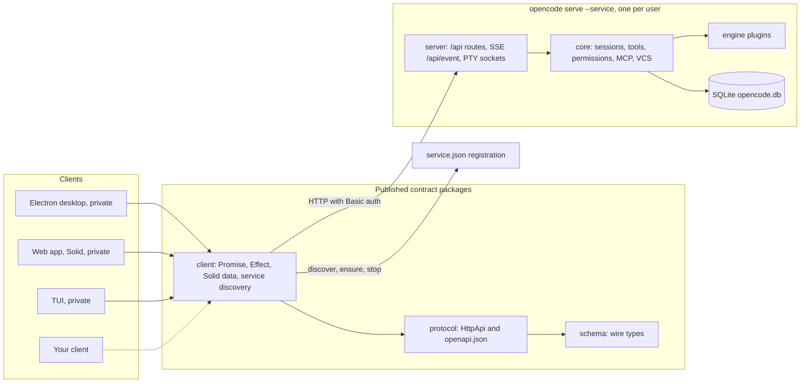

# OpenCode engine contract reference

> Baseline: OpenCode v2.0.25 (tag b44eea9, released 2026-10-08). Facts were read from source at that tag. Re-verify against newer releases before relying on details that changed fast: process model, events, extension points.

## How to read upstream source

The OpenCode repository is cloned at `/home/parth/Production/opencode`, but its checked-out `dev` branch is the **v1** line. Never read v2 facts from the working tree. Read files at a v2 tag without checking out, for example `git -C /home/parth/Production/opencode show v2.0.25:packages/client/src/promise/service.ts`, and list files with `git -C /home/parth/Production/opencode ls-tree -r --name-only v2.0.25 packages/client/src`. Run `git -C /home/parth/Production/opencode fetch --tags` first if a newer tag is needed.

## Agent gotchas

- The npm package `opencode-ai` is the **v1** CLI (1.18.x). The v2 CLI is `@opencode/cli` (versions 2.0.20 to 2.0.26 are published). Use `bunx @opencode/cli@2.0.20 ...` to run an older engine for compatibility tests.
- The engine installed on the maintainer's machine is v2.0.26 at `~/.opencode/bin/opencode`, and a shared background service registration exists at `~/.local/state/opencode/service.json`. Never stop, replace or edit that service from tests; tests use an isolated engine.
- An isolated engine for tests: run `opencode serve` (without `--service`) on a loopback port with `OPENCODE_PASSWORD` set, a temporary `OPENCODE_DB`, and temporary `XDG_STATE_HOME`, `XDG_DATA_HOME` and `XDG_CONFIG_HOME`.
- The generated Promise client accepts a custom `fetch` in `OpenCode.make({ baseUrl, fetch })` (`packages/client/src/promise/generated/client.ts` line 273 at v2.0.25). This is how the renderer adapter sends requests through the gateway.
- Prompt call shape: `client.session.prompt({ sessionID, id, text, files, agents, skills, metadata, delivery, resume })`, posting to `/api/session/{sessionID}/prompt`. `id` must match `^msg_` and makes retries idempotent.
- Request bodies declare `additionalProperties: false`. Never send a field the connected engine version does not declare.
- The event stream `GET /api/event` always starts with `server.connected`, sends a `: heartbeat` comment every 15 seconds, has no replay, and fails a subscriber whose 4,096-event queue overflows.
- `GET /api/info` returns `{ version, pid, urls, paths, capabilities? }`. A 404 means an incompatible protocol, not an older version.
- Use `@opencode/client` only through the Promise root (`@opencode/client`) and `@opencode/client/service`. Do not use `@opencode/client/effect` (it requires a pinned Effect 4 release candidate) or `@opencode/client/solid` (shaped for the official Solid app).

## 1. Repository topology

**[Verified]** v2.0.25 lives on the `v2` lineage. Your local `dev` checkout is the v1 line (`packages/opencode` at 1.18.35). It split from v2 at `0e2dd4a` on 2026-06-26, and the tag's root `AGENTS.md` names `v2` as the default branch. Research against `dev` would describe the wrong product. Everything below was read from the tag.

**[Verified]** The tag's root `AGENTS.md` states the dependency rule: Schema to Core and Protocol, then Core and Protocol to Server. Client runtime code may depend on Schema and Protocol but never on Core or Server.

| Package | Role | npm | Relevance to your client |
| --- | --- | --- | --- |
| `schema` | Browser-safe wire and storage contracts | Published | Types the adapter decodes |
| `protocol` | Effect `HttpApi` definition and committed `openapi.json` | Published | The contract itself |
| `server` | Handlers, SSE feed, auth, CORS, PTY sockets | Published | Runs inside the engine |
| `core` | Sessions, tools, permissions, MCP, VCS, persistence | Published | Engine internals; never import |
| `client` | Generated Promise and Effect clients, Solid data layer, service discovery | Published | Main dependency, adapter and gateway only |
| `sdk` | In-process engine host, no listener | Published | Hermetic integration tests |
| `plugin` | Engine plugin API (Promise, Effect, TUI) | Published | Agent-side extensions |
| `plugin-browser` | Engine plugin with a desktop counterpart | Published | Reference pattern for split extensions |
| `ui` | Solid component library and desktop theme engine | Published | Optional reuse; theme format worth adopting |
| `theme` | Terminal UI themes only | Published | Not relevant |
| `cli` | The `opencode` binary: `serve --service`, `pair`, ACP | Published | The engine you run or join |
| `simulation` | Simulated model provider and driving harness | Published | Deterministic tests (API to verify) |
| `app` | Official Solid web app | Private | Reference only |
| `desktop` | Official Electron shell | Private | Reference only |
| `gui-extensions` | Official GUI extension SDK and built-ins | Private | Design reference (MIT) |
| `session-ui` | Timeline rendering | Private | Reimplement |
| `tui` | Terminal UI | Private | Not relevant |

*Publication status from each package's `script/publish.ts` and the `private` flag in `package.json`.*

*Verified topology at v2.0.25. The dotted edge is where your client attaches.*

## 2. Engine process model

- **[Verified]** **One background service per user and release channel.** `opencode serve --service` writes `service.json` under `$XDG_STATE_HOME/opencode/` (falling back to `~/.local/state/opencode/`) with mode 0600. The file holds instance id, version, URL, pid and a private password. Every 5 seconds the service re-reads the file and shuts itself down if another service has replaced the registration. [cli/src/services/service-registration.ts](https://github.com/anomalyco/opencode/blob/v2.0.25/packages/cli/src/services/service-registration.ts)
- **[Verified]** **Fixed default port.** Stable channels listen on 0xC0DE (49374), so a second contender fails to bind and backs off. Other channels hash to their own port and registration file. [cli/src/services/service-config.ts](https://github.com/anomalyco/opencode/blob/v2.0.25/packages/cli/src/services/service-config.ts)
- **[Verified]** **Discovery API.** `@opencode/client/service` exports `discover()` (find a ready, compatible service without starting one), `ensure()` (start `opencode serve --service` if missing) and `stop()` (with optional terminal handoff). Its comment calls the registration file "the complete discovery contract". [client/src/promise/service.ts](https://github.com/anomalyco/opencode/blob/v2.0.25/packages/client/src/promise/service.ts)
- **[Verified]** **Version replacement.** `ensure({ version })` takes an exact string or a predicate. If the running service fails it, `decide()` returns `replace`, and ensure stops that service and starts its own. A 404 on `GET /api/info` marks a service incompatible rather than older. [client/src/service-probe.ts](https://github.com/anomalyco/opencode/blob/v2.0.25/packages/client/src/service-probe.ts)
- **[Verified]** **The official desktop pins.** On first connect it passes its bundled CLI version, so it replaces any other running version. Reconnects pass no version and adopt whatever is running. [desktop/src/main/service/background-service.ts](https://github.com/anomalyco/opencode/blob/v2.0.25/packages/desktop/src/main/service/background-service.ts)
- **[Verified]** **Persistence.** The engine database is `<data dir>/opencode.db`. Other channels get a channel-specific name, and `OPENCODE_DB` overrides it. [cli/src/database-path.ts](https://github.com/anomalyco/opencode/blob/v2.0.25/packages/cli/src/database-path.ts)
- **[Inferred]** **Two engine processes must not share a database.** The desktop explains its fixed port by saying that with port 0 "two services could boot against the same database". The root `AGENTS.md` describes session execution as process-local, with write-ahead execution claims that a restarted process resumes. Two processes on one database could each drain or resume the same session. Not tested.

> **Implication**
>
> **[Recommendation]** Join the user's service by default and never replace it unasked. If you need isolation, run a private engine with its own `OPENCODE_DB` and accept separate history. Section 8 (see compatibility and upgrade strategy) turns this into a connection policy.

## 3. Client protocol

- **[Verified]** **HTTP and JSON under `/api`.** The API is defined as an Effect `HttpApi` in `protocol`, served live at `/openapi.json` ([server/src/routes.ts](https://github.com/anomalyco/opencode/blob/v2.0.25/packages/server/src/routes.ts)), and committed as `protocol/openapi.json` with 141 operations. The document's own `info` block says version `0.0.1`, "Experimental HttpApi surface".
- **[Verified]** **Authentication.** HTTP Basic with username `opencode` and the service password. Pairing works like this: `POST /api/pair` issues a short-lived single-use code, and `/auth/connect/:code` exchanges it for a session token. The token is HMAC-signed with a key derived from the password, lives 30 days, and is revoked when the password rotates. [server/src/auth.ts](https://github.com/anomalyco/opencode/blob/v2.0.25/packages/server/src/auth.ts)
- **[Verified]** **CORS allowlist.** `http://localhost:*`, `http://127.0.0.1:*`, `oc://renderer`, Tauri origins, `https://*.opencode.ai`, plus a `cors` list from service config. Requests with no Origin header pass. [server/src/cors.ts](https://github.com/anomalyco/opencode/blob/v2.0.25/packages/server/src/cors.ts)
- **[Verified]** **Location scoping.** Most routes take `location[directory]`. One server serves many directories and initializes each lazily on first use. [server/src/location.ts](https://github.com/anomalyco/opencode/blob/v2.0.25/packages/server/src/location.ts)
- **[Verified]** **Terminals.** A WebSocket at `/api/pty/{id}/connect`, gated by a one-time connect token. The generic HTTP client does not cover it.
- **[Verified]** **Strict request bodies.** Bodies such as `session.prompt` declare `additionalProperties: false`, so an older engine rejects any field it does not know.
- **[Verified]** **Typed errors per endpoint**, for example `SessionNotFoundError` and `InvalidCursorError`. The audit replaced many nullable responses with typed 404s. [protocol/src/errors.ts](https://github.com/anomalyco/opencode/blob/v2.0.25/packages/protocol/src/errors.ts)

> **Implication**
>
> **[Inferred]** An Electron renderer on a custom scheme such as `app://` will be refused unless the user's shared service config lists it. Adding it would mean editing someone else's config. Route engine traffic through the main process, which sends no Origin header and keeps the password out of the renderer. Do not reuse `oc://renderer`, which belongs to the official app.

## 4. Events and streaming

- **[Verified]** **One stream for everything.** `GET /api/event` is SSE across all locations. The first event is `server.connected`, and a heartbeat comment arrives every 15 seconds ([server/src/handlers/event.ts](https://github.com/anomalyco/opencode/blob/v2.0.25/packages/server/src/handlers/event.ts)). Each subscriber gets a dropping queue of 4,096 encoded events, and overflow fails that subscriber ([server/src/event-feed.ts](https://github.com/anomalyco/opencode/blob/v2.0.25/packages/server/src/event-feed.ts)). The protocol describes the stream as "Volatile by contract: a slow consumer overflows and fails the stream, and events during disconnection are missed." It sends no `id:` lines and has no `Last-Event-ID` replay. [protocol/src/groups/event.ts](https://github.com/anomalyco/opencode/blob/v2.0.25/packages/protocol/src/groups/event.ts)
- **[Verified]** **Envelope.** Each event has `id` (`evt_…`), `type`, `created`, `data`, and optionally `location` and `metadata`. Durable events add `durable: { aggregateID, seq, version }`. Ephemeral events, which include all streaming deltas, do not. [schema/src/event.ts](https://github.com/anomalyco/opencode/blob/v2.0.25/packages/schema/src/event.ts)
- **[Verified]** **Public inventory.** `EventManifest.ServerDefinitions` lists the events that may appear on the public stream: session lifecycle, inbox, execution, steps, text and reasoning deltas, tool input, calls, progress, success and failure, retry, compaction, revert, permissions, forms, terminals, shells, MCP, VCS, and plugin RPC events named `rpc.*`. [schema/src/event-manifest.ts](https://github.com/anomalyco/opencode/blob/v2.0.25/packages/schema/src/event-manifest.ts)
- **[Verified]** **The reference client's recovery.** 2 s connect timeout, 45 s idle watchdog, 1 s reconnect delay, events applied in 10 ms batches, and a forced resync on the `online` event or when the page returns after 20 s of quiet ([client/src/solid/connection.ts](https://github.com/anomalyco/opencode/blob/v2.0.25/packages/client/src/solid/connection.ts)). On every `server.connected` it refetches active sessions, location, VCS and projects, and revalidates cached reads one at a time so an older response cannot overwrite a newer one ([client/src/solid/data.ts](https://github.com/anomalyco/opencode/blob/v2.0.25/packages/client/src/solid/data.ts)).
- **[Verified]** **No session status event.** Running and idle are derived from `session.execution.*` plus the `GET /api/session/active` snapshot.

## 5. Sessions, execution, concurrency

- **[Verified]** **Admission is separate from execution.** `session.prompt` durably enqueues an inbox item, then wakes the runner. `resume: false` admits without running. Delivery is `steer` (default, delivered at the next step boundary) or `queue` (delivered when the session would go idle). Pending items can be cancelled or switched between modes. (Root `AGENTS.md`, V2 Session Core; audit groups 5 and 7.)
- **[Verified]** **Idempotent retries.** The prompt body accepts an `id` matching `^msg_`. Reusing an id for the same session and type returns the first admission, so a client can retry safely with ids it generates itself.
- **[Verified]** **Concurrency and recovery.** Different sessions run concurrently. Resumes of the same session join one run. `session.interrupt` stops the active run. After a restart the engine resumes sessions that still hold an execution claim.
- **[Verified]** **Other operations** include fork (optionally before a message), staged revert with commit or clear, compact, shell, command, synthetic input, move, background, switch agent or model, diff, context, and one-off generation.

## 6. Permissions, forms, config, credentials

- **[Verified]** **Permissions.** Pending requests are listed per session or globally. A reply carries `decision: "once" | "always" | "reject"`. Saved permissions can be listed and removed, and session rules change through `session.update`.
- **[Verified]** **Approval is a client power.** The official app's auto-approve is a client-local setting that answers every `permission.asked` on a connection, and it sweeps pending requests on reconnect because the stream does not replay them. [app/src/session/requests/auto-approve.ts](https://github.com/anomalyco/opencode/blob/v2.0.25/packages/app/src/session/requests/auto-approve.ts)
- **[Verified]** **Forms** are questions the engine asks the user, with typed answers, reply and cancel.
- **[Verified]** **Configuration** is readable (`GET /api/config` returns documents and directories) but not writable through the stable API. The only write route is experimental and accepts only `shell`.
- **[Verified]** **Credentials and integrations** support list, create, update, remove, activate, OAuth and command-based connection flows.
- **[Verified]** **Engine plugins** can be listed, checked and updated, but there is no install endpoint. They are declared in the `plugins` config key as a package name plus options. [schema/src/config/plugin.ts](https://github.com/anomalyco/opencode/blob/v2.0.25/packages/schema/src/config/plugin.ts)

## 7. Public versus internal surfaces

| Surface | Status | Evidence |
| --- | --- | --- |
| Endpoints marked *Keep* or *Change* in the audit: session, message, inbox, permission, form, fs, vcs, worktree, pty, shell, event, rpc, info | Intended public contract | [V2_HTTP_API_AUDIT.md](https://github.com/anomalyco/opencode/blob/v2.0.25/V2_HTTP_API_AUDIT.md) |
| `/api/experimental/*`: session stats, import, export, wait, log; persistent terminals; runtime MCP overrides; instruction entries; config update; stateless generation; v1 migration status | Outside stable commitment | Audit, "Experimental-only" |
| Workspace routes, config preferences, `project.current`, plugin await-activation, health and server (merged into `info`) | Removed | Audit; v2.0.0 to v2.0.10 diff |
| Labels: OpenAPI `info` says "Experimental HttpApi surface"; the event group says "Experimental event stream routes" | Inconsistent with the audit | `protocol/openapi.json`, `protocol/src/groups/event.ts` |
| `@opencode/client` Promise root | Published, versioned with the engine | Its README calls it a "Private generation target", yet it ships to npm |
| `@opencode/client/solid` data layer | Published, shaped by the official app | Changed between v2.0.20 and v2.0.25 |
| Registration file and `@opencode/client/service` | Discovery contract | Comment in `client/src/promise/service.ts` |
| `gui-extensions` SDK, desktop IPC, app internals | Private | `"private": true` |
| Engine database, CLI-private files, data-directory layout | Internal, no contract | Not exposed by any route or package |

## 8. Existing extension points

### Engine plugins

**[Verified]** `@opencode/plugin` plugins run in-process inside the engine. They register transform hooks for agents, commands, integrations, MCP, models, providers, references, skills, tools, VCS and web search, plus runtime hooks for the AI SDK, session context just before dispatch, and retry decisions. They can add executable tools with schema-typed input and output. Plugins share the host's `effect` instance and run with full engine privileges. [plugin/src/README.md](https://github.com/anomalyco/opencode/blob/v2.0.25/packages/plugin/src/README.md)

### Plugin RPC: the official bridge between a plugin and a client

**[Verified]** A plugin defines methods and events with portable schemas (Standard Schema or JSON Schema). Clients call `POST /api/rpc/{rpcID}/{method}`, and plugin events arrive on the main stream as `rpc.*`. System errors are `rpc.unavailable`, `rpc.method_not_found`, `rpc.invalid_input`, `rpc.invalid_output` and `rpc.internal`. [schema/src/rpc.ts](https://github.com/anomalyco/opencode/blob/v2.0.25/packages/schema/src/rpc.ts)

**[Verified]** `plugin-browser` is the worked example. The engine plugin owns the tools, invocation scope and permissions. The desktop owns tabs, CDP and captures. They connect over authenticated RPC with a versioned `attach`, a readiness event, and an explicit rule that lost calls are never replayed. This is the template for any extension that has both an agent half and a GUI half. [plugin-browser/README.md](https://github.com/anomalyco/opencode/blob/v2.0.25/packages/plugin-browser/README.md)

### The official GUI extension SDK

**[Verified]** `gui-extensions` says that "every feature of the desktop and web app that is not the core shell is an extension". Built-ins include context, btw, debug, terminal, file, review, details, browser, pairing, updater, SSH, WSL and Microsoft Office. [gui-extensions/README.md](https://github.com/anomalyco/opencode/blob/v2.0.25/packages/gui-extensions/README.md)

- **Manifest:** `Extension.define({ id, legacy, os, provides, uses, requires, stores, i18n })`, read before any code loads.
- **Tokens:** `Registry` (lists others contribute to), `Contract` (in-process APIs between extensions), `Ipc` (schema-typed main-to-window contracts).
- **Registries:** Command, MenuItem, Panel, SettingsPage, Server, LinkHandler, TitlebarItem, Slot, Style, MenubarItem. [gui-extensions/src/sdk/registries.ts](https://github.com/anomalyco/opencode/blob/v2.0.25/packages/gui-extensions/src/sdk/registries.ts)
- **Liveness:** optional dependencies arrive as `Live<T>`: pending, active, or inactive (restarting, disabled, failed, blocked). Required dependencies block setup.
- **Stores:** `Store.global`, `Store.session` and `Store.main`, declared up front with migrations from older keys.
- **Discipline:** the host never names an extension, extensions import only each other's `contract.ts`, the linter bans raw effects, app imports and module-level state, and a test boots the graph with each optional provider disabled.

**[Verified]** Groundwork for installable `.ocdx` archives exists. The manifest schema is `opencode.gui-extension/1` with CommonJS bundles. The desktop evaluates main bundles with `new Function` against a shared module map, commented "Installed extensions are trusted code the user chose to install". Renderer bundles are not loaded yet, and the IPC handler refuses install, enable and reload in packaged builds "until installed extensions have a trust model". [desktop/src/main/extension/module.ts](https://github.com/anomalyco/opencode/blob/v2.0.25/packages/desktop/src/main/extension/module.ts) [desktop/src/main/ipc-handlers/extensions.ts](https://github.com/anomalyco/opencode/blob/v2.0.25/packages/desktop/src/main/ipc-handlers/extensions.ts)

**[Verified]** The system is new. It is absent at v2.0.20 and present at v2.0.22, from commits `f406d93` (2026-10-01, "move GUI features into built-in extensions") and `0048c97` (2026-10-04, "typed composition and lifetime primitives").

### Themes, terminal UI plugins and ACP

- **[Verified]** The desktop theme format is JSON with light and dark variants, each built from nine seed colors or a palette, plus token overrides. 36 themes ship. [ui/src/theme/desktop-theme.schema.json](https://github.com/anomalyco/opencode/blob/v2.0.25/packages/ui/src/theme/desktop-theme.schema.json)
- **[Verified]** The terminal UI has its own plugin entry, `@opencode/plugin/tui`.
- **[Verified]** The CLI implements the Agent Client Protocol through `@agentclientprotocol/sdk`. It is an editor-style integration surface, narrower than the HTTP API. [cli/src/acp/agent.ts](https://github.com/anomalyco/opencode/blob/v2.0.25/packages/cli/src/acp/agent.ts)

## 9. How official clients use the engine

- **[Verified]** **The app is multi-server.** Its initial server is the page origin when `opencode serve` hosts it, or none. Users add servers, connect with a password, or paste or scan a pairing link. [app/README.md](https://github.com/anomalyco/opencode/blob/v2.0.25/packages/app/README.md)
- **[Verified]** **The desktop keeps credentials in main.** The renderer reaches main only through `window.electron` and a MessagePort RPC client, and windows run with `contextIsolation`, `sandbox: true` and no Node integration. [desktop/AGENTS.md](https://github.com/anomalyco/opencode/blob/v2.0.25/packages/desktop/AGENTS.md) [desktop/src/main/windows/appearance.ts](https://github.com/anomalyco/opencode/blob/v2.0.25/packages/desktop/src/main/windows/appearance.ts)
- **[Verified]** The desktop guidance prefers SQLite over plain files for persistence, citing Windows `EPERM` problems. The desktop keeps its own database, separate from the engine's.

## 10. Update impact and churn

| Range | Dates | Operations | Schema bodies changed | Character |
| --- | --- | --- | --- | --- |
| `v2.0.0 → v2.0.10` | 09-11 → 09-19 | 139 → 136 | 58 | Breaking (Every operationId lost its `v2.` prefix; workspace routes removed; MCP mutation moved to experimental) |
| `v2.0.10 → v2.0.20` | 09-19 → 09-29 | 136 → 136 | 2 | Stable |
| `v2.0.20 → v2.0.25` | 09-29 → 10-08 | 136 → 141 | 21 | Additive (Added credential list and create, pairing, `vcs.init`; new optional fields; one error shape gained a required tag) |
| `v2.0.25 → v2.0.26` | 10-08 | 141 → 141 | 0 | None |

- **[Verified]** **Cadence:** 27 tagged releases, v2.0.0 to v2.0.26, in 27 days.
- **[Verified]** **Effect is a release candidate.** The contract packages build on `effect 4.0.0-rc.112`, and upstream moved to rc.118 the day after v2.0.26. The client's Promise root has no runtime Effect dependency, but `@opencode/client/effect` requires the exact RC as a peer.
- **[Verified]** **Packages version with the engine.** `@opencode/client` 2.0.25 belongs to engine 2.0.25. OpenChamber pins both `@opencode/client` and `@opencode/schema` at exactly 2.0.25.

## 11. Reuse map

| Capability | Decision | How |
| --- | --- | --- |
| Find, start and stop the engine | Reuse | `@opencode/client/service` in the main process |
| Typed HTTP calls | Reuse | `@opencode/client` Promise root, wrapped by the adapter |
| Wire types | Reuse, adapter only | `@opencode/client` type exports; never re-exported to features |
| Remote servers and pairing | Reuse protocol | `server.pair` and `/auth/connect/:code` |
| Agent loop, tools, providers, MCP, permission evaluation, persistence | Engine owns | Never reimplement in the client |
| Theme format | Adopt format | Accept DesktopTheme JSON so OpenCode themes import unchanged |
| Event reducer and cache | Study, do not depend on | `@opencode/client/solid` is shaped by the official app; write your own reducer behind the adapter |
| UI components | Not used | `@opencode/ui` is Solid and your host is React; build your own design system |
| Timeline rendering | Reimplement | `session-ui` is private |
| GUI extension SDK | Borrow the design | Private and moving; copy patterns under MIT, not the package |
| Test engine | Reuse | `@opencode/sdk` in-process host with an in-memory database; `@opencode/simulation` provider |

## 12. Engine and client responsibilities

| Engine owns | Client owns | Shared through the contract |
| --- | --- | --- |
| Agent loop, model calls, retries, compaction | Presentation, layout, navigation, windows | Session lifecycle and inbox delivery |
| Tool execution, shells, terminals, file mutation | Keybindings, themes, UI preferences | Permission requests (engine asks and enforces, user decides in the client) |
| Permission evaluation and saved rules | Server list, connection state, credential storage | Forms (engine asks, client renders) |
| Session persistence and history | Drafts, tabs, scroll, selection | Plugin RPC between engine plugins and client extensions |
| Providers, credentials, integrations, MCP | Client extensions and their storage | Pairing and remote access |
| Config resolution, instructions, skills, agents | Notifications, OS integration, updates | Diff and VCS views (engine computes, client renders) |

## 13. Compatibility policy

### 13.1 What the adapter contains

- The only imports of `@opencode/client` and `@opencode/schema` in the codebase.
- Domain mapping for reads and writes, and pure event translation.
- Capability flags and version shims, so every "if the engine is older than X" decision lives in one file.
- Contract fixtures for each supported engine version.

### 13.2 Detecting version and capabilities

1. `GET /api/info`: read `version` and `capabilities`. A 404 means an incompatible protocol, as in the client's own probe.
2. `GET /openapi.json`, cached per version: derive which operation ids and request fields exist.
3. Compute `EngineCapabilities` and the support state (supported, untested or unsupported) against the declared range.
4. Publish capabilities to the store. Modules and the extension API read flags. They never compare version strings.

### 13.3 Supported range

**[Recommendation]** Start with `>=2.0.20 <2.1.0`. The floor matches OpenChamber's tested floor, and everything after it has been additive (2.10). Patch versions newer than the latest one you tested run with an "untested engine" notice, and features whose capabilities are missing stay off. Raise the floor deliberately, never by accident.

### 13.4 Handling change

- **Reads:** decode leniently. Ignore unknown fields, map unknown enum values to an `unknown` variant, and count unknown event types.
- **Writes:** send a field only when the connected engine's schema declares it, because bodies reject unknown fields.
- **Experimental routes:** behind feature flags that are off by default. Never exposed through the public extension API.
- **Deprecations:** shims in the adapter, with a removal date tied to raising the supported floor.
- **New engine features:** added behind a capability flag first, so older engines keep working.

### 13.5 Never rely on

- The engine database, its tables or its migration state. OpenChamber's `kv` write is the cautionary example.
- CLI-private files other than the registration file read through `@opencode/client/service`.
- Data-directory layout, such as worktree paths.
- Event ordering beyond the per-aggregate `seq` of durable events, or the size of streaming deltas.
- Error message text. Use the typed error tags.
- Timing, such as how long lazy directory initialization takes.
- `@opencode/client/solid` internals, the private `gui-extensions` SDK, or the official desktop's IPC.

### 13.6 Living beside the official clients

| Situation | Behavior |
| --- | --- |
| Shared service running, version supported | Join it |
| Running, newer than tested, same minor | Join, show "untested engine version", keep missing capabilities off |
| Running, below the floor | Do not replace it. Show Incompatible with clear actions. If the installed CLI is newer than the running service (the user upgraded but the old service is still up), offer to restart the service with it, with consent and a warning that other clients will reconnect. Otherwise show how to update OpenCode. |
| Not running, OpenCode installed | Call `ensure()` with no version, so the user's own CLI starts the shared service |
| Not running, not installed | **[Decided]** No bundled binary. Look for `opencode` on `PATH` and in common install locations, show the official install options, and check again when the window regains focus. |
| Installed CLI below the floor | Show the installed version, the minimum required, and how to update. Read-only browsing of an already-running compatible service still works. |
| Registration replaced while connected | Another client restarted the service. Go back through discovery and recheck the version. |
| Isolated mode | Run `opencode serve` without `--service`, on a loopback port, with `OPENCODE_PASSWORD` set ([cli/src/env.ts](https://github.com/anomalyco/opencode/blob/v2.0.25/packages/cli/src/env.ts)) and a separate `OPENCODE_DB`. Sessions there are not visible to other clients. |
| Remote server | Pair by link or QR code; store the token in the keychain |
| Official app with auto-approve on | It may answer permission requests before your UI shows them. Show requests closed by another client as such, not as errors. |

### 13.7 Keeping extensions working across engine upgrades

- The public API speaks the client domain model, so a wire change touches only the adapter.
- Extensions ask `host.capabilities.has(...)` instead of checking engine versions.
- Only extensions with an engine plugin declare `engines.opencode`, and that range is checked against the connected engine on every connect.

### 13.8 Official engine or fork

**[Recommendation]** Use the official engine. Fork only when all three of these hold: a capability is essential to the core product, it cannot be built as an engine plugin, and upstream has declined it. If you fork, keep it as a small patch queue on top of release tags. The repository's own `patches/` directory shows the style. Rebase on every release you support, and never change the wire protocol in the fork.

**[Decided]** Open upstream issues for four things that would remove most of this document's workarounds. Design so that none of them is required, and adopt each one behind a capability flag if it ships:

- Event replay with a cursor (`Last-Event-ID`, or `after` for durable events).
- An explicit API version or capability list in `/api/info`.
- A plugin install endpoint.
- A documented way for third-party clients to identify themselves.

### 13.9 Stable contracts and implementation details

| Treat as a stable contract | Treat as an implementation detail |
| --- | --- |
| Audited *Keep* and *Change* endpoints and their OpenAPI schemas | `/api/experimental/*` |
| Event types in `EventManifest.ServerDefinitions` | Delta granularity and timing |
| Registration file through `@opencode/client/service` | The CLI's other files and flags |
| Basic auth, pairing tokens | CORS allowlist specifics |
| Plugin RPC route and `rpc.*` events | Engine database and data directory |
| `@opencode/plugin` for engine plugins, versioned with the engine | `@opencode/client/solid`, `gui-extensions`, desktop IPC |
| Your own: `@mortise/extension-api`, manifest schema, theme format | Your own: `@mortise/sdk`, core internals, IPC contracts |
